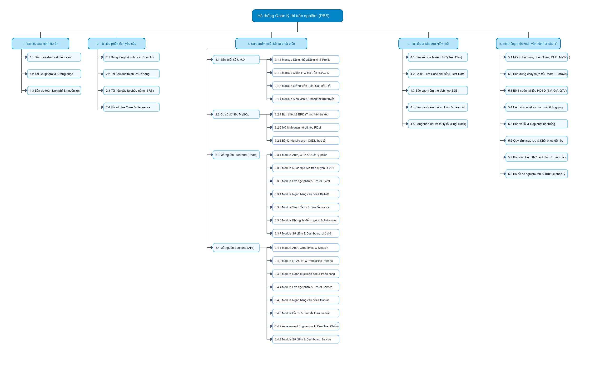
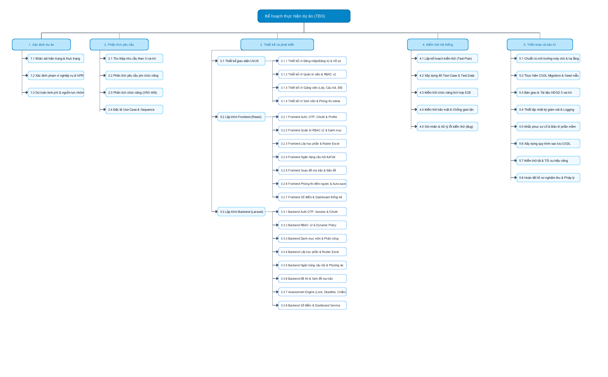

# VINACLASS - Hệ thống Quản lý Khảo thí & Thi trắc nghiệm Trực tuyến Thông minh

> Đồ án học phần **Quản lý dự án phần mềm** phát triển hệ thống khảo thí và tổ chức thi trắc nghiệm trực tuyến sử dụng **Laravel**, **React** và **MySQL**, hỗ trợ quản lý toàn diện quy trình vận hành từ ngân hàng câu hỏi KaTeX, ma trận cấu trúc đề thi, tổ chức thi trực tuyến chống gian lận đến chấm điểm tự động tức thời và báo cáo thống kê phổ điểm.

---

> [!NOTE]
> ### NGUỒN GỐC DỰ ÁN & QUÁ TRÌNH TÁI CẤU TRÚC (REDESIGN & REFACTORING)
> Đồ án này được nghiên cứu, rà soát mã nguồn toàn diện và **tái cấu trúc hoàn toàn mới (Fullstack Redesign & Refactoring)** dựa trên hai dự án mã nguồn mở ban đầu:
> - **Frontend mã nguồn gốc:** [https://github.com/JacketHeee/QLThiTracNghiem](https://github.com/JacketHeee/QLThiTracNghiem)
> - **Backend mã nguồn gốc:** [https://github.com/NguyenAn-25/QuanLyThiTracNghiem_Backend](https://github.com/NguyenAn-25/QuanLyThiTracNghiem_Backend)
> 
> Toàn bộ lộ trình, quyết định kiến trúc và cấu trúc thư mục sau tái cấu trúc được tài liệu hóa chi tiết tại:
> - [Kế hoạch tái cấu trúc hệ thống (PROJECT_REDESIGN.md)](docs/PROJECT_REDESIGN.md)
> - [Kiến trúc chuẩn hóa Client React SPA (CLIENT_STRUCTURE.md)](docs/CLIENT_STRUCTURE.md)

---

### THÀNH VIÊN THỰC HIỆN - NHÓM 18

> **Học phần:** Quản lý dự án phần mềm  
> **Đơn vị đào tạo:** Trường Đại học Sài Gòn – Khoa Công nghệ Thông tin  
> **Bảng theo dõi tiến độ dự án (Google Sheets Online):** [https://docs.google.com/spreadsheets/d/1QCd1hMG5LJcIkaPKPKmmp_igYMundrYl7Cqq-d_iw9s/edit?gid=0#gid=0](https://docs.google.com/spreadsheets/d/1QCd1hMG5LJcIkaPKPKmmp_igYMundrYl7Cqq-d_iw9s/edit?gid=0#gid=0)

| STT | Họ và tên | MSSV |
| :-: | :--- | :-: |
| 1 | **Trần Thanh Quy** | **3123560072** | 
| 2 | **Nguyễn Ngọc Thiên Ân** | **3123560002** |
| 3 | **Danh Thị Ngọc Châu** | **3123560005** |
| 4 | **Lê Hữu Huy** | **3123560033** |
| 5 | **Khưu Minh Đức** | **3123410083** |

---

# Giới thiệu

**VINACLASS** được xây dựng nhằm số hóa toàn diện quy trình đào tạo và kiểm tra đánh giá chất lượng học tập trong môi trường giáo dục số. Nền tảng kết hợp mô hình lớp học học phần hiện đại (lấy cảm hứng từ *Google Classroom*) với một **Cơ chế Khảo thí Trực tuyến Chống gian lận (Assessment Engine)** thời gian thực có tính an toàn và tin cậy cao.

Hệ thống được thiết kế theo hướng phân tách rõ ràng 3 nhóm vai trò tác nhân:

- **Quản trị viên (Administrator):** Quản lý toàn bộ người dùng, cấu hình ma trận phân quyền động RBAC v2, quản trị danh mục môn học, phân công giảng dạy cho giảng viên và giám sát Dashboard KPI toàn trường.
- **Giảng viên (Teacher):** Quản lý lớp học phần, cấp mã mời (Invite Code), import sinh viên qua Excel, upload học liệu bài giảng, xây dựng ngân hàng câu hỏi công thức KaTeX, thiết lập ma trận đề thi tự động, giám sát quá trình thi và xuất bảng điểm lớp ra file Excel.
- **Sinh viên (Student):** Đăng ký tài khoản xác thực OTP email, tham gia lớp học phần bằng mã mời, xem thông báo và tài liệu, tham gia phòng thi trực tuyến với đồng hồ đếm ngược server deadline, lưu bài tự động (Auto-save) và xem kết quả giải thích chi tiết.

Mỗi vai trò đều có giao diện chuyên biệt, luồng nghiệp vụ khép kín và cơ chế kiểm soát truy cập đa tầng ở cả Frontend và Backend API.

---

# Tính năng nổi bật

## 1. Quản trị viên (Administrator)

- **Quản trị người dùng toàn diện:** Tìm kiếm và lọc người dùng theo vai trò (Admin, Teacher, Student) và trạng thái (Active/Locked); Thêm người dùng thủ công, khóa/mở khóa tài khoản tức thời, hỗ trợ đặt lại mật khẩu tạm thời.
- **Phân quyền nâng cao RBAC v2:** Ma trận phân quyền 2 chiều giữa Vai trò (Roles) và các Hành động nguyên tử (`VIEW`, `CREATE`, `UPDATE`, `DELETE`, `EXPORT`, `MANAGE`); Hỗ trợ cơ chế **Ghi đè quyền cá nhân (Personal Permission Overrides)** cho từng người dùng cụ thể.
- **Quản lý danh mục đào tạo học thuật:** Khởi tạo cây danh mục chuẩn: Môn học (Subjects) $\to$ Chương bài học (Chapters) $\to$ Thang mức độ khó (Difficulty Levels theo thang Bloom).
- **Phân công giảng dạy (Teacher Assignments):** Ràng buộc nghiệp vụ chặt chẽ: Chỉ giảng viên được phân công môn học mới có quyền mở lớp học phần, tạo ngân hàng câu hỏi và ra đề thi cho môn học đó.
- **Bảng điều khiển Giám sát (Admin Dashboard & Analytics):** Thống kê thời gian thực các chỉ số KPI: Tổng người dùng, Môn học, Lớp đang mở, Lượt làm bài thi và biểu đồ phân tích lượt nộp bài theo các mốc thời gian.
- **Quản lý phiên làm việc đa thiết bị:** Lưu vết lịch sử IP, thiết bị đăng nhập qua bảng `auth_sessions`, cho phép thu hồi token phiên từ xa.

## 2. Giảng viên / Giáo viên (Teacher)

- **Quản lý Lớp học phần (Course Groups):** Khởi tạo lớp học phần theo môn học được phân công; Cấp, hiển thị và **Đặt lại mã mời (Reset Invite Code)** ngẫu nhiên 8 ký tự; Quản lý trạng thái đóng/mở ghi danh.
- **Quản lý Danh sách Học viên (Class Roster):** Thêm học viên lẻ bằng Email/MSSV; **Import danh sách sinh viên hàng loạt từ tệp Excel mẫu** có cơ chế validate dữ liệu lỗi tự động; Xuất danh sách lớp ra file Excel.
- **Bảng tin & Học liệu lớp học:** Đăng bài thông báo lớp học (Stream Tab); Đăng tải và chia sẻ tài liệu bài giảng (PDF, PowerPoint, Word, ZIP) được sắp xếp theo từng chương bài học.
- **Ngân hàng Câu hỏi Trắc nghiệm Thông minh (Question Bank):**
  - Trình soạn thảo văn bản phong phú (Rich Text) tích hợp công thức Toán học / Lý / Hóa với cú pháp **KaTeX** (`$...$` và `$$...$$`) xem trước trực tiếp (Live Preview).
  - Tải lên hình ảnh minh họa cho câu hỏi; Cấu hình 4 đáp án lựa chọn A, B, C, D kèm lời giải thích chi tiết (Explanation).
  - Phân loại **Kho riêng cá nhân (Private)** và **Kho dùng chung bộ môn (Public)**; Tính năng **Sao chép (Clone)** câu hỏi từ kho chung về kho riêng để chỉnh sửa.
- **Soạn & Cấu hình Đề thi Đa ma trận (Exam Assessments):**
  - **Tạo đề thủ công:** Chọn trực tiếp từng câu hỏi trong ngân hàng câu hỏi.
  - **Tạo đề tự động theo Ma trận cấu trúc:** Thiết lập tổng số câu (vd: 40 câu), ma trận % theo từng Chương và ma trận % theo từng Độ khó. Thuật toán tự động quét và bốc ngẫu nhiên câu hỏi hợp lệ.
  - Thiết lập thông số phòng thi: Thời lượng thi (phút), thời gian mở/đóng đề, số lần làm bài tối đa, xáo trộn câu hỏi và xáo trộn đáp án (Fisher-Yates Shuffling).
  - Kích hoạt tính năng **Giám sát Chống gian lận (Anti-cheating Monitoring)**.
  - Giao đề thi linh hoạt cho một hoặc nhiều lớp học phần.
- **Giám sát Thi, Chấm điểm & Báo cáo Điểm số:**
  - Theo dõi tiến độ sinh viên làm bài theo thời gian thực; Kiểm tra **Nhật ký Vi phạm đổi tab (Cheat Logs)** kèm mốc thời gian chi tiết.
  - Rà soát chi tiết bài thi của từng học viên (từng câu hỏi, đáp án chọn, đúng/sai, điểm số).
  - Biểu đồ phân tích phổ điểm lớp học phần (Điểm TB, Max, Min, tỷ lệ Giỏi/Khá/TB/Yếu).
  - **Xuất Bảng điểm lớp học ra file Excel chuẩn (Export Gradebook)**.

## 3. Học sinh / Sinh viên (Student)

- **Đăng ký & Xác thực OTP Email:** Đăng ký tài khoản mới kèm mã OTP xác thực 6 số gửi về hộp thư điện tử (TTL 60s); Đăng nhập bằng Email/Password hoặc Đăng nhập nhanh một chạm qua **Google OAuth 2.0**.
- **Quản lý Hồ sơ cá nhân:** Cập nhật thông tin liên lạc, đổi mật khẩu định kỳ, theo dõi các thiết bị đang đăng nhập và đăng xuất từ xa.
- **Tham gia Lớp học phần:** Nhập Mã mời (Invite Code) 8 ký tự do giảng viên cung cấp để vào lớp; Tra cứu thông báo và tải tài liệu học tập.
- **Phòng thi Trực tuyến Chuyên biệt (`DoTestPage`):**
  - **Đồng hồ đếm ngược (Countdown Timer):** Đồng bộ tuyệt đối theo deadline trên máy chủ (Server Time), ngăn chặn gian lận chỉnh giờ máy khách.
  - **Bảng điều hướng câu hỏi (Navigation Palette):** Nhận diện trực quan câu chưa làm (xám), câu đã làm (xanh dương), câu phân vân đánh dấu xem lại (cờ đỏ); Chuyển nhanh giữa các câu hỏi.
  - **Cơ chế Lưu ngầm tự động (Adaptive Live Auto-Save):** Mỗi khi nhấp chọn đáp án, hệ thống tự động gửi ngầm lưu lên máy chủ với debounce 500ms; Bảo toàn 100% dữ liệu bài làm ngay cả khi mất điện hoặc rớt mạng.
  - **Cảnh báo Chống gian lận đổi Tab (Tab Blur Detection):** Tự động phát hiện khi sinh viên mở tab mới, chuyển ứng dụng hoặc thu nhỏ cửa sổ; Hiển thị hộp thoại cảnh báo và ghi nhật ký vi phạm gửi về cho giảng viên.
  - **Nộp bài chủ động & Tự động thu bài khi hết giờ:** Hộp thoại kiểm tra số câu chưa làm trước khi nộp; Khi đồng hồ đếm về `00:00`, máy chủ tự động khóa đề và thu bài nộp.
- **Xem Kết quả & Tra cứu Lời giải:** Xem điểm số tức thời ngay sau khi nộp (nếu đề thi cho phép); Xem lại chi tiết từng câu hỏi, đối chiếu đáp án đã chọn với đáp án đúng và đọc lời giải thích của giảng viên.

---

# Demo chức năng

> Các phân hệ chức năng cốt lõi đã được kiểm thử và đặc tả đầy đủ trong bộ tài liệu kỹ thuật:

| STT | Chức năng nổi bật | Mô tả nghiệp vụ | Tài liệu đặc tả / Hướng dẫn |
| :-: | :--- | :--- | :--- |
| 1 | **Đăng ký tài khoản xác thực OTP** | Đăng ký thông tin, nhận mã OTP 6 số qua email (TTL 60s), xác thực 2 bước | [Chi tiết tại Hướng dẫn SV](docs/HDSD_SINH_VIEN.md#1-đăng-ký-tài-khoản-mới--xác-thực-otp-email) |
| 2 | **Đăng nhập Google OAuth 2.0** | Đăng nhập một chạm bằng tài khoản Google trường học, lưu phiên đa thiết bị | [Chi tiết tại Hướng dẫn Admin](docs/HDSD_ADMIN.md#2-đăng-nhập--quản-lý-phiên-làm-việc-quản-trị) |
| 3 | **Cấu hình Ma trận Quyền RBAC v2** | Quản trị ma trận quyền 2 chiều theo hành động nguyên tử, ghi đè quyền cá nhân | [Chi tiết tại Hướng dẫn Admin](docs/HDSD_ADMIN.md#5-phân-quyền-quản-trị-nâng-cao-rbac-v2-role-based-access-control) |
| 4 | **Quản lý Lớp học phần & Mã mời** | Tạo lớp, cấp mã mời 8 ký tự, reset mã mời, quản lý bảng tin và học liệu bài giảng | [Chi tiết tại Hướng dẫn GV](docs/HDSD_GIANG_VIEN.md#2-quản-lý-lớp-học-phần-course-groups) |
| 5 | **Import Roster Sinh viên từ Excel** | Nhập danh sách sinh viên lớp hàng loạt từ file Excel mẫu, kiểm tra tính hợp lệ | [Chi tiết tại Hướng dẫn GV](docs/HDSD_GIANG_VIEN.md#3-quản-lý-danh-sách-học-viên-trong-lớp-class-roster) |
| 6 | **Ngân hàng Câu hỏi KaTeX & Ảnh** | Soạn thảo câu hỏi rich text, công thức toán học KaTeX, kho riêng vs kho công khai | [Chi tiết tại Hướng dẫn GV](docs/HDSD_GIANG_VIEN.md#4-quản-lý-ngân-hàng-câu-hỏi-trắc-nghiệm-question-bank) |
| 7 | **Sinh Đề thi Tự động theo Ma trận** | Cấu hình tỷ lệ % chương và % độ khó, thuật toán quét và bốc ngẫu nhiên câu hỏi | [Chi tiết tại Hướng dẫn GV](docs/HDSD_GIANG_VIEN.md#5-soạn--cấu-hình-đề-thi-trắc-nghiệm-exams--assessments) |
| 8 | **Phòng thi Trực tuyến Chống gian lận**| Đếm ngược server deadline, auto-save ngầm 500ms, bắt sự kiện chuyển tab (`TAB_BLUR`)| [Chi tiết tại Hướng dẫn SV](docs/HDSD_SINH_VIEN.md#5-quy-trình-tham-gia-thi-trắc-nghiệm-trực-tuyến) |
| 9 | **Chấm điểm Tự động & Sổ điểm Excel** | Chấm điểm tự động trong database transaction, vẽ phổ điểm lớp, xuất file Excel | [Chi tiết tại Hướng dẫn GV](docs/HDSD_GIANG_VIEN.md#6-giám-sát-thi-chấm-điểm--báo-cáo-thống-kê-điểm-số) |
| 10| **Admin Dashboard & Thống kê KPI** | Thống kê số liệu người dùng, đề thi, lớp học phần, biểu đồ phân tích lượt thi | [Chi tiết tại Hướng dẫn Admin](docs/HDSD_ADMIN.md#3-bảng-điều-khiển-giám-sát-hệ-thống-admin-dashboard--statistics) |

---

# Thiết kế hệ thống

## 1. Kiến trúc tổng thể (System Architecture)

Hệ thống tuân thủ mô hình **Clean Service-Oriented Architecture** phân tách độc lập giữa Client và Server:

```
+-----------------------------------------------------------------------------------+
|                            CLIENT TIER (React 18/19 SPA)                          |
|  React 19 / TypeScript | Tailwind CSS | Ant Design 6 | Zustand Store | TanStack Query |
+-----------------------------------------------------------------------------------+
                                         |
                                         | HTTP / HTTPS (RESTful JSON APIs)
                                         v
+-----------------------------------------------------------------------------------+
|                        API ROUTING & SECURITY MIDDLEWARE TIER                     |
|      auth:api (JWT) | auth.session | account.active | permission:{func}:{act}     |
+-----------------------------------------------------------------------------------+
                                         |
                                         v
+-----------------------------------------------------------------------------------+
|                          CONTROLLER & REQUEST VALIDATION TIER                     |
|        28 Controllers | Form Request Validation Classes | ApiResponseTrait        |
+-----------------------------------------------------------------------------------+
                                         |
                                         v
+-----------------------------------------------------------------------------------+
|                              DOMAIN SERVICE LAYER TIER                            |
|       ExamAttemptStartService (lockForUpdate) | ExamGradingService                |
|       ExamCreationService (Matrix Shuffling)  | AuthOtpService (SHA-256)          |
+-----------------------------------------------------------------------------------+
                                         |
                                         v
+-----------------------------------------------------------------------------------+
|                       DATA ACCESS & DATABASE STORAGE TIER                         |
|   MySQL 8.0 (18 Tables - InnoDB ACID) | Redis Cache (Session & Rate Limiting)     |
+-----------------------------------------------------------------------------------+
```

## 2. Sơ đồ Phân rã Sản phẩm (PBS) & Phân rã Công việc (TBS)

| Sơ đồ Cấu trúc Sản phẩm (PBS) | Sơ đồ Cấu trúc Công việc (TBS) |
| :---: | :---: |
|  |  |
| *Hình ảnh: Sơ đồ cây phân rã 11 phân hệ sản phẩm kỹ thuật* | *Hình ảnh: Sơ đồ cây phân rã 40 gói công việc kỹ thuật 5 giai đoạn* |
| [Mở file PBS Draw.io](outputs/PBS_Diagram_VinaClass.drawio) | [Mở file TBS Draw.io](outputs/TBS_Diagram_VinaClass.drawio) |

## 3. Hệ thống Hồ sơ Tài liệu Phân tích Kỹ thuật Đi kèm

Nhóm đã xây dựng bộ tài liệu kỹ thuật hoàn chỉnh gồm các tệp độc lập trong thư mục [`docs/`](docs/):
- 📘 **[Tài liệu Đặc tả Sơ đồ Use Case (SODO_USECASE.md)](docs/SODO_USECASE.md):** 24 Use Cases, sơ đồ tổng quát, sơ đồ phân rã 3 vai trò và đặc tả chi tiết 16 Use Case cốt lõi.
- 📙 **[Tài liệu Đặc tả Sơ đồ Hoạt động (SODO_ACTIVITY.md)](docs/SODO_ACTIVITY.md):** 8 Activity Diagrams chi tiết (AD-01 $\to$ AD-08) với đồ họa Mermaid chuẩn UML.
- 📗 **[Tài liệu Đặc tả Sơ đồ Tuần tự (SODO_SEQUENCE.md)](docs/SODO_SEQUENCE.md):** 10 Sequence Diagrams kỹ thuật (SD-01 $\to$ SD-10) phân tích chi tiết tương tác đa tầng.
- 👤 **[Cẩm nang Hướng dẫn Quản trị viên (HDSD_ADMIN.md)](docs/HDSD_ADMIN.md):** Hướng dẫn vận hành người dùng, RBAC v2, danh mục và phân công giảng dạy.
- 👨‍🏫 **[Cẩm nang Hướng dẫn Giảng viên (HDSD_GIANG_VIEN.md)](docs/HDSD_GIANG_VIEN.md):** Hướng dẫn quản lý lớp học phần, ngân hàng câu hỏi KaTeX, tạo đề ma trận và xuất điểm Excel.
- 🎓 **[Cẩm nang Hướng dẫn Sinh viên (HDSD_SINH_VIEN.md)](docs/HDSD_SINH_VIEN.md):** Hướng dẫn đăng ký OTP, vào lớp học và quy trình làm bài thi trực tuyến an toàn.
- 📑 **[Sổ tay Phân tích Nghiệp vụ Hệ thống (Phan_Tich_Nghiep_Vu.md)](outputs/Phan_Tich_Nghiep_Vu_He_Thong_Thi_Trac_Nghiem_VinaClass.md):** Rà soát toàn bộ mã nguồn, từ điển CSDL và quy tắc nghiệp vụ.
- 📊 **[Báo cáo Quản lý Dự án Online (Google Sheets)](https://docs.google.com/spreadsheets/d/1QCd1hMG5LJcIkaPKPKmmp_igYMundrYl7Cqq-d_iw9s/edit?gid=0#gid=0):** Bảng theo dõi tiến độ công việc trực tuyến của Nhóm 18.
- 📁 **[Workbook Quản lý Dự án Excel 8 Sheet (Offline)](outputs/Nhom_18_QuanLyThiTracNghiem_PhanTichNghiepVu_MaNguon.xlsx):** Tách riêng sheet `PBS` và sheet `TBS`, OPPM 40 task, PERT khớp 3.50 tr VNĐ, Gantt Chart, Cây chức năng 4 tầng (409 chức năng).

---

# Công nghệ sử dụng

## Frontend


## Backend


## Database & Cache


## Development & Testing


---

# Cấu trúc dự án

```
vinaclass/
├── client/                               # Frontend Single Page Application (React 18/19)
│   ├── public/                           # Tài nguyên tĩnh trực tiếp
│   ├── src/
│   │   ├── app/                          # Routing, Layouts, Providers, Guards
│   │   │   ├── layout/                   # Layout quản trị, giảng viên, sinh viên
│   │   │   ├── pages/                    # Page components
│   │   │   ├── providers/                # QueryProvider, AntdConfigProvider
│   │   │   └── routing/                  # ProtectedRoute, PermissionRoute
│   │   ├── assets/                       # Hình ảnh, icons, styles
│   │   ├── components/                   # UI Components dùng chung (Atomic Design)
│   │   ├── features/                     # Các module nghiệp vụ chính (Domain Features)
│   │   │   ├── admin/                    # Dashboard KPI & Thống kê quản trị
│   │   │   ├── assessments/              # Đề thi, Soạn ma trận, Phòng thi online (DoTestPage)
│   │   │   ├── auth/                     # Đăng nhập, Đăng ký OTP, Quên mật khẩu
│   │   │   ├── authorization/            # Ma trận phân quyền RBAC v2, Nhóm quyền
│   │   │   ├── catalogs/                 # Danh mục Môn học, Chương, Độ khó
│   │   │   ├── classrooms/               # Lớp học phần, Bảng tin, Roster, Học liệu
│   │   │   ├── identity/                 # Quản lý người dùng, Hồ sơ cá nhân (Profile)
│   │   │   ├── question-bank/            # Ngân hàng câu hỏi KaTeX & Hình ảnh
│   │   │   └── teacher-assignments/      # Phân công giảng dạy môn học
│   │   ├── hooks/                        # Custom React Hooks
│   │   ├── services/                     # Axios API Client & Services
│   │   ├── stores/                       # Zustand Global State
│   │   └── utils/                        # Tiện ích format, KaTeX helper
│   ├── package.json
│   ├── vite.config.ts
│   └── tailwind.config.ts
│
├── server/                               # Backend RESTful API (Laravel 9/10 PHP 8.2)
│   ├── app/
│   │   ├── Http/
│   │   │   ├── Controllers/              # 28 Controllers xử lý API
│   │   │   ├── Middleware/               # JWT Auth, Session Check, Permission Gate
│   │   │   └── Requests/                 # Form Request Validation
│   │   ├── Models/                       # 18 Eloquent Models quan hệ
│   │   ├── Services/                     # Domain Service Layer xử lý logic cốt lõi
│   │   │   ├── AuthOtpService.php        # Sinh & băm mã OTP 6 số qua email
│   │   │   ├── ExamAttemptStartService.php # Khóa bi quan & tính Server Deadline
│   │   │   ├── ExamGradingService.php    # Tự động tính điểm bài thi
│   │   │   ├── ExamCreationService.php   # Thuật toán ma trận & Fisher-Yates
│   │   │   └── RolePermissionSyncService.php # Đồng bộ ma trận quyền RBAC v2
│   │   ├── Exports/                      # Maatwebsite Excel Gradebook Export
│   │   └── Exceptions/                   # Exception Handler chuẩn hóa JSON
│   ├── config/                           # Cấu hình JWT, Sanctum, CORS, Mail, Database
│   ├── database/
│   │   ├── migrations/                   # 42 Migration files thiết kế CSDL
│   │   └── seeders/                      # Dữ liệu mẫu (Users, Roles, Questions, Subjects)
│   ├── routes/
│   │   └── api.php                       # Danh mục toàn bộ API endpoints
│   ├── composer.json
│   └── artisan
│
├── docs/                                 # Hệ thống tài liệu kỹ thuật & Hướng dẫn sử dụng
│   ├── CLIENT_STRUCTURE.md               # Kiến trúc chuẩn hóa Client React SPA
│   ├── PROJECT_REDESIGN.md               # Kế hoạch tái cấu trúc toàn diện hệ thống
│   ├── SODO_USECASE.md                   # Đặc tả Sơ đồ Use Case toàn diện (24 Use Cases)
│   ├── SODO_ACTIVITY.md                  # 8 Sơ đồ Hoạt động Activity Diagrams
│   ├── SODO_SEQUENCE.md                  # 10 Sơ đồ Tuần tự Sequence Diagrams
│   ├── HDSD_ADMIN.md                     # Cẩm nang Hướng dẫn Sử dụng cho Quản trị viên
│   ├── HDSD_GIANG_VIEN.md                # Cẩm nang Hướng dẫn Sử dụng cho Giảng viên
│   └── HDSD_SINH_VIEN.md                 # Cẩm nang Hướng dẫn Sử dụng cho Sinh viên
│
├── outputs/                              # Kết xuất báo cáo & Workbook Quản lý Dự án
│   ├── Nhom_18_QuanLyThiTracNghiem_PhanTichNghiepVu_MaNguon.xlsx # Workbook 8 Sheet
│   ├── PBS_Diagram_VinaClass.png         # Sơ đồ Cây Phân rã Sản phẩm (PBS)
│   ├── TBS_Diagram_VinaClass.png         # Sơ đồ Cây Phân rã Công việc (TBS)
│   └── Huong_Dan_Su_Dung_He_Thong_VinaClass.md # Cẩm nang HDSD Toàn diện
│
└── README.md                             # Tài liệu tổng quan dự án
```

---

# Hướng dẫn cài đặt

## 1. Yêu cầu môi trường

- **Node.js:** `>= 18.x` (khuyến nghị `20.x LTS`)
- **PHP:** `>= 8.2`
- **Composer:** `>= 2.x`
- **MySQL Database:** `>= 8.0`
- **Trình duyệt Web:** Google Chrome hoặc Microsoft Edge mới nhất

## 2. Clone mã nguồn

```bash
git clone https://github.com/thanhquy185/vinaclass.git

cd vinaclass
```

## 3. Cài đặt & Khởi chạy Backend (Laravel)

```bash
cd server

# 1. Cài đặt các gói phụ thuộc PHP
composer install

# 2. Khởi tạo tệp môi trường
cp .env.example .env

# 3. Cập nhật thông số kết nối CSDL trong file .env
# DB_CONNECTION=mysql
# DB_HOST=127.0.0.1
# DB_PORT=3306
# DB_DATABASE=vinaclass_db
# DB_USERNAME=root
# DB_PASSWORD=

# 4. Sinh Application Key & JWT Secret Key
php artisan key:generate
php artisan jwt:secret

# 5. Chạy Migration và nạp dữ liệu mẫu
php artisan migrate:fresh --seed

# 6. Khởi động máy chủ phát triển Backend
php artisan serve
# Máy chủ Backend chạy tại: http://localhost:8000
```

## 4. Cài đặt & Khởi chạy Frontend (React + Vite)

Mở một cửa sổ Terminal mới:

```bash
cd client

# 1. Cài đặt các gói phụ thuộc Node.js
npm install
# hoặc dùng pnpm: pnpm install

# 2. Khởi tạo file cấu hình môi trường nếu cần
# VITE_API_BASE_URL=http://localhost:8000/api

# 3. Khởi chạy máy chủ phát triển Frontend
npm run dev
# Giao diện ứng dụng chạy tại: http://localhost:5173
```

---

# Tài khoản trải nghiệm mặc định

Sau khi chạy lệnh `php artisan db:seed`, bạn có thể đăng nhập bằng các tài khoản sau:

| Vai trò người dùng | Tên đăng nhập / Email | Mật khẩu mặc định | Quyền hạn trải nghiệm |
| :--- | :--- | :---: | :--- |
| **Quản trị viên (Admin)** | `admin` *(hoặc `admin@gmail.com`)* | `123456` | Toàn quyền quản trị hệ thống, RBAC v2, Users, Môn học, Dashboard |
| **Giảng viên (Teacher)** | `gianvien@gmail.com` | `123456` | Quản lý lớp học phần, Ngân hàng câu hỏi KaTeX, Soạn đề ma trận, Sổ điểm |
| **Sinh viên (Student)** | `sinhvien@gmail.com` | `123456` | Tham gia lớp, Phòng thi trực tuyến, Nộp bài thi, Xem kết quả |

---

# Hạn chế của hệ thống

- **Chưa tích hợp Webcam AI Proctoring:** Hiện tại hệ thống mới giám sát sự kiện chuyển tab (`TAB_BLUR`) và thoát toàn màn hình (`FULLSCREEN_EXIT`), chưa tích hợp nhận diện khuôn mặt qua webcam liên tục để phát hiện nhiều người trước màn hình.
- **Phụ thuộc vào dịch vụ gửi Email bên thứ ba:** Tốc độ gửi mã OTP xác thực email phụ thuộc vào độ trễ của cổng SMTP / Google Mail API.
- **Chưa hỗ trợ thi Ngoại tuyến (Offline Test):** Khi mất kết nối Internet kéo dài, thí sinh cần chờ mạng ổn định để đồng bộ các câu trả lời ngầm lên máy chủ.

---

# Hướng phát triển trong tương lai

- **Tích hợp Trí tuệ Nhân tạo (AI Question Generation):** Tự động phân tích slide bài giảng PDF/PowerPoint để sinh câu hỏi trắc nghiệm tự động theo các cấp độ nhận thức Bloom.
- **Giám sát Khảo thí Đa phương thức (AI Webcam & Audio Monitoring):** Nhận diện khuôn mặt (Face Recognition) định danh thí sinh trước khi vào thi và phát hiện tiếng ồn trao đổi bài trong phòng thi.
- **Ứng dụng Di động (Mobile App):** Xây dựng ứng dụng di động trên nền tảng React Native / Flutter cho phép sinh viên nhận thông báo đẩy tức thì và làm bài kiểm tra ngắn.
- **Tích hợp Chuẩn Khảo thí Quốc tế (LTI - Learning Tools Interoperability):** Kết nối liên thông dữ liệu đề thi và sổ điểm với hệ thống LMS Canvas / Moodle của nhà trường.

---

<p align="center">
  <strong>TRƯỜNG ĐẠI HỌC SÀI GÒN – KHOA CÔNG NGHỆ THÔNG TIN</strong><br>
  <em>Học phần: Quản lý dự án phần mềm – Nhóm 18</em><br>
  <em>Năm học 2026–2027</em>
</p>
