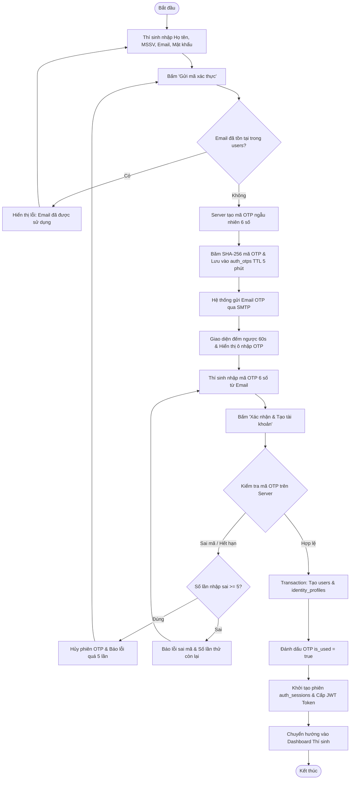
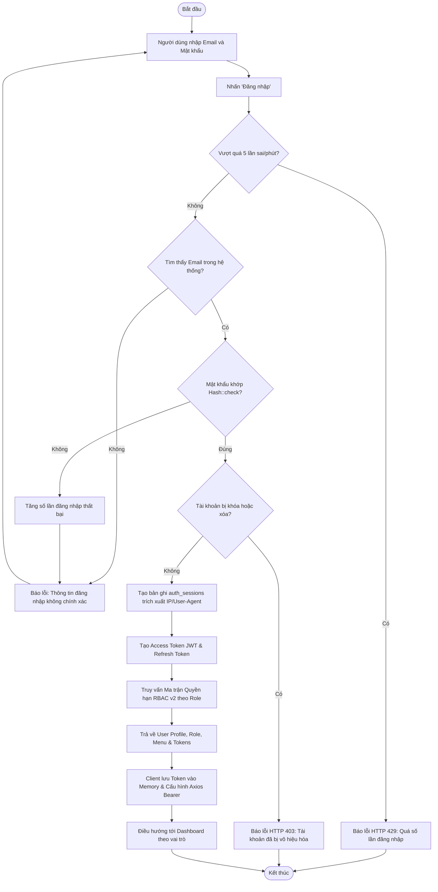
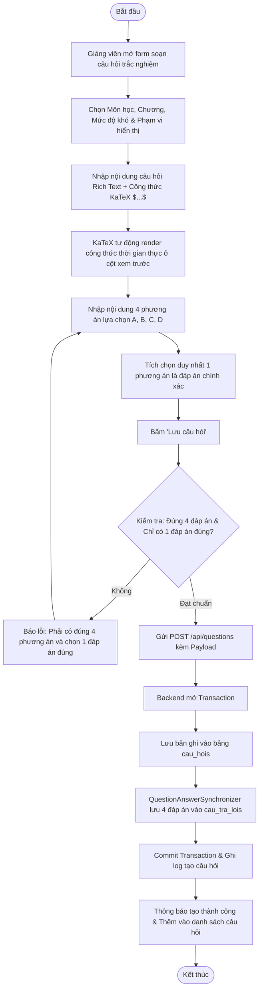
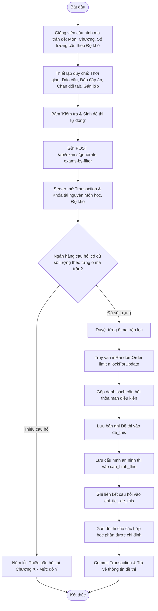
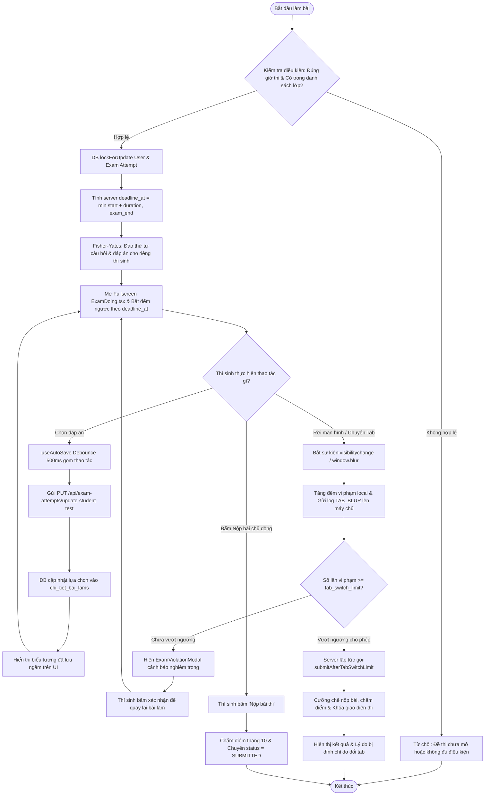
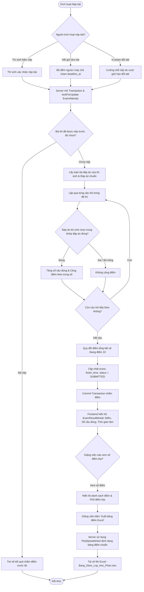

# TÀI LIỆU ĐẶC TẢ SƠ ĐỒ HOẠT ĐỘNG (ACTIVITY DIAGRAMS)
## HỆ THỐNG QUẢN LÝ THI TRẮC NGHIỆM TRỰC TUYẾN VINACLASS

---

> **Dự án:** Hệ thống Khảo thí và Quản lý Thi trắc nghiệm Trực tuyến VinaClass  
> **Phiên bản tài liệu:** v2.4.0 (Đồng bộ theo mã nguồn thực tế Laravel 10 + React 18)  
> **Ngày phát hành:** 30/10/2026  
> **Thực hiện:** Nhóm 18 - Quản lý Dự án Công nghệ Thông tin  
> **Tài liệu liên quan cùng bộ:**
> - [Tài liệu Đặc tả Use Case Toàn diện](file:///Users/macbook/Desktop/projects-src/vinaclass/docs/SODO_USECASE.md)
> - [Tài liệu Đặc tả Sơ đồ Tuần tự (Sequence Diagrams)](file:///Users/macbook/Desktop/projects-src/vinaclass/docs/SODO_SEQUENCE.md)
> - [Sổ tay Phân tích Nghiệp vụ & Đối chiếu Toàn bộ Mã nguồn](file:///Users/macbook/Desktop/projects-src/vinaclass/outputs/Phan_Tich_Nghiep_Vu_He_Thong_Thi_Trac_Nghiem_VinaClass.md)

---

## MỤC LỤC SƠ ĐỒ HOẠT ĐỘNG

1. [Tổng quan về Mô hình Hóa Hoạt động (Activity Modeling)](#tổng-quan-về-mô-hình-hóa-hoạt-động-activity-modeling)
2. [AD-01: Quy trình Đăng ký tài khoản & Xác thực Email OTP 2 bước](#31-ad-01-quy-trình-đăng-ký-tài-khoản--xác-thực-email-otp-2-bước)
3. [AD-02: Quy trình Đăng nhập, Cấp JWT & Quản lý phiên đa thiết bị](#32-ad-02-quy-trình-đăng-nhập-cấp-jwt--quản-lý-phiên-đa-thiết-bị)
4. [AD-03: Quy trình Phân quyền động RBAC v2 & Đồng bộ ma trận quyền hạn](#33-ad-03-quy-trình-phân-quyền-động-rbac-v2--đồng-bộ-ma-trận-quyền-hạn)
5. [AD-04: Quy trình Tạo Lớp học phần & Nhập Roster sinh viên từ Excel](#34-ad-04-quy-trình-tạo-lớp-học-phần--nhập-roster-sinh-viên-từ-excel)
6. [AD-05: Quy trình Soạn thảo câu hỏi ngân hàng KaTeX & Đồng bộ đáp án](#35-ad-05-quy-trình-soạn-thảo-câu-hỏi-ngân-hàng-katex--đồng-bộ-đáp-án)
7. [AD-06: Quy trình Sinh đề thi tự động theo ma trận tỷ lệ & Fisher-Yates Shuffle](#36-ad-06-quy-trình-sinh-đề-thi-tự-động-theo-ma-trận-tỷ-lệ--fisher-yates-shuffle)
8. [AD-07: Quy trình Khảo thí Engine trực tuyến: Khóa bi quan, Auto-save & Bắt gian lận](#37-ad-07-quy-trình-khảo-thí-engine-trực-tuyến-khóa-bi-quan-auto-save--bắt-gian-lận)
9. [AD-08: Quy trình Nộp bài thi, Chấm điểm tự động & Xuất bảng điểm Excel](#38-ad-08-quy-trình-nộp-bài-thi-chấm-điểm-tự-động--xuất-bảng-điểm-excel)
10. [Bảng Ánh xạ Activity Diagram sang Mã nguồn (Controllers & Services)](#bảng-ánh-xạ-activity-diagram-sang-mã-nguồn-controllers--services)

---

## TỔNG QUAN VỀ MÔ HÌNH HÓA HOẠT ĐỘNG (ACTIVITY MODELING)

Sơ đồ hoạt động (Activity Diagram) trong tài liệu này mô tả chi tiết dòng điều khiển (Control Flow) và dòng dữ liệu (Data Flow) của 8 quy trình nghiệp vụ cốt lõi nhất trong hệ thống VinaClass.
Mỗi sơ đồ làm rõ:
- **Nút hành động (Action Nodes):** Các thao tác của người dùng trên giao diện hoặc các bước xử lý ngầm tại Backend.
- **Nút quyết định (Decision Nodes):** Các điểm rẽ nhánh điều kiện logic (ví dụ: kiểm tra trùng lặp email, kiểm tra tính hợp lệ của mã OTP, kiểm tra hết hạn bài thi...).
- **Xử lý ngoại lệ (Exception / Error Handling):** Các kịch bản lỗi, thông báo phản hồi và cơ chế rollback giao dịch dữ liệu.

---

# PHẦN 3: SƠ ĐỒ HOẠT ĐỘNG (ACTIVITY DIAGRAMS)

## 3.1. AD-01: Quy trình Đăng ký tài khoản & Xác thực Email OTP 2 bước



---

## 3.2. AD-02: Quy trình Đăng nhập, Cấp JWT & Quản lý phiên đa thiết bị



---

## 3.3. AD-03: Quy trình Phân quyền động RBAC v2 & Đồng bộ ma trận quyền hạn

```mermaid
flowchart TD
    Start([Bắt đầu]) --> AdminOpen[Quản trị viên mở trang Ma trận Phân quyền]
    AdminOpen --> FetchMatrix[Gọi GET /api/roles/{role}/permission-matrix]
    FetchMatrix --> RenderTable[Hiển thị bảng 2 chiều: Module x Hành động nguyên tử]
    RenderTable --> AdminToggle[Admin thao tác Toggle Checkbox cấp/thu hồi quyền]
    AdminToggle --> AdminSave[Admin bấm 'Lưu Ma trận Phân quyền']
    AdminSave --> ServerLock[Server mở Transaction & Role::lockForUpdate]

    ServerLock --> CheckAdminRole{Vai trò có phải là ADMIN tối cao?}
    CheckAdminRole -- Đúng --> ThrowProtect[Báo lỗi: Không được chỉnh sửa quyền của ADMIN]
    ThrowProtect --> EndNode([Kết thúc])

    CheckAdminRole -- Không --> ValidatePermIds[Kiểm tra tính hợp lệ & Loại bỏ ID trùng lặp]
    ValidatePermIds --> SyncPivot[Gọi permissions->sync: Cập nhật permission_details]
    SyncPivot --> SyncLegacy[Gọi RolePermissionCompatibilityService đồng bộ role_details]
    SyncLegacy --> FlushCache[Flush toàn bộ Redis Cache quyền hạn của Role]
    FlushCache --> CommitTx[Commit DB Transaction]
    CommitTx --> NotifySuccess[Trả về HTTP 200 & Toast thông báo thành công]
    NotifySuccess --> EndNode
```

---

## 3.4. AD-04: Quy trình Tạo Lớp học phần & Nhập Roster sinh viên từ Excel

```mermaid
flowchart TD
    Start([Bắt đầu]) --> TeacherUpload[Giảng viên mở Lớp học phần & Kéo thả file Excel Roster]
    TeacherUpload --> SubmitImport[Gửi POST /api/course-groups/{id}/students/import]
    SubmitImport --> ReadExcel[CourseGroupRosterService đọc file bằng Maatwebsite Excel]
    ReadExcel --> CheckHeader{File chứa cột MSSV, Họ tên, Email?}

    CheckHeader -- Không --> FormatError[Ném lỗi: Định dạng file Excel không đúng chuẩn mẫu]
    FormatError --> EndNode([Kết thúc])

    CheckHeader -- Có --> LoopRows[Lặp qua từng dòng dữ liệu sinh viên trong file]
    LoopRows --> NormalizeData[Chuẩn hóa mã sinh viên, email và họ tên]
    NormalizeData --> CheckUserExist{Sinh viên đã có tài khoản trong users?}

    CheckUserExist -- Chưa có --> CreateStudent[Tạo tài khoản sinh viên mới với vai trò STUDENT]
    CreateStudent --> CheckEnrolled{Sinh viên đã tham gia lớp học này chưa?}
    CheckUserExist -- Đã có --> CheckEnrolled

    CheckEnrolled -- Đã tham gia --> SkipStudent[Đưa vào danh sách bỏ qua - đã có sẵn]
    CheckEnrolled -- Chưa --> EnrollStudent[Chèn bản ghi vào bảng chi_tiet_nhoms]
    EnrollStudent --> IncSuccess[Tăng bộ đếm thêm thành công]

    SkipStudent --> CheckMoreRows{Còn dòng dữ liệu nào không?}
    IncSuccess --> CheckMoreRows
    CheckMoreRows -- Còn --> LoopRows
    CheckMoreRows -- Hết --> SummaryResult[Tổng kết: Số lượng thêm mới, trùng lặp, lỗi]
    SummaryResult --> ShowModal[Hiển thị Modal kết quả chi tiết & Cập nhật danh sách]
    ShowModal --> EndNode
```

---

## 3.5. AD-05: Quy trình Soạn thảo câu hỏi ngân hàng KaTeX & Đồng bộ đáp án



---

## 3.6. AD-06: Quy trình Sinh đề thi tự động theo ma trận tỷ lệ & Fisher-Yates Shuffle



---

## 3.7. AD-07: Quy trình Khảo thí Engine trực tuyến: Khóa bi quan, Auto-save & Bắt gian lận



---

## 3.8. AD-08: Quy trình Nộp bài thi, Chấm điểm tự động & Xuất bảng điểm Excel



---


---

## BẢNG ÁNH XẠ ACTIVITY DIAGRAM SANG MÃ NGUỒN (CONTROLLERS & SERVICES)

| Mã Sơ đồ | Tên Quy trình Nghiệp vụ | Use Case liên quan | Backend Controllers & Services | Frontend React Components |
| :--- | :--- | :---: | :--- | :--- |
| **AD-01** | Đăng ký tài khoản & Xác thực Email OTP | UC-01, UC-03 | `AuthController.php`<br>`AuthOtpService.php`<br>`StudentRegistrationService.php` | `client/src/features/auth/pages/RegisterPage.tsx`<br>`client/src/features/auth/components/RegisterForm.tsx` |
| **AD-02** | Đăng nhập JWT & Quản lý phiên đa thiết bị | UC-02, UC-04, UC-05 | `AuthController.php`<br>`AuthService.php`<br>`AuthSessionService.php` | `client/src/features/auth/pages/LoginPage.tsx`<br>`client/src/features/identity/pages/ProfilePage.tsx` |
| **AD-03** | Phân quyền động RBAC v2 & Đồng bộ ma trận | UC-06, UC-07, UC-08 | `PermissionAdministrationController.php`<br>`RoleController.php`<br>`RolePermissionSyncService.php` | `client/src/features/authorization/pages/PermissionMatrixV2Page.tsx`<br>`PermissionGroupPage.tsx` |
| **AD-04** | Tạo Lớp học phần & Nhập Roster từ Excel | UC-09, UC-10, UC-11 | `CourseGroupController.php`<br>`CourseGroupRosterService.php`<br>`CourseGroupInvitationService.php` | `client/src/features/classrooms/pages/CourseGroupPage.tsx`<br>`client/src/features/classrooms/components/StudentRosterImportForm.tsx` |
| **AD-05** | Soạn thảo câu hỏi KaTeX & Đồng bộ đáp án | UC-13, UC-14 | `QuestionController.php`<br>`AnswerOptionController.php`<br>`QuestionAnswerSynchronizer.php` | `client/src/features/question-bank/pages/QuestionBankPage.tsx`<br>`client/src/features/question-bank/components/QuestionEditorForm.tsx` |
| **AD-06** | Sinh đề thi tự động theo ma trận tỷ lệ | UC-15 | `ExamController.php`<br>`ExamCreationService.php`<br>`ExamQuestionSelectionService.php` | `client/src/features/assessments/pages/TestFormPage.tsx`<br>`client/src/features/assessments/pages/AddQuestionTestPage.tsx` |
| **AD-07** | Khảo thí Engine: Lock, Auto-save & Bắt gian lận | UC-16, UC-17, UC-18 | `ExamAttemptController.php`<br>`ExamAttemptStartService.php`<br>`ExamAttemptLogController.php` | `client/src/features/assessments/pages/DoTestPage.tsx`<br>`client/src/features/assessments/components/exam/ExamDoing.tsx` |
| **AD-08** | Nộp bài thi, Chấm điểm tự động & Xuất Excel | UC-19, UC-21, UC-22 | `ExamAttemptController.php`<br>`ExamGradingService.php`<br>`ExamAttemptSubmissionService.php` | `client/src/features/assessments/pages/ResultDoTestPage.tsx`<br>`client/src/features/classrooms/components/CourseGroupGradebookTab.tsx` |

---
*Tài liệu được biên soạn và chuẩn hóa bởi Nhóm 18 - Dự án Khảo thí Trực tuyến VinaClass.*