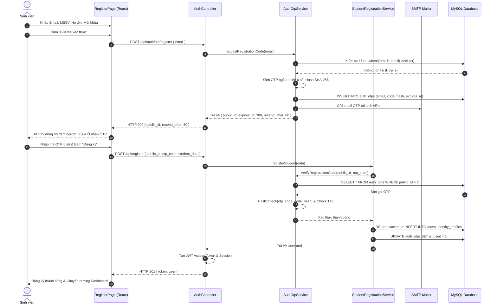
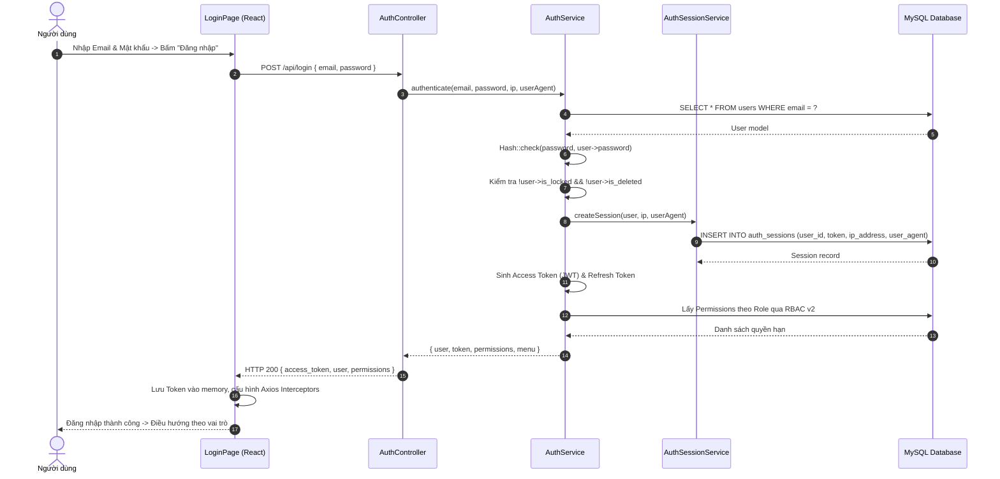
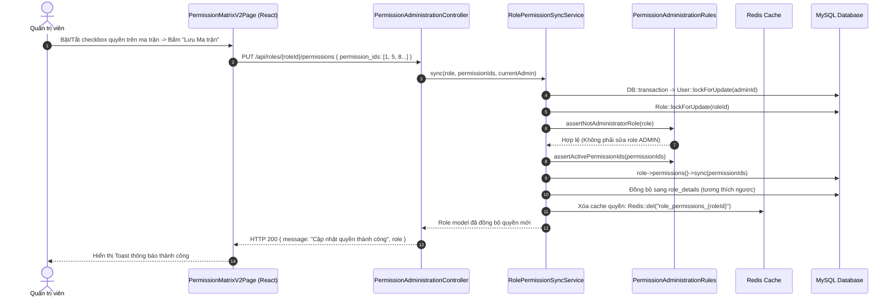
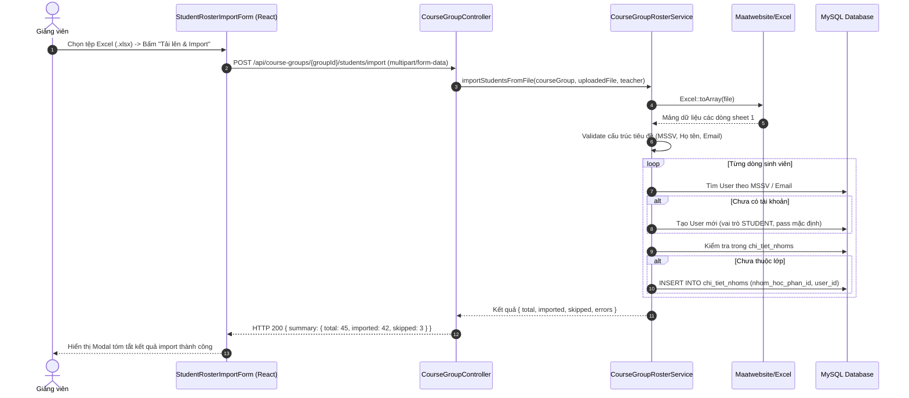
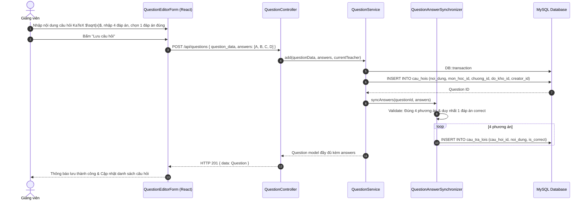
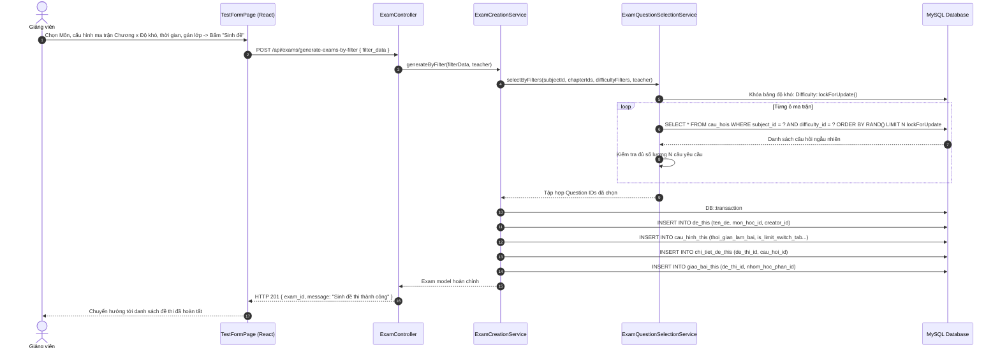
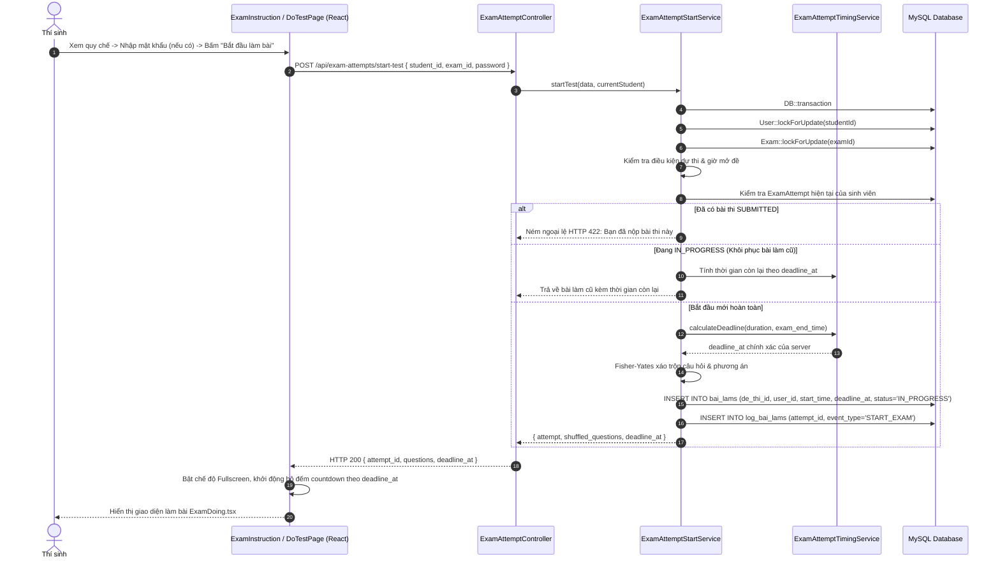
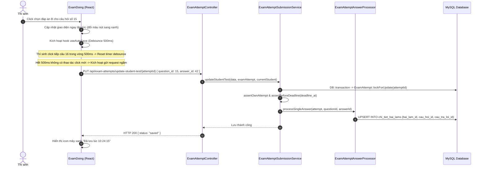
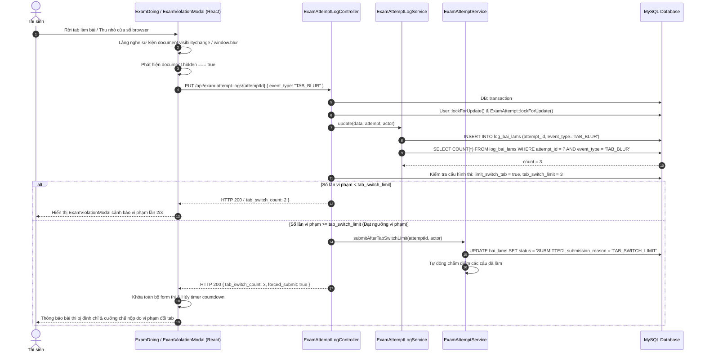
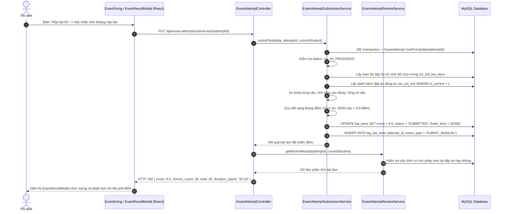

# TÀI LIỆU ĐẶC TẢ SƠ ĐỒ TUẦN TỰ (SEQUENCE DIAGRAMS)
## HỆ THỐNG QUẢN LÝ THI TRẮC NGHIỆM TRỰC TUYẾN VINACLASS

---

> **Dự án:** Hệ thống Khảo thí và Quản lý Thi trắc nghiệm Trực tuyến VinaClass  
> **Phiên bản tài liệu:** v2.4.0 (Đồng bộ theo mã nguồn thực tế Laravel 10 + React 18)  
> **Ngày phát hành:** 30/10/2026  
> **Thực hiện:** Nhóm 18 - Quản lý Dự án Công nghệ Thông tin  
> **Tài liệu liên quan cùng bộ:**
> - [Tài liệu Đặc tả Use Case Toàn diện](file:///Users/macbook/Desktop/projects-src/vinaclass/docs/SODO_USECASE.md)
> - [Tài liệu Đặc tả Sơ đồ Hoạt động (Activity Diagrams)](file:///Users/macbook/Desktop/projects-src/vinaclass/docs/SODO_ACTIVITY.md)
> - [Sổ tay Phân tích Nghiệp vụ & Đối chiếu Toàn bộ Mã nguồn](file:///Users/macbook/Desktop/projects-src/vinaclass/outputs/Phan_Tich_Nghiep_Vu_He_Thong_Thi_Trac_Nghiem_VinaClass.md)

---

## MỤC LỤC SƠ ĐỒ TUẦN TỰ

1. [Kiến trúc Tương tác Đa tầng (Clean Service-Oriented Architecture)](#kiến-trúc-tương-tác-đa-tầng-clean-service-oriented-architecture)
2. [SD-01: Xác thực OTP Đăng ký tài khoản Sinh viên](#41-sd-01-xác-thực-otp-đăng-ký-tài-khoản-sinh-viên)
3. [SD-02: Đăng nhập xác thực JWT & Khởi tạo phiên làm việc](#42-sd-02-đăng-nhập-xác-thực-jwt--khởi-tạo-phiên-làm-việc)
4. [SD-03: Cập nhật ma trận phân quyền động RBAC v2](#43-sd-03-cập-nhật-ma-trận-phân-quyền-động-rbac-v2)
5. [SD-04: Import danh sách sinh viên vào lớp học phần từ tệp Excel](#44-sd-04-import-danh-sách-sinh-viên-vào-lớp-học-phần-từ-tệp-excel)
6. [SD-05: Soạn thảo và lưu câu hỏi trắc nghiệm KaTeX](#45-sd-05-soạn-thảo-và-lưu-câu-hỏi-trắc-nghiệm-katex)
7. [SD-06: Sinh đề thi tự động theo bộ lọc ma trận kiến thức](#46-sd-06-sinh-đề-thi-tự-động-theo-bộ-lọc-ma-trận-kiến-thức)
8. [SD-07: Bắt đầu làm bài thi với khóa bi quan chống gian lận đa luồng (`lockForUpdate`)](#47-sd-07-bắt-đầu-làm-bài-thi-với-khóa-bi-quan-chống-gian-lận-đa-luồng)
9. [SD-08: Live Auto-save tự động lưu bài thi ngầm (Debounce 500ms)](#48-sd-08-live-auto-save-tự-động-lưu-bài-thi-ngầm-debounce-500ms)
10. [SD-09: Giám sát vi phạm rời màn hình (Tab Blur) & Cưỡng chế nộp bài](#49-sd-09-giám-sát-vi-phạm-rời-màn-hình-tab-blur--cưỡng-chế-nộp-bài)
11. [SD-10: Nộp bài, Chấm điểm tức thì & Xem kết quả phân tích](#410-sd-10-nộp-bài-chấm-điểm-tức-thì--xem-kết-quả-phân-tích)
12. [Bảng Phân tích Giao thức & Mã trạng thái HTTP (API Protocols)](#bảng-phân-tích-giao-thức--mã-trạng-thái-http-api-protocols)

---

## KIẾN TRÚC TƯƠNG TÁC ĐA TẦNG (CLEAN SERVICE-ORIENTED ARCHITECTURE)

Mọi sơ đồ tuần tự (Sequence Diagram) trong hệ thống VinaClass thể hiện sự phối hợp tuần tự giữa 5 tầng kiến trúc phần mềm:
1. **Client Tier (React 18 SPA):** Tiếp nhận tương tác người dùng, quản lý state cục bộ (Zustand/React Query), bắt sự kiện DOM và gửi HTTP Request.
2. **Routing & Middleware Tier (Laravel HTTP):** Xác thực mã thông báo `auth:api`, kiểm tra phiên `auth.session`, kiểm tra trạng thái kích hoạt tài khoản `account.active`, và kiểm tra quyền nguyên tử `permission:{module}:{action}`.
3. **Controller Tier (Laravel Controllers):** Tiếp nhận dữ liệu, validate schema thông qua FormRequest, điều phối và gọi Service xử lý.
4. **Service Tier (Domain Business Logic):** Nơi thực thi logic nghiệp vụ, quản lý giao dịch CSDL `DB::beginTransaction()`, khóa dòng bi quan `lockForUpdate()`, tính toán thuật toán và gửi mail/ghi log.
5. **Persistence Tier (MySQL Database & Eloquent Models):** Lưu trữ dữ liệu quan hệ, đảm bảo toàn vẹn khóa ngoại (Foreign Keys) và ACID transactions.

---

# PHẦN 4: SƠ ĐỒ TUẦN TỰ KỸ THUẬT (SEQUENCE DIAGRAMS)

## 4.1. SD-01: Xác thực OTP Đăng ký tài khoản Sinh viên

---

## 4.2. SD-02: Đăng nhập xác thực JWT & Khởi tạo phiên làm việc

---

## 4.3. SD-03: Cập nhật ma trận phân quyền động RBAC v2

---

## 4.4. SD-04: Import danh sách sinh viên vào lớp học phần từ tệp Excel

---

## 4.5. SD-05: Soạn thảo và lưu câu hỏi trắc nghiệm KaTeX

---

## 4.6. SD-06: Sinh đề thi tự động theo bộ lọc ma trận kiến thức

---

## 4.7. SD-07: Bắt đầu làm bài thi với khóa bi quan chống gian lận đa luồng

---

## 4.8. SD-08: Live Auto-save tự động lưu bài thi ngầm (Debounce 500ms)

---

## 4.9. SD-09: Giám sát vi phạm rời màn hình (Tab Blur) & Cưỡng chế nộp bài

---

## 4.10. SD-10: Nộp bài, Chấm điểm tức thì & Xem kết quả phân tích

---

---

## BẢNG PHÂN TÍCH GIAO THỨC & MÃ TRẠNG THÁI HTTP (API PROTOCOLS)

| Mã SD | Tên Luồng Tuần tự | Endpoint API | HTTP Method | Mã HTTP thành công | Mã HTTP lỗi thường gặp | Cơ chế An toàn CSDL |
| :--- | :--- | :--- | :---: | :---: | :--- | :--- |
| **SD-01** | Xác thực OTP Đăng ký | `/api/auth/otp/register` `/api/register` | POST | 200, 201 | 422 (Email trùng), 400 (Sai OTP) | Transaction + SHA-256 Hash |
| **SD-02** | Đăng nhập JWT & Phiên | `/api/auth/login` `/api/auth/me` | POST GET | 200 | 401 (Sai MK), 403 (Bị khóa), 429 (Rate limit) | Lưu vết IP & User Agent `auth_sessions` |
| **SD-03** | Cập nhật RBAC v2 | `/api/roles/{id}/permissions` | PUT | 200 | 403 (Không có quyền MANAGE) | `DB::transaction()` đồng bộ `role_details` |
| **SD-04** | Import Roster Excel | `/api/course-groups/{id}/students/import` | POST | 200 | 422 (File sai định dạng/trùng MSSV) | Rollback toàn bộ nếu có lỗi nghiêm trọng |
| **SD-05** | Soạn câu hỏi KaTeX | `/api/questions` | POST | 201 | 422 (Thiếu đáp án đúng/sai cú pháp KaTeX) | Transaction lưu câu hỏi + 4 đáp án |
| **SD-06** | Sinh đề thi tự động | `/api/exams/generate-matrix` | POST | 201 | 400 (Ngân hàng thiếu câu theo tỷ lệ) | Thuật toán Fisher-Yates Shuffling |
| **SD-07** | Bắt đầu thi trực tuyến | `/api/exam-attempts/start-test` | POST | 200 | 403 (Ngoài giờ thi/hết lượt thi) | `lockForUpdate()` trên User và Exam |
| **SD-08** | Live Auto-save ngầm | `/api/test-answers/save` | POST | 200 | 408 (Quá hạn deadline), 403 (Đã nộp bài) | Optimistic save + Debounce 500ms |
| **SD-09** | Bắt vi phạm Tab Blur | `/api/exam-attempt-logs/{id}` | PUT | 200 | 400 (Dữ liệu log không hợp lệ) | Auto-submit nếu vi phạm $\ge$ limit |
| **SD-10** | Nộp bài & Chấm điểm | `/api/exam-attempts/{id}/submit` | POST | 200 | 409 (Bài thi đã được nộp trước đó) | `lockForUpdate()` + Tự động chấm điểm tức thì |

---
*Tài liệu được biên soạn và chuẩn hóa bởi Nhóm 18 - Dự án Khảo thí Trực tuyến VinaClass.*