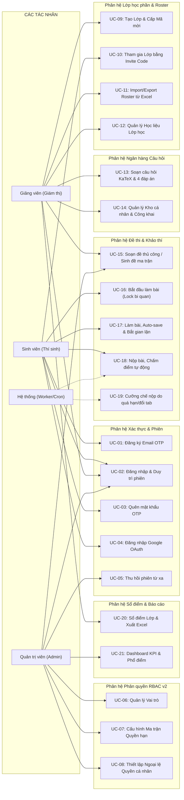
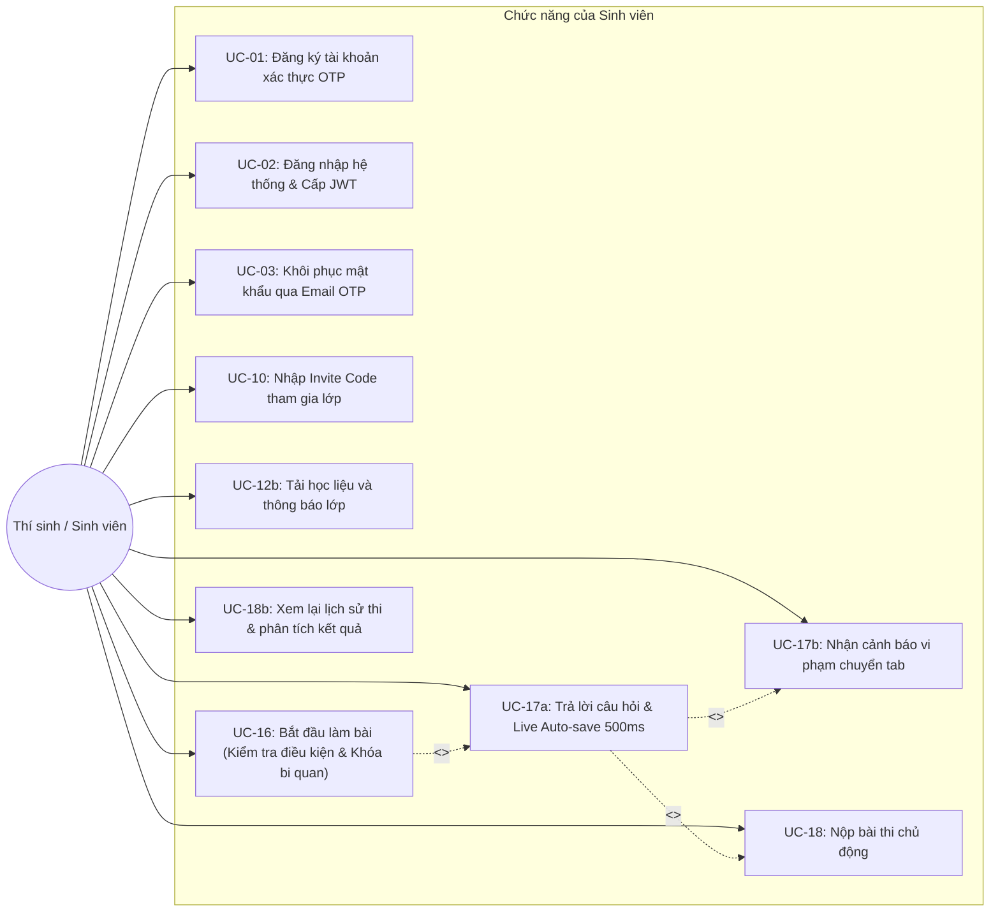
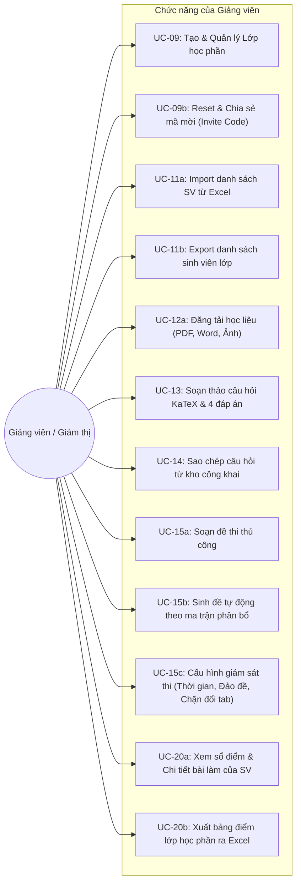
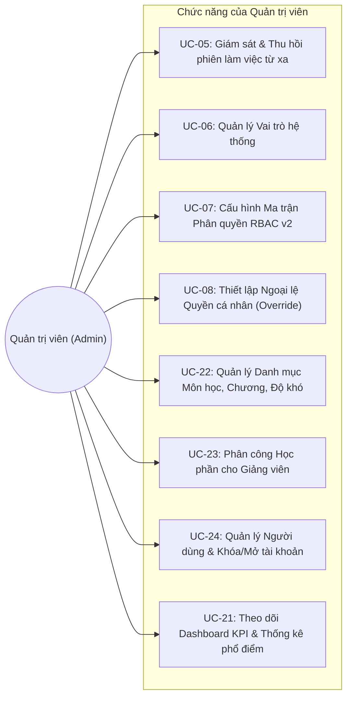

# TÀI LIỆU ĐẶC TẢ USE CASE TOÀN DIỆN
## HỆ THỐNG QUẢN LÝ THI TRẮC NGHIỆM TRỰC TUYẾN VINACLASS

---

> **Dự án:** Hệ thống Khảo thí và Quản lý Thi trắc nghiệm Trực tuyến VinaClass  
> **Phiên bản tài liệu:** v2.4.0 (Đồng bộ theo mã nguồn thực tế Laravel 10 + React 18)  
> **Ngày phát hành:** 30/10/2026  
> **Thực hiện:** Nhóm 18 - Quản lý Dự án Công nghệ Thông tin  
> **Tài liệu liên quan cùng bộ:**
> - [Tài liệu Đặc tả Sơ đồ Hoạt động (Activity Diagrams)](file:///Users/macbook/Desktop/projects-src/vinaclass/docs/SODO_ACTIVITY.md)
> - [Tài liệu Đặc tả Sơ đồ Tuần tự (Sequence Diagrams)](file:///Users/macbook/Desktop/projects-src/vinaclass/docs/SODO_SEQUENCE.md)
> - [Sổ tay Phân tích Nghiệp vụ & Đối chiếu Toàn bộ Mã nguồn](file:///Users/macbook/Desktop/projects-src/vinaclass/outputs/Phan_Tich_Nghiep_Vu_He_Thong_Thi_Trac_Nghiem_VinaClass.md)

---

## MỤC LỤC TỔNG QUAN

1. [Phần 1: Tổng quan Hệ thống & Danh mục Tác nhân (Actors)](#phần-1-tổng-quan-hệ-thống--danh-mục-tác-nhân-actors)
   - 1.1. Phạm vi nghiệp vụ & Bối cảnh kỹ thuật
   - 1.2. Kiến trúc giải pháp kỹ thuật (Clean Service-Oriented Architecture)
   - 1.3. Bảng phân tích Tác nhân hệ thống (Actors)
2. [Phần 2: Sơ đồ Use Case Hệ thống](#phần-2-sơ-đồ-use-case-hệ-thống)
   - 2.1. Sơ đồ Use Case tổng quát toàn hệ thống
   - 2.2. Sơ đồ Use Case phân rã theo vai trò tác nhân
     - 2.2.1. Phân hệ Thí sinh / Sinh viên (Student)
     - 2.2.2. Phân hệ Giảng viên / Giám thị (Teacher)
     - 2.2.3. Phân hệ Quản trị viên (Administrator)
3. [Phần 3: Bảng Ma trận 24 Use Cases Toàn hệ thống](#phần-3-bảng-ma-trận-24-use-cases-toàn-hệ-thống)
4. [Phần 4: Đặc tả Kỹ thuật Chi tiết các Use Case Cốt lõi](#phần-4-đặc-tả-kỹ-thuật-chi-tiết-các-use-case-cốt-lõi)
   - UC-01: Đăng ký tài khoản xác thực OTP qua Email
   - UC-02: Đăng nhập hệ thống & Quản lý phiên làm việc
   - UC-05: Cấu hình Ma trận Phân quyền Động RBAC v2
   - UC-07: Tạo Lớp học phần & Cấp mã mời ghi danh
   - UC-08: Tham gia Lớp học phần bằng Invite Code
   - UC-09: Nhập danh sách sinh viên vào lớp từ tập tin Excel (Roster Import)
   - UC-11: Soạn thảo câu hỏi trắc nghiệm hỗ trợ KaTeX & 4 phương án
   - UC-13: Sinh đề thi tự động theo ma trận tỷ lệ chương & độ khó
   - UC-14: Bắt đầu bài thi trực tuyến với khóa bi quan (`lockForUpdate`)
   - UC-15: Làm bài thi trực tuyến, đếm ngược máy chủ & Live Auto-save Debounce
   - UC-16: Giám sát vi phạm chuyển Tab & Cưỡng chế nộp bài vi phạm
5. [Phần 5: Ma trận Truy vết Use Case sang Activity & Sequence](#phần-5-ma-trận-truy-vết-use-case-sang-activity--sequence)

---

# PHẦN 1: TỔNG QUAN HỆ THỐNG & DANH MỤC TÁC NHÂN (ACTORS)

## 1.1. Phạm vi nghiệp vụ & Bối cảnh kỹ thuật
Hệ thống Quản lý Thi trắc nghiệm trực tuyến **VinaClass** là nền tảng kiểm tra đánh giá số hóa phục vụ các cơ sở giáo dục đại học, cao đẳng và các tổ chức đào tạo. Hệ thống được xây dựng trên nền tảng kiến trúc phân tán hiện đại:
- **Client (Frontend):** React 18 SPA, Vite, TypeScript, TailwindCSS, Ant Design, KaTeX, Zustand, TanStack Query.
- **Server (Backend):** Laravel 10 RESTful API, PHP 8.2+, Eloquent ORM, MySQL 8.0, Redis Caching & Queue Worker, Maatwebsite Excel, PhpSpreadsheet, PHPMailer / SMTP.
- **Đặc thù kỹ thuật nổi bật:**
  1. *Khảo thí thời gian thực với khóa bi quan (`lockForUpdate`):* Chống việc mở song song 2 bài thi trên nhiều tab/trình duyệt.
  2. *Thời gian đếm ngược máy chủ (Server-authoritative Deadline):* Độc lập hoàn toàn với đồng hồ máy tính thí sinh để ngăn chặn việc chỉnh giờ local.
  3. *Cơ chế lưu bài thi thích ứng (Adaptive Live Auto-save):* Lắng nghe từng thay đổi lựa chọn đáp án, tự động đẩy lên máy chủ ngầm với debounce 500ms, đảm bảo không mất dữ liệu ngay cả khi mất điện hoặc rớt mạng.
  4. *Giám sát hành vi gian lận (Anti-cheat Event Logging):* Giám sát sự kiện `visibilitychange` và `window.blur`, ghi nhận chính xác thời điểm và số lần rời khỏi màn hình thi; tự động kích hoạt cưỡng chế nộp bài khi vượt ngưỡng cho phép (`tab_switch_limit`).
  5. *Phân quyền động đa tầng (RBAC v2 Engine):* Cho phép quản trị viên cấu hình ma trận quyền hạn ma trận theo từng hành động nguyên tử (`view`, `create`, `update`, `delete`, `publish`, `assign`) và hỗ trợ thiết lập ngoại lệ quyền cho từng tài khoản cụ thể (`User Permission Overrides`).

## 1.2. Kiến trúc giải pháp kỹ thuật
Hệ thống tuân thủ nghiêm ngặt mô hình **Clean Service-Oriented Architecture** trên nền tảng Laravel:
- **Routing Layer (`server/routes/api/*.php`):** Định tuyến module hóa, bọc bởi các Middleware an ninh (`auth:api`, `auth.session`, `account.active`, `permission:*`).
- **Controller Layer (`server/app/Http/Controllers/*.php`):** Tiếp nhận HTTP Request, điều phối dữ liệu qua Request Validation Classes, ủy thác toàn bộ xử lý nghiệp vụ cho Service Layer và chuẩn hóa Response qua `ApiResponseTrait`.
- **Service Layer (`server/app/Services/*.php`):** Nơi thực thi 100% logic nghiệp vụ cốt lõi, giao dịch nguyên tử (`DB::transaction`), cơ chế khóa hàng (`lockForUpdate`), thuật toán sinh ma trận và tích hợp dịch vụ ngoài (Mail, Excel).
- **Data Access & Model Layer (`server/app/Models/*.php`):** Định nghĩa quan hệ Eloquent, Soft Deletes, Scopes và Type Castings.

## 1.3. Bảng phân tích Tác nhân hệ thống (Actors)

| Mã Tác nhân | Tên Tác nhân | Định danh kỹ thuật | Mô tả vai trò & Trách nhiệm trong hệ thống |
| :--- | :--- | :--- | :--- |
| **ACT-01** | **Sinh viên (Thí sinh)** | `STUDENT` | Người học tham gia hệ thống: Đăng ký tài khoản xác thực OTP, tham gia lớp học phần bằng mã mời (Invite Code), tải tài liệu học tập, làm bài kiểm tra trực tuyến, lưu đáp án tự động, nhận cảnh báo vi phạm khi đổi tab, nộp bài và xem lại kết quả/lịch sử thi. |
| **ACT-02** | **Giảng viên (Giám thị)** | `TEACHER` | Cán bộ giảng dạy phụ trách môn học: Quản lý lớp học phần, cấp mã mời, nhập danh sách sinh viên từ file Excel, tải lên tài liệu học tập, soạn thảo ngân hàng câu hỏi KaTeX, tạo và cấu hình đề thi (thủ công hoặc sinh ngẫu nhiên theo ma trận), giám sát bài làm và xuất bảng điểm lớp ra file Excel. |
| **ACT-03** | **Quản trị viên** | `ADMIN` | Người quản trị tối cao của hệ thống: Quản lý người dùng, phân công giảng dạy cho giảng viên, quản lý danh mục môn học / chương / độ khó, cấu hình ma trận phân quyền động RBAC v2, thiết lập ngoại lệ quyền người dùng và theo dõi Dashboard thống kê KPI hệ thống. |
| **ACT-04** | **Hệ thống (Tác nhân ngầm)** | `SYSTEM / WORKER` | Máy chủ nền, cron scheduler và queue worker: Thực hiện sinh mã OTP, gửi email SMTP, kiểm tra hết hạn bài thi (`deadline_at`), tự động chấm điểm bài nộp, và tự động cưỡng chế kết thúc bài thi khi vượt giới hạn đổi tab. |

---

# PHẦN 2: ĐẶC TẢ USE CASE TOÀN DIỆN (USE CASE SPECIFICATIONS)

## 2.1. Sơ đồ Use Case Tổng quát toàn hệ thống

---

## 2.2. Sơ đồ Use Case Phân rã theo Vai trò Tác nhân

### 2.2.1. Phân hệ Thí sinh / Sinh viên (Student)

### 2.2.2. Phân hệ Giảng viên / Giám thị (Teacher)

### 2.2.3. Phân hệ Quản trị viên (Administrator)

---

## 2.3. Bảng Ma trận Use Case Toàn hệ thống (24 Use Cases)

| Mã Use Case | Tên Use Case | Phân hệ Chức năng | Tác nhân chính | Độ ưu tiên |
| :--- | :--- | :--- | :--- | :--- |
| **UC-01** | Đăng ký tài khoản xác thực OTP qua Email | Xác thực & Phiên | Sinh viên | High |
| **UC-02** | Đăng nhập hệ thống & Quản lý phiên làm việc | Xác thực & Phiên | Sinh viên, Giảng viên, Admin | Critical |
| **UC-03** | Khôi phục mật khẩu qua Email OTP | Xác thực & Phiên | Sinh viên, Giảng viên, Admin | High |
| **UC-04** | Đăng nhập một chạm bằng Google OAuth 2.0 | Xác thực & Phiên | Sinh viên, Giảng viên | Medium |
| **UC-05** | Giám sát & Thu hồi phiên làm việc từ xa | Xác thực & Phiên | Quản trị viên | Medium |
| **UC-06** | Quản lý Vai trò người dùng | Phân quyền RBAC v2 | Quản trị viên | High |
| **UC-07** | Cấu hình Ma trận Phân quyền động RBAC v2 | Phân quyền RBAC v2 | Quản trị viên | Critical |
| **UC-08** | Thiết lập Ngoại lệ Quyền cá nhân (User Overrides) | Phân quyền RBAC v2 | Quản trị viên | High |
| **UC-09** | Tạo và Quản lý Lớp học phần & Cấp mã mời | Lớp học & Roster | Giảng viên | Critical |
| **UC-10** | Tham gia Lớp học phần bằng Invite Code | Lớp học & Roster | Sinh viên | High |
| **UC-11** | Nhập/Xuất danh sách sinh viên từ tập tin Excel | Lớp học & Roster | Giảng viên, Admin | Critical |
| **UC-12** | Quản lý Học liệu và Tài liệu của Lớp học phần | Lớp học & Roster | Giảng viên, Sinh viên | Medium |
| **UC-13** | Soạn thảo câu hỏi trắc nghiệm KaTeX & 4 đáp án | Ngân hàng Câu hỏi | Giảng viên, Admin | Critical |
| **UC-14** | Quản lý kho cá nhân & Chia sẻ ngân hàng câu hỏi | Ngân hàng Câu hỏi | Giảng viên | High |
| **UC-15** | Sinh đề thi tự động theo ma trận tỷ lệ phân bổ | Đề thi & Cấu hình | Giảng viên, Admin | Critical |
| **UC-16** | Bắt đầu bài thi trực tuyến với khóa bi quan (`lockForUpdate`) | Khảo thí Engine | Sinh viên | Critical |
| **UC-17** | Làm bài thi trực tuyến & Live Auto-save Debounce 500ms | Khảo thí Engine | Sinh viên | Critical |
| **UC-18** | Bắt sự kiện gian lận chuyển Tab & Cảnh báo vi phạm | Khảo thí Engine | Sinh viên, Hệ thống | Critical |
| **UC-19** | Nộp bài thi trực tuyến & Tự động chấm điểm tức thì | Khảo thí Engine | Sinh viên, Hệ thống | Critical |
| **UC-20** | Cưỡng chế nộp bài khi hết giờ hoặc vượt giới hạn đổi tab | Khảo thí Engine | Hệ thống (Worker/Cron) | Critical |
| **UC-21** | Xem sổ điểm lớp học phần & Xuất bảng điểm Excel | Sổ điểm & Báo cáo | Giảng viên | High |
| **UC-22** | Xem chi tiết bài làm, lịch sử làm bài & Phổ điểm | Sổ điểm & Báo cáo | Sinh viên, Giảng viên | High |
| **UC-23** | Quản lý Danh mục Môn học, Chương và Độ khó | Danh mục Quản trị | Quản trị viên | High |
| **UC-24** | Xem Dashboard KPI & Thống kê hiệu suất hệ thống | Thống kê Quản trị | Quản trị viên | Medium |

---

## 2.4. Đặc tả Kỹ thuật Chi tiết 16 Use Case Cốt lõi

### UC-01: Đăng ký tài khoản xác thực OTP qua Email
- **Mã định danh:** `UC-01`
- **Tác nhân:** Sinh viên (Khách vãng lai).
- **Mục đích:** Đảm bảo chỉ người dùng sở hữu hộp thư điện tử thực mới có thể khởi tạo tài khoản Sinh viên trên hệ thống.
- **Tiền điều kiện:** Người dùng chưa đăng nhập, chưa có tài khoản trùng địa chỉ email trong bảng `users`.
- **Hậu điều kiện:** Tài khoản sinh viên được tạo trong `users` với vai trò `STUDENT`, thông tin cá nhân lưu trong `identity_profiles`, mã OTP được đánh dấu đã sử dụng.
- **Luồng sự kiện chính (Main Flow):**
  1. Người dùng mở trang Đăng ký (`/register`), nhập Họ tên, Mã sinh viên, Email, Mật khẩu, Xác nhận mật khẩu.
  2. Người dùng nhấn nút "Gửi mã xác thực".
  3. Frontend gọi `POST /api/auth/otp/register` với body `{ email }`.
  4. Backend kiểm tra email chưa tồn tại, sinh ngẫu nhiên mã số OTP 6 chữ số, mã hóa SHA-256 lưu vào bảng `auth_otps` với `purpose = 'REGISTER'`, thời gian sống 5 phút (`OTP_LIFETIME_MINUTES = 5`), giới hạn 5 lần nhập sai (`MAX_ATTEMPTS = 5`).
  5. Backend kích hoạt SMTP gửi email chứa mã OTP đến hòm thư người dùng và trả về `public_id` của phiên OTP kèm thời gian chờ gửi lại (60 giây).
  6. Giao diện hiển thị ô nhập mã OTP 6 số và đồng hồ đếm ngược 60 giây.
  7. Người dùng nhập mã OTP và nhấn "Xác nhận & Tạo tài khoản".
  8. Frontend gửi payload lên `POST /api/register` gồm thông tin cá nhân, mật khẩu, `otp_code` và `public_id`.
  9. Backend `StudentRegistrationService` xác thực mã OTP: nếu hợp lệ, mở transaction tạo `users`, tạo `identity_profiles`, băm mật khẩu bằng Bcrypt (`cost = 10`), cấp quyền mặc định `STUDENT`.
  10. Hệ thống tạo phiên làm việc mới trong `auth_sessions`, sinh cặp Access Token (JWT) và Refresh Token gửi về cho client.
  11. Frontend lưu Access Token vào state/memory, chuyển hướng người dùng vào trang chủ Sinh viên.
- **Luồng phụ / Ngoại lệ (Alternative & Exception Flows):**
  - *A1 - Email đã tồn tại:* Tại bước 4, nếu email đã tồn tại trong `users`, Backend trả về HTTP 422 với thông báo "Email đã được sử dụng". Giao diện highlight ô nhập email báo lỗi.
  - *A2 - Mã OTP không đúng:* Tại bước 9, nếu mã OTP sai, Backend tăng trường `attempts` trong `auth_otps`. Nếu `attempts < 5`, trả về HTTP 422 "Mã xác thực không chính xác, bạn còn (5 - attempts) lần thử".
  - *A3 - Mã OTP hết hạn hoặc bị khóa:* Nếu quá 5 phút hoặc nhập sai quá 5 lần, Backend hủy phiên OTP và trả về HTTP 410/422 yêu cầu gửi lại mã mới.
  - *A4 - Yêu cầu gửi lại OTP khi chưa hết 60s:* Hệ thống chặn ở cả client và rate limiter backend (`throttle:auth-otp-resend`), trả về HTTP 429 "Vui lòng chờ hết thời gian đếm ngược".
- **Quy tắc nghiệp vụ:** Mật khẩu tối thiểu 8 ký tự; mã OTP chỉ có hiệu lực một lần (`is_used = true` sau khi xác thực); email tự động chuẩn hóa về chữ thường (`strtolower`).
- **Giao diện liên quan:** [RegisterPage.tsx](file:///Users/macbook/Desktop/projects-src/vinaclass/client/src/features/auth/pages/RegisterPage.tsx), [RegisterForm.tsx](file:///Users/macbook/Desktop/projects-src/vinaclass/client/src/features/auth/components/RegisterForm.tsx).
- **Controller & Service:** [AuthController.php](file:///Users/macbook/Desktop/projects-src/vinaclass/server/app/Http/Controllers/AuthController.php), [AuthOtpService.php](file:///Users/macbook/Desktop/projects-src/vinaclass/server/app/Services/AuthOtpService.php), [StudentRegistrationService.php](file:///Users/macbook/Desktop/projects-src/vinaclass/server/app/Services/StudentRegistrationService.php).

---

### UC-02: Đăng nhập hệ thống & Quản lý phiên làm việc
- **Mã định danh:** `UC-02`
- **Tác nhân:** Sinh viên, Giảng viên, Quản trị viên.
- **Mục đích:** Định danh người dùng, cấp mã truy cập an toàn (JWT) và khởi tạo bản ghi phiên làm việc trong hệ thống (`auth_sessions`).
- **Tiền điều kiện:** Người dùng đã có tài khoản, tài khoản không bị khóa (`is_locked = false`) và chưa bị xóa mềm (`is_deleted = false`).
- **Hậu điều kiện:** Phiên làm việc mới được lưu vào `auth_sessions`, Access Token được lưu trữ tại Client, điều hướng người dùng tới Dashboard tương ứng với vai trò.
- **Luồng sự kiện chính:**
  1. Người dùng truy cập trang Đăng nhập (`/login`), nhập Email và Mật khẩu.
  2. Frontend gọi API `POST /api/login`.
  3. Backend kiểm tra Rate Limiter đăng nhập (`throttle:auth-login`, tối đa 5 lần sai / phút).
  4. Backend tìm người dùng theo Email, kiểm tra mật khẩu bằng `Hash::check()`.
  5. Backend kiểm tra trạng thái tài khoản: không bị khóa, không bị xóa.
  6. Backend gọi `AuthSessionService::createSession()`, trích xuất `ip_address`, `user_agent`, sinh session token ngẫu nhiên an toàn, lưu vào bảng `auth_sessions`.
  7. Backend sinh Access Token (JWT, TTL 60 phút) và Refresh Token (TTL 30 ngày), đồng thời truy vấn danh sách Permissions của vai trò qua RBAC v2.
  8. Backend trả về thông tin người dùng, vai trò, menu điều hướng được phân quyền và Tokens.
  9. Frontend lưu token, cấu hình Axios Interceptor tự động gán header `Authorization: Bearer <token>`, lưu profile vào Zustand store và điều hướng đến Dashboard.
- **Luồng ngoại lệ:**
  - *E1 - Sai thông tin xác thực:* Backend ghi nhận lần thử sai, trả về HTTP 401 "Thông tin đăng nhập không chính xác".
  - *E2 - Tài khoản bị khóa:* Backend trả về HTTP 403 "Tài khoản của bạn đã bị vô hiệu hóa bởi Quản trị viên".
  - *E3 - Vượt ngưỡng Rate Limit:* Trả về HTTP 429 "Quá nhiều lần đăng nhập không thành công. Vui lòng thử lại sau 60 giây".
- **Giao diện liên quan:** [LoginPage.tsx](file:///Users/macbook/Desktop/projects-src/vinaclass/client/src/features/auth/pages/LoginPage.tsx), [LoginForm.tsx](file:///Users/macbook/Desktop/projects-src/vinaclass/client/src/features/auth/components/LoginForm.tsx).
- **Controller & Service:** [AuthController.php](file:///Users/macbook/Desktop/projects-src/vinaclass/server/app/Http/Controllers/AuthController.php), [AuthService.php](file:///Users/macbook/Desktop/projects-src/vinaclass/server/app/Services/AuthService.php), [AuthSessionService.php](file:///Users/macbook/Desktop/projects-src/vinaclass/server/app/Services/AuthSessionService.php).

---

### UC-05: Cấu hình Ma trận Phân quyền Động RBAC v2
- **Mã định danh:** `UC-05` (Tương đương UC-07 trong ma trận)
- **Tác nhân:** Quản trị viên (Admin).
- **Mục đích:** Cho phép Quản trị viên bật/tắt quyền hạn theo từng chức năng và hành động nguyên tử (`view`, `create`, `update`, `delete`, `publish`, `assign`) cho từng Vai trò (`Role`) trong hệ thống mà không cần sửa code.
- **Tiền điều kiện:** Người dùng là ADMIN tối cao, có quyền `manage_rbac`.
- **Hậu điều kiện:** Quyền hạn mới được ghi nhận vào bảng `permission_details` / pivot table, đồng bộ tương thích ngược với `role_details`, xóa sạch bộ nhớ đệm phân quyền (Cache Flush).
- **Luồng sự kiện chính:**
  1. Quản trị viên mở trang "Ma trận Phân quyền" (`/admin/permissions-v2`).
  2. Frontend gọi `GET /api/permissions/catalog` và `GET /api/roles/{role}/permission-matrix`.
  3. Backend trả về cây danh mục nhóm quyền (Học phần, Đề thi, Câu hỏi, Sinh viên, Điểm số...) và trạng thái bật/tắt (boolean) của từng quyền đối với vai trò được chọn.
  4. Quản trị viên thao tác tích chọn hoặc bỏ tích các checkbox quyền hạn tương ứng.
  5. Quản trị viên nhấn nút "Lưu Ma trận Quyền".
  6. Frontend gửi payload `PUT /api/roles/{role}/permissions` chứa mảng `permission_ids`.
  7. Backend kích hoạt `RolePermissionSyncService::sync()`:
     - Mở Transaction và thực hiện khóa hàng `Role::lockForUpdate()`.
     - Kiểm tra nếu là vai trò `ADMIN` tối cao thì từ chối sửa đổi để bảo vệ hệ thống không bị mất quyền quản trị.
     - Kiểm tra tính hợp lệ của danh sách `permission_ids` (loại bỏ trùng lặp, đảm bảo quyền đang kích hoạt).
     - Gọi `permissions()->sync($permissionIds)` cập nhật liên kết.
     - Gọi `RolePermissionCompatibilityService::syncLegacyPermissionsFromV2()` để duy trì tương thích cho các middleware cũ.
  8. Backend xóa cache phân quyền của vai trò trên Redis.
  9. Backend trả về thông báo thành công HTTP 200 kèm danh sách quyền mới.
  10. Frontend hiển thị thông báo "Cập nhật ma trận phân quyền thành công" và làm mới giao diện.
- **Quy tắc nghiệp vụ:** Tuyệt đối không cho phép thu hồi quyền của vai trò hệ thống `ADMIN`. Mọi thay đổi quyền phải được ghi nhận vào nhật ký hệ thống.
- **Giao diện liên quan:** [PermissionMatrixV2Page.tsx](file:///Users/macbook/Desktop/projects-src/vinaclass/client/src/features/authorization/pages/PermissionMatrixV2Page.tsx).
- **Controller & Service:** [PermissionAdministrationController.php](file:///Users/macbook/Desktop/projects-src/vinaclass/server/app/Http/Controllers/PermissionAdministrationController.php), [RolePermissionSyncService.php](file:///Users/macbook/Desktop/projects-src/vinaclass/server/app/Services/Authorization/RolePermissionSyncService.php).

---

### UC-07: Tạo Lớp học phần & Cấp mã mời ghi danh
- **Mã định danh:** `UC-07` (Tương đương UC-09 trong ma trận)
- **Tác nhân:** Giảng viên, Quản trị viên.
- **Mục đích:** Giảng viên tạo lớp học phần mới cho môn học được phân công và tạo mã mời (Invite Code) ngẫu nhiên để sinh viên tự ghi danh.
- **Tiền điều kiện:** Giảng viên đã được phân công giảng dạy môn học đó (`phan_congs`).
- **Hậu điều kiện:** Bản ghi lớp học phần được tạo trong `nhom_hoc_phans` với mã mời gồm 6 ký tự ngẫu nhiên duy nhất (`ma_moi`).
- **Luồng sự kiện chính:**
  1. Giảng viên vào trang "Lớp học phần" (`/classrooms`), nhấn nút "Tạo lớp học mới".
  2. Hệ thống hiển thị modal biểu mẫu nhập: Tên nhóm/lớp, chọn Môn học (chỉ hiển thị các môn giảng viên được phân công), Học kỳ, Năm học, Mô tả.
  3. Giảng viên nhập đầy đủ thông tin và nhấn "Tạo lớp".
  4. Frontend gửi `POST /api/course-groups` kèm dữ liệu biểu mẫu.
  5. Backend kiểm tra phân công: nếu không phải Admin, kiểm tra xem Giảng viên có được gán môn học này trong `phan_congs` hay không.
  6. Backend gọi `CourseGroupInvitationService::generateUniqueInviteCode()` sinh chuỗi ngẫu nhiên 6 ký tự (chữ hoa và số), kiểm tra không trùng lặp trong toàn bộ bảng `nhom_hoc_phans`.
  7. Backend lưu lớp học phần vào cơ sở dữ liệu với `trang_thai = 1` (kích hoạt) và gán `giang_vien_id = Auth::id()`.
  8. Backend trả về đối tượng lớp học phần vừa tạo kèm mã mời `ma_moi`.
  9. Frontend hiển thị lớp học trên danh sách, cho phép Giảng viên nhấn nút copy mã mời hoặc gửi link mời trực tiếp.
- **Luồng ngoại lệ:** Nếu Giảng viên cố tình gửi `subject_id` mà mình không được phân công, Backend trả về HTTP 403 "Giảng viên chưa được phân công giảng dạy học phần này".
- **Giao diện liên quan:** [CourseGroupPage.tsx](file:///Users/macbook/Desktop/projects-src/vinaclass/client/src/features/classrooms/pages/CourseGroupPage.tsx), [CourseGroupForm.tsx](file:///Users/macbook/Desktop/projects-src/vinaclass/client/src/features/classrooms/components/CourseGroupForm.tsx).
- **Controller & Service:** [CourseGroupController.php](file:///Users/macbook/Desktop/projects-src/vinaclass/server/app/Http/Controllers/CourseGroupController.php), [CourseGroupService.php](file:///Users/macbook/Desktop/projects-src/vinaclass/server/app/Services/CourseGroupService.php), [CourseGroupInvitationService.php](file:///Users/macbook/Desktop/projects-src/vinaclass/server/app/Services/CourseGroupInvitationService.php).

---

### UC-08: Tham gia Lớp học phần bằng Invite Code
- **Mã định danh:** `UC-08` (Tương đương UC-10 trong ma trận)
- **Tác nhân:** Sinh viên.
- **Mục đích:** Cho phép Sinh viên chủ động nhập mã mời để tham gia vào lớp học phần của Giảng viên.
- **Tiền điều kiện:** Sinh viên đã đăng nhập, có mã mời 6 ký tự do Giảng viên cung cấp.
- **Hậu điều kiện:** Bản ghi liên kết được tạo trong `chi_tiet_nhoms`, sinh viên có quyền truy cập học liệu và các bài thi gán cho lớp này.
- **Luồng sự kiện chính:**
  1. Sinh viên vào màn hình Lớp học, nhấn "Tham gia lớp học bằng mã".
  2. Sinh viên nhập mã mời 6 ký tự (ví dụ: `VK89X2`) và bấm "Tham gia".
  3. Frontend gọi API `POST /api/course-groups/join` với body `{ invite_code: "VK89X2" }`.
  4. Backend tìm lớp học phần theo `ma_moi = 'VK89X2'` và `is_deleted = false`.
  5. Backend kiểm tra sinh viên đã là thành viên của lớp hay chưa trong bảng `chi_tiet_nhoms`.
  6. Nếu chưa, tạo bản ghi mới trong `chi_tiet_nhoms` với `user_id = Auth::id()` và `nhom_hoc_phan_id = $group->id`.
  7. Backend trả về thông tin chi tiết lớp học vừa tham gia thành công.
  8. Frontend hiển thị thông báo thành công và chuyển hướng sinh viên vào không gian học tập của lớp.
- **Luồng ngoại lệ:**
  - *E1 - Mã mời không tồn tại:* Trả về HTTP 404 "Mã mời không tồn tại hoặc lớp học đã kết thúc".
  - *E2 - Đã tham gia trước đó:* Trả về HTTP 422 "Bạn đã là thành viên của lớp học phần này".
- **Giao diện liên quan:** [JoinClassForm.tsx](file:///Users/macbook/Desktop/projects-src/vinaclass/client/src/features/classrooms/components/JoinClassForm.tsx).
- **Controller & Service:** [CourseGroupController.php](file:///Users/macbook/Desktop/projects-src/vinaclass/server/app/Http/Controllers/CourseGroupController.php), [CourseGroupMembershipService.php](file:///Users/macbook/Desktop/projects-src/vinaclass/server/app/Services/CourseGroupMembershipService.php).

---

### UC-09: Nhập danh sách sinh viên vào lớp từ tập tin Excel (Roster Import)
- **Mã định danh:** `UC-09` (Tương đương UC-11 trong ma trận)
- **Tác nhân:** Giảng viên, Quản trị viên.
- **Mục đích:** Hỗ trợ Giảng viên thêm hàng loạt sinh viên vào lớp học phần từ danh sách Excel đào tạo mà không cần nhập thủ công từng người.
- **Tiền điều kiện:** Giảng viên là người phụ trách lớp học phần, tệp Excel đúng định dạng mẫu (`.xlsx` hoặc `.xls`).
- **Hậu điều kiện:** Tất cả sinh viên hợp lệ trong tệp Excel được ghi danh vào lớp (`chi_tiet_nhoms`). Nếu sinh viên chưa có tài khoản, hệ thống tự tạo tài khoản tạm thời.
- **Luồng sự kiện chính:**
  1. Giảng viên vào chi tiết Lớp học phần -> tab "Thành viên", bấm "Nhập từ Excel".
  2. Giảng viên tải file mẫu nếu cần, sau đó kéo thả file Excel danh sách sinh viên lên form.
  3. Frontend gửi `POST /api/course-groups/{courseGroup}/students/import` với `multipart/form-data`.
  4. Backend `CourseGroupRosterService::importStudentsFromFile()` tiếp nhận file:
     - Đọc dữ liệu sheet 1 qua `Maatwebsite\Excel\Facades\Excel::toArray()`.
     - Nhận diện dòng tiêu đề (tìm các cột: STT, Mã sinh viên / MSSV, Họ và tên, Email).
     - Duyệt từng dòng dữ liệu: Chuẩn hóa MSSV, Email, Họ tên.
     - Với mỗi sinh viên: Tìm tài khoản trong `users` theo Email hoặc MSSV. Nếu chưa có, tự động tạo tài khoản Sinh viên mới với mật khẩu mặc định được băm an toàn.
     - Kiểm tra nếu sinh viên chưa có trong lớp thì thêm vào `chi_tiet_nhoms`.
  5. Backend tổng hợp kết quả: Số lượng thành công, số lượng bỏ qua do đã có sẵn, số lượng lỗi định dạng.
  6. Backend trả về JSON tóm tắt kết quả import.
  7. Frontend hiển thị Dialog tổng kết chi tiết cho Giảng viên và làm mới bảng danh sách sinh viên.
- **Giao diện liên quan:** [StudentRosterImportForm.tsx](file:///Users/macbook/Desktop/projects-src/vinaclass/client/src/features/classrooms/components/StudentRosterImportForm.tsx), [CourseGroupStudentPage.tsx](file:///Users/macbook/Desktop/projects-src/vinaclass/client/src/features/classrooms/pages/CourseGroupStudentPage.tsx).
- **Controller & Service:** [CourseGroupController.php](file:///Users/macbook/Desktop/projects-src/vinaclass/server/app/Http/Controllers/CourseGroupController.php), [CourseGroupRosterService.php](file:///Users/macbook/Desktop/projects-src/vinaclass/server/app/Services/CourseGroupRosterService.php).

---

### UC-11: Soạn thảo câu hỏi trắc nghiệm hỗ trợ KaTeX & 4 phương án
- **Mã định danh:** `UC-11` (Tương đương UC-13 trong ma trận)
- **Tác nhân:** Giảng viên, Quản trị viên.
- **Mục đích:** Giảng viên tạo câu hỏi trắc nghiệm 4 lựa chọn (A, B, C, D) cho môn học, hỗ trợ công thức toán học/hóa học phức tạp qua cú pháp KaTeX (`$...$`) và định dạng Rich Text.
- **Tiền điều kiện:** Giảng viên được phân công giảng dạy môn học hoặc là Quản trị viên.
- **Hậu điều kiện:** Câu hỏi mới được lưu vào `cau_hois` và đúng 4 phương án lựa chọn được lưu vào `cau_tra_lois`, trong đó có đúng 1 phương án có `is_correct = 1`.
- **Luồng sự kiện chính:**
  1. Giảng viên vào "Ngân hàng câu hỏi" (`/question-bank`), nhấn "Thêm câu hỏi mới".
  2. Giao diện hiển thị form soạn thảo: Chọn Môn học, Chương, Mức độ khó (Nhận biết, Thông hiểu, Vận dụng, Vận dụng cao), Chế độ hiển thị (Cá nhân / Công khai).
  3. Giảng viên nhập nội dung câu hỏi vào khung soạn thảo (có thể gõ công thức KaTeX như `\frac{-b \pm \sqrt{\Delta}}{2a}`).
  4. Giảng viên nhập nội dung 4 phương án trả lời A, B, C, D và tích chọn Radio Button để chỉ định duy nhất 1 đáp án chính xác.
  5. Khung Preview bên cạnh render trực tiếp công thức toán học thời gian thực bằng thư viện KaTeX để Giảng viên kiểm tra trực quan.
  6. Giảng viên nhấn "Lưu câu hỏi".
  7. Frontend gửi `POST /api/questions` chứa nội dung câu hỏi và mảng 4 phương án.
  8. Backend mở Transaction:
     - Lưu câu hỏi vào bảng `cau_hois`.
     - `QuestionAnswerSynchronizer` duyệt qua 4 đáp án, kiểm tra đảm bảo có đúng 1 đáp án đúng, lưu vào bảng `cau_tra_lois`.
  9. Backend trả về HTTP 201 kèm dữ liệu câu hỏi hoàn chỉnh.
  10. Frontend thông báo thành công và cập nhật ngân hàng câu hỏi.
- **Luồng ngoại lệ:** Nếu Giảng viên quên chọn đáp án đúng hoặc chọn nhiều hơn 1 đáp án đúng, Backend trả về HTTP 422 "Câu hỏi trắc nghiệm một đáp án bắt buộc phải có đúng một phương án chính xác".
- **Giao diện liên quan:** [QuestionBankPage.tsx](file:///Users/macbook/Desktop/projects-src/vinaclass/client/src/features/question-bank/pages/QuestionBankPage.tsx), [QuestionEditorForm.tsx](file:///Users/macbook/Desktop/projects-src/vinaclass/client/src/features/question-bank/components/QuestionEditorForm.tsx).
- **Controller & Service:** [QuestionController.php](file:///Users/macbook/Desktop/projects-src/vinaclass/server/app/Http/Controllers/QuestionController.php), [QuestionService.php](file:///Users/macbook/Desktop/projects-src/vinaclass/server/app/Services/QuestionService.php), [QuestionAnswerSynchronizer.php](file:///Users/macbook/Desktop/projects-src/vinaclass/server/app/Services/QuestionAnswerSynchronizer.php).

---

### UC-13: Sinh đề thi tự động theo ma trận tỷ lệ chương & độ khó
- **Mã định danh:** `UC-13` (Tương đương UC-15 trong ma trận)
- **Tác nhân:** Giảng viên, Quản trị viên.
- **Mục đích:** Tạo đề thi chuẩn hóa bằng cách cấu hình số lượng câu hỏi phân bổ theo từng Chương và từng Mức độ khó (Ma trận đề thi). Hệ thống tự động bốc ngẫu nhiên câu hỏi đạt chuẩn.
- **Tiền điều kiện:** Ngân hàng câu hỏi của môn học có đủ số lượng câu hỏi theo yêu cầu của từng ô trong ma trận.
- **Hậu điều kiện:** Đề thi được tạo trong `de_this`, các câu hỏi được liên kết trong `chi_tiet_de_this`, cấu hình thi được tạo trong `cau_hinh_this` và đề thi được gán cho các lớp học phần chỉ định (`giao_bai_this`).
- **Luồng sự kiện chính:**
  1. Giảng viên vào mục Đề thi, chọn "Tạo đề thi tự động theo ma trận".
  2. Giảng viên nhập thông tin chung: Tên đề thi, Môn học, Thời gian làm bài (phút), Thời gian bắt đầu mở đề, Thời gian đóng đề.
  3. Giảng viên chọn các Chương cần kiểm tra và cấu hình số lượng câu hỏi cho từng mức độ khó:
     - Ví dụ: Chương 1: 5 Dễ, 3 Trung bình, 2 Khó.
     - Chương 2: 4 Dễ, 4 Trung bình, 2 Cực khó.
  4. Giảng viên cấu hình an ninh thi: Mật khẩu đề thi (nếu có), Đảo thứ tự câu hỏi, Đảo thứ tự phương án, Giới hạn số lần chuyển tab (ví dụ: tối đa 3 lần).
  5. Giảng viên chọn các Lớp học phần được phép làm đề thi này.
  6. Giảng viên nhấn nút "Kiểm tra & Sinh đề thi".
  7. Frontend gửi payload lên `POST /api/exams/generate-exams-by-filter`.
  8. Backend `ExamQuestionSelectionService::selectByFilters()`:
     - Khóa các bản ghi liên quan để đảm bảo tính toàn vẹn dữ liệu.
     - Kiểm tra số lượng câu hỏi khả dụng trong ngân hàng (câu hỏi công khai + câu hỏi cá nhân của giảng viên).
     - Nếu không đủ số lượng, ném lỗi chi tiết chỉ rõ ô ma trận bị thiếu.
     - Nếu đủ số lượng, thực hiện truy vấn ngẫu nhiên `inRandomOrder()->limit($count)->lockForUpdate()`.
  9. Backend `ExamCreationService::add()` tạo bản ghi Đề thi, tạo Cấu hình thi (`cau_hinh_this`), ghi danh sách câu hỏi vào `chi_tiet_de_this` và tạo phân công lớp vào `giao_bai_this`.
  10. Backend trả về thông tin đề thi vừa khởi tạo.
  11. Frontend hiển thị thông báo thành công và chuyển về danh sách đề thi.
- **Giao diện liên quan:** [TestFormPage.tsx](file:///Users/macbook/Desktop/projects-src/vinaclass/client/src/features/assessments/pages/TestFormPage.tsx).
- **Controller & Service:** [ExamController.php](file:///Users/macbook/Desktop/projects-src/vinaclass/server/app/Http/Controllers/ExamController.php), [ExamCreationService.php](file:///Users/macbook/Desktop/projects-src/vinaclass/server/app/Services/ExamCreationService.php), [ExamQuestionSelectionService.php](file:///Users/macbook/Desktop/projects-src/vinaclass/server/app/Services/ExamQuestionSelectionService.php).

---

### UC-14: Bắt đầu bài thi trực tuyến với khóa bi quan (`lockForUpdate`)
- **Mã định danh:** `UC-14` (Tương đương UC-16 trong ma trận)
- **Tác nhân:** Sinh viên (Thí sinh).
- **Mục đích:** Thí sinh vào phòng thi, hệ thống kiểm tra toàn bộ điều kiện dự thi, kích hoạt cơ chế khóa bi quan chống gian lận đa phiên, tính toán thời hạn nộp bài trên server (`deadline_at`) và cấp phát đề thi đã đảo ngẫu nhiên.
- **Tiền điều kiện:** Thí sinh thuộc danh sách lớp được giao bài thi, thời gian hiện tại nằm trong khoảng `[start_time, end_time]`, thí sinh chưa từng nộp bài thi này trước đó.
- **Hậu điều kiện:** Bản ghi bài làm mới được tạo trong `bai_lams` với trạng thái `IN_PROGRESS`, thời hạn `deadline_at` được chốt cố định trên máy chủ, log bắt đầu thi được ghi vào `log_bai_lams`.
- **Luồng sự kiện chính:**
  1. Thí sinh truy cập trang danh sách bài thi của lớp, chọn bài thi và nhấn "Vào thi".
  2. Màn hình [ExamInstruction.tsx](file:///Users/macbook/Desktop/projects-src/vinaclass/client/src/features/assessments/components/exam/ExamInstruction.tsx) hiển thị quy chế thi: Thời lượng, số câu, quy định chuyển tab. Nếu đề thi có mật khẩu, thí sinh nhập mật khẩu phòng thi.
  3. Thí sinh tích chọn "Tôi đã đọc và đồng ý với quy chế thi" và nhấn "Bắt đầu làm bài".
  4. Frontend gửi `POST /api/exam-attempts/start-test` kèm `{ student_id, exam_id, password }`.
  5. Backend thực hiện mở Transaction và tiến hành khóa bi quan tài khoản và đề thi:
     - Khóa tài khoản: `User::lockForUpdate()->findOrFail($studentId)`.
     - Khóa đề thi: `Exam::with(['examConfiguration', 'courseGroups'])->lockForUpdate()->findOrFail($examId)`.
  6. Backend kiểm tra điều kiện an ninh:
     - Kiểm tra đề thi đang mở (`now >= start_time` và `now < end_time`).
     - Kiểm tra mật khẩu đề thi (nếu cấu hình yêu cầu).
     - Kiểm tra quyền dự thi: Thí sinh phải thuộc ít nhất một lớp học phần trong danh sách được giao.
     - Kiểm tra số lần thi: Nếu đã có bài làm ở trạng thái `SUBMITTED`, từ chối không cho thi lại.
     - Nếu đã có bài làm ở trạng thái `IN_PROGRESS` (do rớt mạng hoặc F5), khôi phục bài làm cũ kèm thời gian còn lại thay vì tạo mới.
  7. Nếu bắt đầu mới:
     - Backend tính toán thời hạn nộp bài chính xác: `deadline_at = min(now + duration, exam.end_time)`.
     - Tạo bản ghi mới trong `bai_lams` với `status = 'IN_PROGRESS'`.
     - Nếu cấu hình có đảo câu hỏi: Xáo trộn danh sách câu hỏi bằng thuật toán Fisher-Yates và ghi nhận thứ tự riêng cho thí sinh.
     - Nếu cấu hình có đảo đáp án: Xáo trộn vị trí A, B, C, D của từng câu hỏi.
     - Ghi nhật ký vào `log_bai_lams` với sự kiện `START_EXAM`.
  8. Backend trả về thông tin bài làm: `attempt_id`, `deadline_at`, danh sách câu hỏi đã xáo trộn (không chứa trường đáp án đúng).
  9. Frontend chuyển sang chế độ toàn màn hình (Fullscreen Mode), bật bộ đếm thời gian thực đồng bộ theo `deadline_at` và hiển thị giao diện làm bài [ExamDoing.tsx](file:///Users/macbook/Desktop/projects-src/vinaclass/client/src/features/assessments/components/exam/ExamDoing.tsx).
- **Giao diện liên quan:** [DoTestPage.tsx](file:///Users/macbook/Desktop/projects-src/vinaclass/client/src/features/assessments/pages/DoTestPage.tsx), [ExamInstruction.tsx](file:///Users/macbook/Desktop/projects-src/vinaclass/client/src/features/assessments/components/exam/ExamInstruction.tsx).
- **Controller & Service:** [ExamAttemptController.php](file:///Users/macbook/Desktop/projects-src/vinaclass/server/app/Http/Controllers/ExamAttemptController.php), [ExamAttemptStartService.php](file:///Users/macbook/Desktop/projects-src/vinaclass/server/app/Services/ExamAttemptStartService.php), [ExamAttemptTimingService.php](file:///Users/macbook/Desktop/projects-src/vinaclass/server/app/Services/ExamAttemptTimingService.php).

---

### UC-15: Làm bài thi trực tuyến, đếm ngược máy chủ & Live Auto-save Debounce
- **Mã định danh:** `UC-15` (Tương đương UC-17 trong ma trận)
- **Tác nhân:** Sinh viên (Thí sinh).
- **Mục đích:** Thí sinh lựa chọn câu trả lời, hệ thống tự động lưu bài thi ngầm lên máy chủ (Live Auto-save) để phòng ngừa rủi ro mất điện, tắt trình duyệt đột ngột hoặc mất kết nối mạng.
- **Tiền điều kiện:** Bài thi đang ở trạng thái `IN_PROGRESS` và thời gian hiện tại chưa vượt quá `deadline_at`.
- **Hậu điều kiện:** Lựa chọn đáp án của thí sinh được cập nhật vào bảng `chi_tiet_bai_lams`.
- **Luồng sự kiện chính:**
  1. Thí sinh đọc câu hỏi trên màn hình làm bài, nhấn chọn phương án trả lời (A, B, C hoặc D).
  2. Giao diện React ngay lập tức cập nhật trạng thái đã chọn trên UI (đánh dấu màu xanh trên thanh điều hướng câu hỏi bên phải).
  3. Trình hook `useAutoSave` trên React kích hoạt cơ chế Debounce 500ms để gom nhóm các thao tác click liên tiếp của thí sinh, tránh spam request mạng.
  4. Khi hết 500ms không có thao tác click mới, Frontend gọi ngầm API `PUT /api/exam-attempts/update-student-test/{examAttempt}` với payload `{ question_id: 102, answer_option_id: 408 }`.
  5. Backend `ExamAttemptSubmissionService::updateStudentTest()`:
     - Mở Transaction và thực hiện khóa bi quan bản ghi bài làm: `ExamAttempt::lockForUpdate()->findOrFail($id)`.
     - Kiểm tra quyền sở hữu bài làm của thí sinh (`updateOwnAttempt`).
     - Kiểm tra bài thi vẫn đang mở và `now < deadline_at`.
     - Cập nhật hoặc chèn lựa chọn đáp án vào bảng `chi_tiet_bai_lams`.
  6. Backend trả về HTTP 200 "Lưu bài làm thành công".
  7. Frontend hiển thị biểu tượng mây tích xanh nhỏ "Đã lưu lúc HH:mm:ss" ở góc trên màn hình.
- **Luồng ngoại lệ (Rớt mạng):** Nếu mạng bị ngắt, Axios Interceptor bắt lỗi và đưa payload vào hàng đợi Offline Storage (IndexedDB/LocalStorage). Khi có mạng trở lại, hệ thống tự động đồng bộ lại lên máy chủ.
- **Giao diện liên quan:** [ExamDoing.tsx](file:///Users/macbook/Desktop/projects-src/vinaclass/client/src/features/assessments/components/exam/ExamDoing.tsx), [ExamQuestionNavigation.tsx](file:///Users/macbook/Desktop/projects-src/vinaclass/client/src/features/assessments/components/exam/ExamQuestionNavigation.tsx).
- **Controller & Service:** [ExamAttemptController.php](file:///Users/macbook/Desktop/projects-src/vinaclass/server/app/Http/Controllers/ExamAttemptController.php), [ExamAttemptSubmissionService.php](file:///Users/macbook/Desktop/projects-src/vinaclass/server/app/Services/ExamAttemptSubmissionService.php), [ExamAttemptAnswerProcessor.php](file:///Users/macbook/Desktop/projects-src/vinaclass/server/app/Services/ExamAttemptAnswerProcessor.php).

---

### UC-16: Giám sát vi phạm chuyển Tab & Cưỡng chế nộp bài vi phạm
- **Mã định danh:** `UC-16` (Tương đương UC-18 & UC-20 trong ma trận)
- **Tác nhân:** Sinh viên, Hệ thống (Worker).
- **Mục đích:** Phát hiện và ngăn chặn thí sinh mở tab khác tra cứu tài liệu trong lúc làm bài; tự động cảnh báo và cưỡng chế thu bài khi vượt quá giới hạn vi phạm cho phép.
- **Tiền điều kiện:** Bài thi có bật cấu hình hạn chế chuyển tab (`is_limit_switch_tab = true`, `tab_switch_limit = N`).
- **Hậu điều kiện:** Sự kiện vi phạm được ghi vào `log_bai_lams`. Nếu số lần vi phạm `>= tab_switch_limit`, bài thi bị khóa ngay lập tức và tự động chuyển sang trạng thái `SUBMITTED`.
- **Luồng sự kiện chính:**
  1. Trong khi đang làm bài trên `ExamDoing.tsx`, thí sinh bấm chuyển sang tab khác trong trình duyệt hoặc thu nhỏ cửa sổ trình duyệt để mở ứng dụng khác.
  2. Trình duyệt kích hoạt sự kiện JavaScript `document.visibilitychange` hoặc `window.blur`.
  3. Frontend phát hiện trạng thái `document.hidden === true`:
     - Tăng biến đếm vi phạm local `tabSwitchCount = tabSwitchCount + 1`.
     - Gửi request khẩn cấp lên API: `PUT /api/exam-attempt-logs/{examAttempt}` với payload `{ event_type: "TAB_BLUR", details: "Thí sinh rời khỏi màn hình làm bài" }`.
  4. Backend `ExamAttemptLogController::update()`:
     - Mở Transaction và thực hiện `lockForUpdate` bản ghi bài làm.
     - Lưu sự kiện vào bảng `log_bai_lams` kèm dấu thời gian chính xác của máy chủ.
     - Đếm tổng số lần vi phạm chuyển tab của bài làm này.
     - So sánh với cấu hình: `if ($is_limit_switch_tab && $count >= $tab_switch_limit && $status !== 'SUBMITTED')`.
  5. **Trường hợp vi phạm chưa vượt ngưỡng:**
     - Backend trả về tổng số lần vi phạm hiện tại `{ tab_switch_count: count }`.
     - Khi thí sinh quay lại tab thi, Frontend hiển thị modal cảnh báo toàn màn hình [ExamViolationModal.tsx](file:///Users/macbook/Desktop/projects-src/vinaclass/client/src/features/assessments/components/exam/ExamViolationModal.tsx): "Cảnh báo: Bạn vừa rời khỏi màn hình thi! Đây là lần vi phạm thứ X/N. Nếu vượt quá N lần, bài thi sẽ tự động bị thu hồi!".
     - Thí sinh bắt buộc phải bấm nút "Tôi hiểu và quay lại làm bài" để tiếp tục.
  6. **Trường hợp vi phạm vượt ngưỡng (Cưỡng chế nộp bài):**
     - Tại bước 4, Backend lập tức kích hoạt `ExamAttemptService::submitAfterTabSwitchLimit($lockedAttempt->id, $actor)`.
     - Hệ thống tính toán điểm số các câu đã làm, chốt trạng thái `status = 'SUBMITTED'`, ghi nhận lý do nộp bài `SUBMISSION_REASON_TAB_SWITCH_LIMIT`.
     - Backend trả về thông báo bài thi đã bị cưỡng chế thu hồi.
     - Frontend đóng ngay lập tức giao diện làm bài, vô hiệu hóa mọi thao tác chọn đáp án và chuyển hướng thí sinh đến trang Thông báo kết quả vi phạm.
- **Giao diện liên quan:** [ExamViolationModal.tsx](file:///Users/macbook/Desktop/projects-src/vinaclass/client/src/features/assessments/components/exam/ExamViolationModal.tsx), [ExamDoing.tsx](file:///Users/macbook/Desktop/projects-src/vinaclass/client/src/features/assessments/components/exam/ExamDoing.tsx).
- **Controller & Service:** [ExamAttemptLogController.php](file:///Users/macbook/Desktop/projects-src/vinaclass/server/app/Http/Controllers/ExamAttemptLogController.php), [ExamAttemptLogService.php](file:///Users/macbook/Desktop/projects-src/vinaclass/server/app/Services/ExamAttemptLogService.php), [ExamAttemptService.php](file:///Users/macbook/Desktop/projects-src/vinaclass/server/app/Services/ExamAttemptService.php).

---

---

# PHẦN 5: MA TRẬN TRUY VẾT YÊU CẦU (TRACEABILITY MATRIX)

Bảng ma trận truy vết dưới đây kết nối toàn diện giữa **Use Case**, **Sơ đồ Hoạt động (Activity)**, **Sơ đồ Tuần tự (Sequence)**, **Backend Controllers/Services**, **Frontend React Components** và **Bảng Cơ sở dữ liệu (Database Tables)**:

| Mã UC | Tên Use Case | Activity Diagram | Sequence Diagram | Backend Controller & Service | Frontend React Component / Page | Bảng Cơ sở dữ liệu |
| :--- | :--- | :--- | :--- | :--- | :--- | :--- |
| **UC-01** | Đăng ký tài khoản Email OTP | AD-01 | SD-01 | `AuthController.php` `AuthOtpService.php` `StudentRegistrationService.php` | `RegisterPage.tsx` `RegisterForm.tsx` | `users` `identity_profiles` `auth_otps` |
| **UC-02** | Đăng nhập & Quản lý phiên | AD-02 | SD-02 | `AuthController.php` `AuthService.php` `AuthSessionService.php` | `LoginPage.tsx` `LoginForm.tsx` | `users` `auth_sessions` `roles` |
| **UC-03** | Khôi phục mật khẩu OTP | AD-01 | SD-01 | `AuthController.php` `AuthOtpService.php` `UserService.php` | `ForgotPasswordPage.tsx` | `users` `auth_otps` |
| **UC-04** | Đăng nhập Google OAuth | AD-02 | SD-02 | `AuthController.php` `GoogleOAuthService.php` | `GoogleCallbackPage.tsx` | `users` `auth_sessions` |
| **UC-05** | Quản lý phiên làm việc đa thiết bị | AD-02 | SD-02 | `AuthController.php` `AuthSessionService.php` | `ProfilePage.tsx` | `auth_sessions` |
| **UC-06** | Quản lý Vai trò hệ thống | AD-03 | SD-03 | `RoleController.php` `RoleService.php` | `PermissionGroupPage.tsx` | `roles` |
| **UC-07** | Cấu hình Ma trận Quyền RBAC v2 | AD-03 | SD-03 | `PermissionAdministrationController.php` `RolePermissionSyncService.php` | `PermissionMatrixV2Page.tsx` `PermissionForm.tsx` | `roles` `actions` `role_details` |
| **UC-08** | Thiết lập Ngoại lệ Quyền cá nhân | AD-03 | SD-03 | `PermissionAdministrationController.php` `UserPermissionOverrideSyncService.php` | `PermissionMatrixPage.tsx` | `users` `actions` `user_permission_overrides` |
| **UC-09** | Tạo Lớp học phần & Cấp mã mời | AD-04 | SD-04 | `CourseGroupController.php` `CourseGroupService.php` `CourseGroupInvitationService.php` | `CourseGroupPage.tsx` `CourseGroupForm.tsx` | `nhom_hoc_phans` `phan_congs` |
| **UC-10** | Tham gia Lớp bằng Invite Code | AD-04 | SD-04 | `CourseGroupController.php` `CourseGroupMembershipService.php` | `JoinClassForm.tsx` `CoursePage.tsx` | `nhom_hoc_phans` `chi_tiet_nhoms` |
| **UC-11** | Nhập Roster sinh viên từ Excel | AD-04 | SD-04 | `CourseGroupController.php` `CourseGroupRosterService.php` | `StudentRosterImportForm.tsx` `CourseGroupStudentPage.tsx` | `users` `chi_tiet_nhoms` |
| **UC-12** | Quản lý Học liệu Lớp học | AD-04 | SD-04 | `CourseGroupMaterialController.php` `CourseGroupMaterialService.php` | `CourseGroupMaterialFormModal.tsx` | `course_group_materials` |
| **UC-13** | Soạn câu hỏi trắc nghiệm KaTeX | AD-05 | SD-05 | `QuestionController.php` `QuestionService.php` `QuestionAnswerSynchronizer.php` | `QuestionBankPage.tsx` `QuestionEditorForm.tsx` | `cau_hois` `cau_tra_lois` |
| **UC-14** | Quản lý kho câu hỏi chia sẻ | AD-05 | SD-05 | `QuestionController.php` `QuestionService.php` | `QuestionBankPage.tsx` | `cau_hois` `mon_hocs` |
| **UC-15** | Sinh đề tự động theo ma trận | AD-06 | SD-06 | `ExamController.php` `ExamCreationService.php` `ExamQuestionSelectionService.php` | `TestFormPage.tsx` `AddQuestionTestPage.tsx` | `de_this` `cau_hinh_this` `chi_tiet_de_this` `giao_bai_this` |
| **UC-16** | Bắt đầu thi với khóa bi quan | AD-07 | SD-07 | `ExamAttemptController.php` `ExamAttemptStartService.php` `ExamAttemptTimingService.php` | `DoTestPage.tsx` `ExamInstruction.tsx` | `bai_lams` `de_this` `log_bai_lams` |
| **UC-17** | Làm bài & Live Auto-save 500ms | AD-07 | SD-08 | `ExamAttemptController.php` `ExamAttemptSubmissionService.php` `ExamAttemptAnswerProcessor.php` | `ExamDoing.tsx` `ExamQuestionNavigation.tsx` | `bai_lams` `chi_tiet_bai_lams` |
| **UC-18** | Giám sát Tab Blur & Đổi màn hình | AD-07 | SD-09 | `ExamAttemptLogController.php` `ExamAttemptLogService.php` | `ExamViolationModal.tsx` `ExamDoing.tsx` | `log_bai_lams` `cau_hinh_this` |
| **UC-19** | Nộp bài & Tự động chấm điểm | AD-08 | SD-10 | `ExamAttemptController.php` `ExamAttemptSubmissionService.php` `ExamAttemptReviewService.php` | `ExamResultModal.tsx` `ExamResultOverview.tsx` | `bai_lams` `chi_tiet_bai_lams` `cau_tra_lois` |
| **UC-20** | Cưỡng chế nộp bài do vi phạm | AD-07 | SD-09 | `ExamAttemptLogController.php` `ExamAttemptService.php` | `ExamViolationModal.tsx` | `bai_lams` `log_bai_lams` |
| **UC-21** | Sổ điểm Lớp & Xuất Excel | AD-08 | SD-10 | `ExamAttemptController.php` `CourseGroupController.php` | `ResultPage.tsx` `ResultDoTestPage.tsx` | `bai_lams` `chi_tiet_nhoms` `users` |
| **UC-22** | Xem chi tiết bài làm & Phổ điểm | AD-08 | SD-10 | `ExamAttemptController.php` `ExamAttemptReviewService.php` | `TestDetailPage.tsx` `ExamResultQuestionReview.tsx` | `bai_lams` `chi_tiet_bai_lams` |
| **UC-23** | Quản lý Môn học, Chương, Độ khó | AD-03 | SD-03 | `SubjectController.php` `ChapterController.php` `DifficultyController.php` | `SubjectPage.tsx` `DifficultyLevelPage.tsx` | `mon_hocs` `chuongs` `do_khos` |
| **UC-24** | Dashboard KPI & Thống kê | AD-02 | SD-02 | `DashboardController.php` `DashboardService.php` | `AdminDashboardPage.tsx` `AdminStatisticsPage.tsx` | `users` `de_this` `bai_lams` `cau_hois` |

---

> **Ghi chú bảo trì:** Mọi thay đổi trong kiến trúc mã nguồn (thêm Controller, Service, hoặc thay đổi sơ đồ thực thể bảng CSDL) cần được cập nhật đồng bộ vào tài liệu đặc tả này để đảm bảo tính nhất quán giữa tài liệu kỹ thuật và mã nguồn triển khai thực tế.

