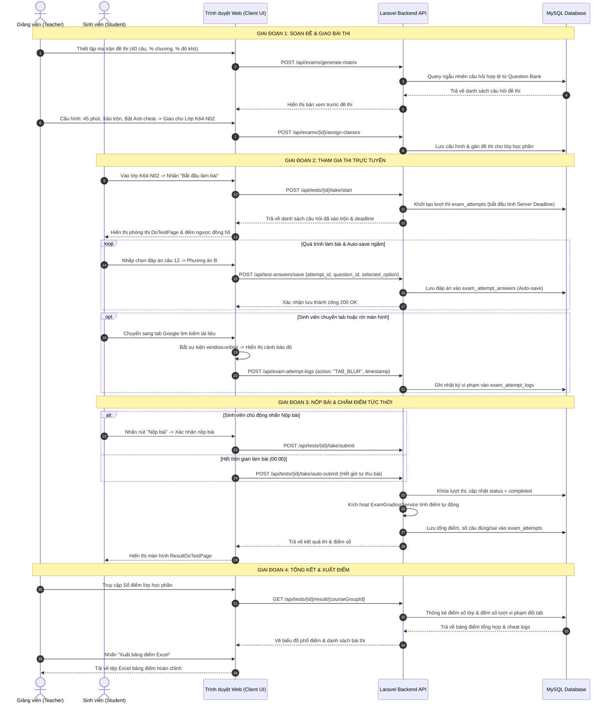

# CẨM NANG HƯỚNG DẪN SỬ DỤNG TOÀN DIỆN HỆ THỐNG KHẢO THÍ TRỰC TUYẾN VINACLASS
## TÀI LIỆU VẬN HÀNH DÀNH CHO QUẢN TRỊ VIÊN, GIẢNG VIÊN VÀ HỌC SINH / SINH VIÊN

---

> **Mã tài liệu:** HDSD-VC-2026-v2.0  
> **Dự án:** Hệ thống Quản lý Khảo thí & Thi Trắc nghiệm Trực tuyến VinaClass  
> **Đơn vị phát triển:** Nhóm 18 (Quy, Ân, Huy, Châu, Đức)  
> **Công nghệ áp dụng:** React 18, Vite, TypeScript, Tailwind CSS, Laravel 11 PHP 8.2, MySQL 8.0, KaTeX, RESTful API  
> **Bộ hồ sơ tài liệu thành phần:**
> - [Hướng dẫn dành riêng cho Quản trị viên (Admin Guide)](file:///Users/macbook/Desktop/projects-src/vinaclass/docs/HDSD_ADMIN.md)
> - [Hướng dẫn dành riêng cho Giảng viên (Teacher Guide)](file:///Users/macbook/Desktop/projects-src/vinaclass/docs/HDSD_GIANG_VIEN.md)
> - [Hướng dẫn dành riêng cho Sinh viên (Student Guide)](file:///Users/macbook/Desktop/projects-src/vinaclass/docs/HDSD_SINH_VIEN.md)
> - [Tài liệu Đặc tả Sơ đồ Use Case](file:///Users/macbook/Desktop/projects-src/vinaclass/docs/SODO_USECASE.md)
> - [Tài liệu Đặc tả Sơ đồ Hoạt động (Activity Diagrams)](file:///Users/macbook/Desktop/projects-src/vinaclass/docs/SODO_ACTIVITY.md)
> - [Tài liệu Đặc tả Sơ đồ Tuần tự (Sequence Diagrams)](file:///Users/macbook/Desktop/projects-src/vinaclass/docs/SODO_SEQUENCE.md)
> - [Sổ tay Phân tích Nghiệp vụ & Đối chiếu Toàn bộ Mã nguồn](file:///Users/macbook/Desktop/projects-src/vinaclass/outputs/Phan_Tich_Nghiep_Vu_He_Thong_Thi_Trac_Nghiem_VinaClass.md)
> - [Workbook Excel 8 Sheet phân tích & Sơ đồ PBS/TBS](file:///Users/macbook/Desktop/projects-src/vinaclass/outputs/Nhom_18_QuanLyThiTracNghiem_PhanTichNghiepVu_MaNguon.xlsx)

---

## MỤC LỤC TỔNG THỂ

1. [Tổng quan Kiến trúc & Quy trình Nghiệp vụ Khảo thí VinaClass](#1-tổng-quan-kiến-trúc--quy-trình-nghiệp-vụ-khảo-thí-vinaclass)
2. [Ma trận Phân quyền & Ma trận Chức năng theo 3 Vai trò](#2-ma-trận-phân-quyền--ma-trận-chức-năng-theo-3-vai-trò)
3. [Tóm tắt Cẩm nang Vận hành dành cho Quản trị viên (Admin)](#3-tóm-tắt-cẩm-nang-vận-hành-dành-cho-quản-trị-viên-admin)
4. [Tóm tắt Cẩm nang Vận hành dành cho Giảng viên (Teacher)](#4-tóm-tắt-cẩm-nang-vận-hành-dành-cho-giảng-viên-teacher)
5. [Tóm tắt Cẩm nang Vận hành dành cho Học sinh / Sinh viên (Student)](#5-tóm-tắt-cẩm-nang-vận-hành-dành-cho-học-sinh--sinh-viên-student)
6. [Luồng Tương tác Khảo thí Toàn trình (End-to-End Exam Workflow)](#6-luồng-tương-tác-khảo-thí-toàn-trình-end-to-end-exam-workflow)
7. [Các Cơ chế Kỹ thuật Cốt lõi & Đảm bảo An toàn Khảo thí](#7-các-cơ-chế-kỹ-thuật-cốt-lõi--đảm-bảo-an-toàn-khảo-thí)

---

## 1. TỔNG QUAN KIẾN TRÚC & QUY TRÌNH NGHIỆP VỤ KHẢO THÍ VINACLASS

Hệ thống Khảo thí VinaClass được xây dựng nhằm cung cấp giải pháp toàn diện cho công tác chuyển đổi số trong giáo dục và khảo thí trắc nghiệm. Hệ thống chuẩn hóa chu trình khép kín từ khâu quản lý danh mục, phân công giảng dạy, biên soạn ngân hàng câu hỏi, tạo lập ma trận đề thi, tổ chức phòng thi trực tuyến chống gian lận đến chấm điểm tự động và xuất báo cáo điểm số.

```
+----------------------------------------------------------------------------------------------------+
|                                    SƠ ĐỒ CHU TRÌNH KHẢO THÍ KHÉP KÍN                               |
+----------------------------------------------------------------------------------------------------+
                                                                                                    
 [QUẢN TRỊ VIÊN]                [GIẢNG VIÊN]                                  [SINH VIÊN]           
        |                              |                                           |                
        |--- 1. Cấu hình Danh mục ---->|                                           |                
        |    (Môn học, Chương, Độ khó) |                                           |                
        |                              |                                           |                
        |--- 2. Phân công Môn học ---->|                                           |                
        |    (Teacher Assignments)     |                                           |                
        |                              |--- 3. Khởi tạo Lớp học & cấp Mã mời ----->|                
        |                              |    (Invite Code / Roster Import)          |                
        |                              |                                           |                
        |                              |--- 4. Soạn Ngân hàng Câu hỏi (KaTeX)      |                
        |                              |    (Private / Public / Clone)             |                
        |                              |                                           |                
        |                              |--- 5. Soạn Đề thi (Ma trận % / Thủ công)  |                
        |                              |    (Cấu hình thời lượng, Xáo trộn, Anti)  |                
        |                              |                                           |                
        |                              |--- 6. Giao Đề thi cho Lớp học phần ------>|                
        |                              |                                           |                
        |                              |                          7. Vào phòng thi trực tuyến       
        |                              |                             - Đếm ngược Server deadline    
        |                              |                             - Auto-save ngầm từng câu      
        |                              |                             - Giám sát vi phạm đổi tab     
        |                              |                                           |                
        |                              |<-- 8. Nộp bài (Chủ động / Tự động thu) ---|                
        |                              |                                           |                
        |                              |--- 9. Chấm thi tự động, xem Nhật ký vi phạm, Xuất Excel    
        v                              v                                           v                
```

---

## 2. MA TRẬN PHÂN QUYỀN & MA TRẬN CHỨC NĂNG THEO 3 VAI TRÒ

| Phân hệ chức năng | Chức năng chi tiết | Quản trị viên (Admin) | Giảng viên (Teacher) | Sinh viên (Student) | Mã nguồn điều khiển |
| :--- | :--- | :---: | :---: | :---: | :--- |
| **Xác thực & Danh tính** | Đăng nhập credentials & Google OAuth | ✔ | ✔ | ✔ | `AuthController.php`, `LoginPage.tsx` |
| | Đăng ký tài khoản mới kèm OTP 6 số | - | - | ✔ | `AuthOtpService.php`, `RegisterPage.tsx` |
| | Quên mật khẩu & Reset qua OTP | ✔ | ✔ | ✔ | `ForgotPasswordPage.tsx` |
| | Quản lý Profile & Đổi mật khẩu | ✔ | ✔ | ✔ | `ProfilePage.tsx` |
| | Giám sát phiên đăng nhập đa thiết bị | ✔ | ✔ | ✔ | `auth_sessions`, `ProfilePage.tsx` |
| **Quản trị Người dùng** | Xem danh sách & Lọc người dùng | ✔ | - | - | `UserController.php`, `UserPage.tsx` |
| | Thêm mới người dùng thủ công | ✔ | - | - | `UserDialog.tsx` |
| | Khóa / Mở khóa tài khoản | ✔ | - | - | `UserStatusDialog.tsx` |
| | Reset mật khẩu người dùng | ✔ | - | - | `UserPasswordChangeDialog.tsx` |
| **Phân quyền RBAC v2** | Quản lý Nhóm quyền (Roles) | ✔ | - | - | `RoleController.php`, `PermissionGroupPage.tsx` |
| | Ma trận quyền nguyên tử 2 chiều | ✔ | - | - | `PermissionAdministrationController.php` |
| | Ghi đè quyền cá nhân (Override) | ✔ | - | - | `PermissionMatrixV2Page.tsx` |
| **Danh mục Đào tạo** | Quản lý Môn học (Subjects) | ✔ | Chỉ xem | Chỉ xem | `SubjectController.php`, `SubjectPage.tsx` |
| | Quản lý Chương bài (Chapters) | ✔ | Chỉ xem | Chỉ xem | `ChapterController.php`, `ChapterPage.tsx` |
| | Quản lý Mức độ khó (Difficulties) | ✔ | Chỉ xem | - | `DifficultyController.php`, `DifficultyLevelPage.tsx` |
| **Phân công Giảng dạy** | Gán giảng viên phụ trách môn học | ✔ | Chỉ xem | - | `TeacherSubjectController.php`, `AssignmentPage.tsx` |
| **Lớp học phần (Classroom)** | Tạo lớp học phần mới | - | ✔ | - | `CourseGroupController.php`, `CourseGroupPage.tsx` |
| | Cấp & Reset Mã mời (Invite Code) | - | ✔ | - | `CourseGroupInviteCodePanel.tsx` |
| | Nhập mã mời để vào lớp | - | - | ✔ | `JoinClassForm.tsx` |
| | Quản lý Roster (Import Excel) | - | ✔ | - | `StudentRosterImportForm.tsx` |
| | Đăng bài bảng tin (Stream) | - | ✔ | Xem & Bình luận | `CourseGroupStreamTab.tsx` |
| | Upload & Tải tài liệu môn học | - | Upload/Xóa | Xem/Tải về | `CourseGroupMaterialController.php` |
| **Ngân hàng Câu hỏi** | Soạn câu hỏi KaTeX & Hình ảnh | - | ✔ (Môn phân công) | - | `QuestionController.php`, `QuestionEditorForm.tsx` |
| | Phân loại Private / Public | - | ✔ | - | `QuestionItem.tsx` |
| | Sao chép (Clone) câu hỏi | - | ✔ | - | `QuestionBankPage.tsx` |
| **Soạn & Cấu hình Đề** | Tạo đề thi thủ công | - | ✔ | - | `ExamController.php`, `AddQuestionTestPage.tsx` |
| | Tạo đề thi tự động theo ma trận | - | ✔ | - | `ExamConfigurationController.php` |
| | Cài đặt xáo trộn & Chống gian lận | - | ✔ | - | `ExamSettingsSidebar.tsx` |
| | Giao đề thi cho lớp học | - | ✔ | - | `TestCourseGroupAssignmentFields.tsx` |
| **Phòng thi Khảo thí** | Vào phòng thi & Bắt đầu làm bài | - | - | ✔ | `ExamAttemptStartService.php`, `DoTestPage.tsx` |
| | Đồng hồ đếm ngược Server deadline | - | - | ✔ | `DoTestPage.tsx` |
| | Auto-save ngầm từng câu trả lời | - | - | ✔ | `ExamAttemptAnswerController.php` |
| | Giám sát vi phạm đổi tab (TAB_BLUR)| - | - | Bị ghi nhận | `ExamAttemptLogController.php` |
| | Nộp bài (Chủ động / Tự động thu) | - | - | ✔ | `ExamAttemptController.php` |
| **Chấm thi & Điểm số** | Chấm điểm tự động tức thời | - | Hệ thống chạy | Hệ thống chạy | `ExamGradingService.php` |
| | Xem kết quả thi & Lời giải thích | - | ✔ | ✔ (Nếu cho phép)| `ResultDoTestPage.tsx` |
| | Xem chi tiết bài làm & Log vi phạm | - | ✔ | - | `TestDetailPage.tsx` |
| | Phân tích phổ điểm lớp học phần | - | ✔ | - | `ExamScoreDistributionChart.tsx` |
| | Xuất Bảng điểm lớp ra file Excel | - | ✔ | - | `CourseGroupGradebookTab.tsx` |
| **Báo cáo Quản trị** | Dashboard số liệu tổng quan KPI | ✔ | - | - | `DashboardController.php`, `AdminDashboardPage.tsx` |
| | Thống kê phân tích tăng trưởng | ✔ | - | - | `AdminStatisticsPage.tsx` |

---

## 3. TÓM TẮT CẨM NANG VẬN HÀNH DÀNH CHO QUẢN TRỊ VIÊN (ADMIN)

> *Xem chi tiết đầy đủ tại:* [HDSD_ADMIN.md](file:///Users/macbook/Desktop/projects-src/vinaclass/docs/HDSD_ADMIN.md)

1. **Đăng nhập & Giám sát Dashboard (`/admin/dashboard`):**
   - Theo dõi 4 chỉ số KPI: Tổng Người dùng (phân bổ SV, GV, QTV), Tổng Môn học, Số Lớp học phần đang mở, và Lượt thi nộp bài.
   - Kiểm tra đồ thị phân bố lượt làm bài theo mốc thời gian để chuẩn bị tài nguyên máy chủ vào các đợt thi tập trung.
2. **Quản trị Tài khoản Người dùng (`/users`):**
   - Lọc theo Vai trò (Admin, Teacher, Student) và Trạng thái (Active/Locked).
   - Thêm tài khoản thủ công hoặc Đặt lại mật khẩu (Reset Password) hỗ trợ người dùng khi không nhận được mã xác thực.
   - Khóa tức thời các tài khoản có hành vi bất thường, thu hồi token đăng nhập.
3. **Quản trị Phân quyền RBAC v2 (`/permission-matrix`):**
   - Thiết lập ma trận quyền 2 chiều giữa Vai trò và Hành động nguyên tử (`VIEW`, `CREATE`, `UPDATE`, `DELETE`, `EXPORT`, `MANAGE`).
   - Cung cấp tính năng gán quyền ghi đè (Personal Permission Override) cho các cá nhân đặc thù mà không cần sửa vai trò gốc.
4. **Quản lý Danh mục Học thuật (`/catalogs`):**
   - Khởi tạo cây danh mục chuẩn: Môn học (Subjects) -> Chương bài học (Chapters) -> Mức độ khó (Difficulty Levels).
5. **Phân công Giảng dạy (`/assignments`):**
   - Gán Giảng viên phụ trách Môn học theo học kỳ.
   - Đảm bảo tính toàn vẹn: Chỉ giảng viên được phân công mới có quyền tạo ngân hàng câu hỏi, soạn đề và mở lớp học phần cho môn học đó.

---

## 4. TÓM TẮT CẨM NANG VẬN HÀNH DÀNH CHO GIẢNG VIÊN (TEACHER)

> *Xem chi tiết đầy đủ tại:* [HDSD_GIANG_VIEN.md](file:///Users/macbook/Desktop/projects-src/vinaclass/docs/HDSD_GIANG_VIEN.md)

1. **Quản lý Lớp học phần (`/courses`):**
   - Tạo lớp học phần mới theo môn học được phân công.
   - Nhận Mã mời (Invite Code 8 ký tự), chia sẻ cho sinh viên; chủ động Reset mã mời khi cần bảo mật.
   - Đăng thông báo lên Bảng tin (Stream) và tải lên Học liệu tài liệu môn học (PDF, PPTX, DOCX, ZIP).
2. **Quản lý Danh sách Sinh viên (Class Roster):**
   - Thêm sinh viên lẻ bằng Email / MSSV.
   - Import hàng loạt sinh viên qua tệp Excel mẫu chuẩn hóa, kiểm tra lỗi hợp lệ tự động trước khi ghi danh.
   - Xuất danh sách lớp ra file Excel phục vụ điểm danh.
3. **Quản lý Ngân hàng Câu hỏi Trắc nghiệm (`/question`):**
   - Soạn câu hỏi với Trình soạn thảo văn bản phong phú (Rich Text).
   - Hỗ trợ công thức Toán học / Lý / Hóa với cú pháp KaTeX (`$...$` và `$$...$$`), xem trước thời gian thực (Live Preview).
   - Tải lên hình ảnh minh họa cho câu hỏi.
   - Thiết lập 4 đáp án A/B/C/D, đánh dấu đáp án đúng, nhập Lời giải thích chi tiết (Explanation).
   - Phân loại Kho riêng (Private) hoặc Kho dùng chung của bộ môn (Public); Sao chép (Clone) câu hỏi từ kho chung về kho riêng.
4. **Soạn & Cấu hình Đề thi (`/exams`):**
   - **Tạo đề thủ công:** Chọn trực tiếp từng câu hỏi từ ngân hàng câu hỏi.
   - **Tạo đề tự động theo Ma trận tỷ lệ %:** Thiết lập tổng số câu (vd: 40 câu), ma trận % theo từng Chương và ma trận % theo từng Độ khó. Thuật toán tự động quét và bốc ngẫu nhiên câu hỏi hợp lệ.
   - Cài đặt thời lượng thi, thời gian mở/đóng đề, xáo trộn thứ tự câu hỏi và đáp án, số lần làm bài tối đa.
   - Kích hoạt tính năng **Giám sát vi phạm chuyển tab (Anti-cheating Monitoring)**.
   - Giao đề thi vào một hoặc nhiều lớp học phần.
5. **Giám sát Thi & Báo cáo Điểm số:**
   - Theo dõi tiến độ sinh viên làm bài thi trong thời gian thực.
   - Kiểm tra **Nhật ký Vi phạm đổi tab (Cheat Logs)**: Số lần rời màn hình thi (`TAB_BLUR`), mốc thời gian vi phạm.
   - Xem chi tiết bài thi của từng sinh viên (đáp án chọn, đúng/sai, điểm số).
   - Phân tích biểu đồ phổ điểm lớp học phần (điểm trung bình, max, min, tỷ lệ đạt).
   - Xuất Bảng điểm lớp ra tệp Excel chuẩn.

---

## 5. TÓM TẮT CẨM NANG VẬN HÀNH DÀNH CHO HỌC SINH / SINH VIÊN (STUDENT)

> *Xem chi tiết đầy đủ tại:* [HDSD_SINH_VIEN.md](file:///Users/macbook/Desktop/projects-src/vinaclass/docs/HDSD_SINH_VIEN.md)

1. **Đăng ký & Đăng nhập:**
   - Đăng ký tài khoản mới: Điền họ tên, email, nhận mã OTP 6 số qua email xác thực (hiệu lực 60s).
   - Đăng nhập bằng Email/Mật khẩu hoặc Đăng nhập nhanh với Google OAuth.
   - Khôi phục mật khẩu qua mã OTP gửi về email khi bị quên.
2. **Tham gia Lớp học phần & Tải Học liệu:**
   - Nhấn "Tham gia lớp học", nhập Mã mời (Invite Code 8 ký tự) do Giảng viên cung cấp.
   - Đọc thông báo trên Bảng tin lớp; tải về giáo trình, slide bài học do Giảng viên chia sẻ.
3. **Quy trình Khảo thí Trực tuyến (`DoTestPage`):**
   - Chuẩn bị máy tính (PC/Laptop), mạng ổn định, trình duyệt Chrome/Edge, đóng toàn bộ tab và ứng dụng nhắn tin.
   - Vào bài thi, đọc quy chế và nhấn **Bắt đầu làm bài**.
   - **Đồng hồ đếm ngược:** Đếm lùi thời gian được đồng bộ chính xác với deadline trên máy chủ (Server Time).
   - **Bảng điều hướng câu hỏi:** Nhận biết câu chưa làm (xám), câu đã làm (xanh dương), nút cờ đỏ Đánh dấu xem lại.
   - **Lưu ý chống gian lận:** Nghiêm cấm mở tab mới, thu nhỏ cửa sổ hoặc chuyển ứng dụng. Mọi lần rời màn hình đều bị hệ thống phát cảnh báo và ghi nhận 1 lần vi phạm (`TAB_BLUR`) gửi cho giảng viên.
   - **Cơ chế Tự động lưu đáp án ngầm (Auto-Save):** Mỗi lượt nhấp chọn đáp án đều được lưu ngầm tức thì lên máy chủ. Nếu mất điện hoặc rớt mạng, bài làm vẫn được bảo toàn nguyên vẹn.
   - **Nộp bài:** Nhấn "Nộp bài", kiểm tra số câu chưa làm và xác nhận nộp; hoặc hệ thống sẽ **Tự động thu bài khi hết giờ (00:00)**.
4. **Xem Điểm & Lời giải thích:**
   - Nhận điểm số và số câu đúng/sai ngay sau khi nộp (nếu đề thi cho phép công bố).
   - Xem lại bài làm và đọc Lời giải thích chi tiết của từng câu hỏi để ôn tập.

---

## 6. LUỒNG TƯƠNG TÁC KHẢO THÍ TOÀN TRÌNH (END-TO-END EXAM WORKFLOW)

Sơ đồ tuần tự thể hiện sự phối hợp nhịp nhàng giữa Giảng viên, Sinh viên, Giao diện Client và Máy chủ Server VinaClass:



---

## 7. CÁC CƠ CHẾ KỸ THUẬT CỐT LÕI & ĐẢM BẢO AN TOÀN KHẢO THÍ

### 7.1. Cơ chế Đồng bộ Thời gian Máy chủ (Server Deadline Synchronization)
- Để ngăn chặn việc sinh viên chỉnh giờ trên máy tính để kéo dài thời gian làm bài:
  - Khi bắt đầu làm bài, máy chủ tính toán thời điểm kết thúc tuyệt đối: `deadline = start_time + duration_minutes`.
  - Mọi yêu cầu lưu đáp án hoặc nộp bài gửi lên đều được máy chủ đối chiếu trực tiếp với `deadline`. Nếu `current_server_time > deadline + tolerance_grace_period`, máy chủ sẽ từ chối nhận câu trả lời bổ sung và cưỡng chế kết thúc bài thi.

### 7.2. Cơ chế Lưu ngầm Bất đồng bộ (Optimistic Auto-save Engine)
- Giao diện người dùng áp dụng kỹ thuật lưu đáp án bất đồng bộ với cơ chế thử lại (Retry with exponential backoff). Khi sinh viên chọn đáp án, giao diện phản hồi trạng thái chọn tức thì (`< 16ms`), đồng thời một tiến trình ngầm gửi yêu cầu `HTTP POST` đến máy chủ. Nếu mạng bị chập chờn, yêu cầu được đưa vào hàng đợi cục bộ và tự động đồng bộ lại ngay khi kết nối mạng được phục hồi.

### 7.3. Cơ chế Khóa Giao dịch (Concurrency Lock)
- Tại Backend, các thao tác bắt đầu bài thi và nộp bài thi được bọc trong giao dịch cơ sở dữ liệu với kỹ thuật `lockForUpdate()`. Cơ chế này ngăn chặn tuyệt đối tình trạng một sinh viên nhấn nộp bài nhiều lần cùng lúc (Double Submission Race Condition) gây sai lệch dữ liệu điểm số.

---
*Tài liệu được biên soạn và chuẩn hóa bởi Nhóm 18 - Dự án Khảo thí Trực tuyến VinaClass.*

