# TÀI LIỆU PHÂN TÍCH NGHIỆP VỤ HỆ THỐNG QUẢN LÝ & THI TRẮC NGHIỆM TRỰC TUYẾN (VINACLASS)

> **Dự án:** VinaClass - Hệ thống Quản lý Lớp học phần & Tổ chức Khảo thí Trắc nghiệm Trực tuyến  
> **Phiên bản rà soát:** v2.0 (Kiến trúc chuẩn hóa Backend Laravel RESTful API + Frontend React 18 SPA)  
> **Thời điểm hoàn thiện:** 30/10/2026  
> **Tệp đính kèm Excel:** [`outputs/Phan_Tich_Nghiep_Vu_He_Thong_Thi_Trac_Nghiem_VinaClass.xlsx`](file:///Users/macbook/Desktop/projects-src/vinaclass/outputs/Phan_Tich_Nghiep_Vu_He_Thong_Thi_Trac_Nghiem_VinaClass.xlsx)

---

## 1. TỔNG QUAN HỆ THỐNG VÀ MỤC TIÊU BÀI TOÁN

### 1.1 Bối cảnh và Mục tiêu
Hệ thống **VinaClass** được thiết kế nhằm số hóa và tối ưu hóa toàn bộ chu trình đào tạo và kiểm tra đánh giá trong nhà trường:
1. **Quản lý học phần theo lớp học (Classroom Hub):** Kết hợp mô hình tương tự Google Classroom, cho phép giảng viên quản trị lớp học phần, chia sẻ tài liệu bài giảng, đăng thông báo và phân công bài thi.
2. **Khảo thí trắc nghiệm trực tuyến tập trung:** Tự động hóa toàn bộ các khâu từ quản trị ngân hàng câu hỏi, soạn thảo đề thi (thủ công và tự động theo ma trận lọc), xáo trộn câu hỏi/đáp án, giám sát quá trình làm bài chống gian lận, đến chấm điểm tự động tức thời và tổng hợp báo cáo phổ điểm.
3. **Phân quyền bảo mật đa tầng (RBAC v2):** Phân định rạch ròi 3 nhóm tác nhân chính (Admin, Giảng viên, Sinh viên) kèm cơ chế thiết lập ngoại lệ quyền cho từng cá nhân (Permission Overrides).

### 1.2 Kiến trúc Kỹ thuật Tổng thể
- **Backend:** Laravel 8/9+ RESTful API, áp dụng **Service Layer Pattern** (với hơn 50+ service chuyên trách), Eloquent ORM, Database Transactions bảo toàn dữ liệu, Policy/Gate Authorization, JWT Authentication kết hợp Stateful Session (`auth_sessions`) và OTP qua Email.
- **Frontend:** React 18, TypeScript Strict Mode, Vite Dev Server, **Atomic Design** kết hợp **Feature-Based Architecture**, Ant Design 5, Tailwind CSS, Zustand Store (quản lý UI State & Session thi) và TanStack Query (caching API ngầm).
- **Database:** MySQL 8 với hơn 30 bảng quan hệ chặt chẽ, tối ưu index, foreign key cascade/restrict và cơ chế khóa bi quan (`lockForUpdate`) chống tranh chấp dữ liệu khi thi.

---

## 2. PHÂN TÍCH ĐỐI TƯỢNG VÀ VAI TRÒ SỬ DỤNG (ACTORS & ROLES)

| Tác nhân (Actor) | Mã vai trò | Trách nhiệm và Quyền hạn nghiệp vụ | Phạm vi dữ liệu truy cập (Scope) |
| :--- | :---: | :--- | :--- |
| **Quản trị viên** *(Admin)* | `ADMIN` | Quản trị người dùng (thêm, khóa/mở khóa tài khoản, đổi mật khẩu); Cấu hình ma trận phân quyền hệ thống; Quản lý danh mục Môn học, Mức độ khó câu hỏi; Phân công môn học cho giảng viên; Giám sát toàn bộ KPI và báo cáo phổ điểm toàn trường. | Toàn quyền trên toàn hệ thống (không bị giới hạn bởi quyền sở hữu hay phạm vi lớp). |
| **Giảng viên** *(Teacher)* | `TEACHER` | Quản lý ngân hàng câu hỏi cá nhân và khai thác câu hỏi công khai; Tạo và cấu hình đề thi (thủ công hoặc theo ma trận lọc); Tạo lớp học phần cho các môn được phân công; Quản lý thành viên lớp qua mã mời (Invite Code) hoặc Excel; Giao bài thi cho lớp; Giám sát kết quả thi và xuất bảng điểm. | Giới hạn trong các môn học được Admin phân công (`teacher_subjects`), các câu hỏi, đề thi và lớp học phần do mình tạo/phụ trách. |
| **Sinh viên** *(Student)* | `STUDENT` | Đăng ký tài khoản với xác thực OTP qua Email; Tham gia lớp học bằng mã mời; Xem tài liệu và thông báo bài giảng; Xem danh sách đề thi được giao; Làm bài thi trực tuyến với đồng hồ đếm ngược và cảnh báo chống gian lận; Nộp bài và xem lại kết quả/giải thích chi tiết. | Chỉ truy cập được các lớp mình tham gia, các đề thi giao cho lớp đó, và bài làm của chính mình. |

---

## 3. CÁC QUY TẮC NGHIỆP VỤ CỐT LÕI (CORE BUSINESS RULES)

1. **BR-01 (Ràng buộc phân công môn học):** Giảng viên chỉ được phép tạo lớp học phần, soạn câu hỏi và tạo đề thi cho những môn học đã được Admin phân công thông qua bảng `teacher_subjects`.
2. **BR-02 (Điều kiện tham gia dự thi):** Sinh viên chỉ được vào thi khi: Tài khoản đang hoạt động (`is_locked = 0`), là thành viên hợp lệ của lớp được giao đề, thời điểm hiện tại nằm trong khung giờ mở đề (`start_time <= now <= end_time`), và chưa sử dụng hết số lần thi cho phép.
3. **BR-03 (Tính hạn chót làm bài - Effective Deadline):** Hạn chót nộp bài (`deadline_at`) được chốt tại thời điểm bắt đầu thi:  
   $$\text{deadline\_at} = \min(\text{now} + \text{duration\_minutes}, \text{exam.end\_time}, \text{assignment.end\_time})$$
4. **BR-04 (Cơ chế tiếp tục làm bài - Resume):** Nếu thí sinh bị mất kết nối mạng hoặc đóng trình duyệt đột ngột trong khi chưa hết thời gian làm bài và đề thi có bật `is_enable_resume`, thí sinh có thể vào lại để làm tiếp mà không bị mất các câu trả lời đã lưu.
5. **BR-05 (Giám sát chống gian lận - Proctoring):** Bắt sự kiện rời màn hình làm bài (`TAB_BLUR`), thoát chế độ toàn màn hình (`FULLSCREEN_EXIT`), tự động ghi vào `exam_attempt_logs` và cảnh báo thí sinh. Có thể cấu hình tự động cưỡng chế thu bài nếu vi phạm quá số lần quy định.
6. **BR-06 (Thuật toán đảo đề - Shuffling):** Hỗ trợ xáo trộn ngẫu nhiên thứ tự câu hỏi và thứ tự các phương án lựa chọn (A, B, C, D) cho từng thí sinh nhưng vẫn duy trì mapping chính xác với ID của phương án đúng.
7. **BR-07 (Chấm điểm tự động):** Chấm điểm tự động trong database transaction ngay khi nộp bài:  
   $$\text{Điểm} = \left(\frac{\text{Số câu đúng}}{\text{Tổng số câu}}\right) \times 10$$
8. **BR-08 (Phân quyền RBAC đa cấp):** Mỗi quyền là một cặp `(function, action)`. Quyền cá nhân (`permission_details`) có thể ghi đè quyền của Role; Trong đó quy tắc cấm (`DENY`) luôn ưu tiên cao hơn quy tắc cấp (`GRANT`).
9. **BR-09 (Xác thực OTP & Quản lý phiên):** Đăng ký và quên mật khẩu bắt buộc phải xác thực mã OTP 6 chữ số gửi qua email (hạn 5 phút, giới hạn 5 lần thử). Mọi phiên đăng nhập đều được lưu vết trong `auth_sessions` và có thể thu hồi từ xa.
10. **BR-10 (Bảo vệ quyền sở hữu câu hỏi):** Câu hỏi riêng tư (`is_public = 0`) chỉ giảng viên tạo mới có quyền sửa/xóa/đưa vào đề; Câu hỏi công khai (`is_public = 1`) cho phép các giảng viên khác xem và nhân bản (`copyFromPublic`) về kho riêng.

---

## 4. TÓM TẮT 8 PHÂN HỆ NGHIỆP VỤ CHÍNH VÀ CÁC USE CASES

1. **Phân hệ 1 - Xác thực & Hồ sơ cá nhân (Auth & Identity):** Đăng nhập credentials, Google OAuth, Đăng ký OTP, Quên mật khẩu OTP, Đăng xuất hủy session, Xem và cập nhật Profile đa đối tượng, Đổi mật khẩu.
2. **Phân hệ 2 - Phân quyền & Quản trị Hệ thống (RBAC & System):** Quản lý danh sách người dùng, Khóa/Mở khóa tài khoản, Admin Reset Password, Quản lý Vai trò (Roles), Ma trận phân quyền Role Matrix, Cấu hình ngoại lệ phân quyền User Overrides, Dựng Menu điều hướng động.
3. **Phân hệ 3 - Danh mục Đào tạo (Catalogs):** Quản lý Môn học (Subjects CRUD), Quản lý Chương bài học (Chapters), Quản lý Thang độ khó (Difficulty Levels), Phân công giảng viên giảng dạy (Teacher Assignments).
4. **Phân hệ 4 - Ngân hàng Câu hỏi (Question Bank):** Lọc và tìm kiếm câu hỏi đa tiêu chí, Thêm câu hỏi Rich Text/LaTeX kèm các phương án trả lời, Sửa/Xóa câu hỏi, Sao chép câu hỏi công khai vào kho cá nhân.
5. **Phân hệ 5 - Quản lý Đề thi (Exams & Test Config):** Soạn đề thi thủ công, Tạo đề thi tự động theo ma trận lọc (tỷ lệ chương và độ khó), Thiết lập cấu hình phòng thi (đảo đề, xem điểm, xem đáp án, cảnh báo tab), Giao đề thi cho lớp học phần.
6. **Phân hệ 6 - Quản lý Lớp học phần (Classrooms / Course Groups):** Tạo lớp học phần & sinh mã mời (Invite Code), Sinh viên tham gia lớp bằng mã mời, Quản lý danh sách sinh viên lớp, Nhập/Xuất danh sách sinh viên qua Excel, Quản lý tài liệu bài giảng (upload/download), Bảng tin thông báo lớp học.
7. **Phân hệ 7 - Khảo thí Trực tuyến (Assessments & Proctoring):** Danh sách bài thi của sinh viên, Màn hình quy chế thi, Bắt đầu làm bài thi (sinh attempt, khóa bi quan, tính deadline), Tự động lưu đáp án ngầm (Live Auto-save), Bắt sự kiện vi phạm chuyển tab ghi log, Nộp bài thi và chấm điểm tức thời, Xem kết quả thi và lời giải chi tiết.
8. **Phân hệ 8 - Đánh giá, Báo cáo & Dashboard:** Bảng điểm tổng hợp lớp học phần, Xuất báo cáo điểm ra Excel, Admin Dashboard tổng quan KPI toàn trường, Biểu đồ thống kê phổ điểm và tiến độ học tập.

---

## 5. CẤU TRÚC TỆP EXCEL ĐÍNH KÈM

File Excel phân tích nghiệp vụ chi tiết đã được khởi tạo tại:  
[`outputs/Phan_Tich_Nghiep_Vu_He_Thong_Thi_Trac_Nghiem_VinaClass.xlsx`](file:///Users/macbook/Desktop/projects-src/vinaclass/outputs/Phan_Tich_Nghiep_Vu_He_Thong_Thi_Trac_Nghiem_VinaClass.xlsx)  
Bao gồm 8 Sheet được định dạng bảng chuẩn, màu sắc chuyên nghiệp và tự động căn chỉnh độ rộng cột:
- **Sheet 1: `TongQuan_NghiepVu`** - Tổng quan bài toán, mục tiêu, kiến trúc giải pháp, 3 vai trò người dùng và 10 quy tắc nghiệp vụ cốt lõi.
- **Sheet 2: `MaTran_ChucNang_UseCases`** - Bảng kê chi tiết 47 Use Case hoàn chỉnh với đầy đủ Input/Output, Màn hình giao diện, API Endpoint và đánh giá trạng thái hoàn thiện.
- **Sheet 3: `QuyTrinh_Workflows`** - Phân tích chi tiết từng bước cho 6 luồng quy trình cốt lõi (Xác thực OTP, Phân công môn/lớp, Ngân hàng câu hỏi, Soạn & giao đề thi, Làm bài & giám sát thi, Chấm điểm & phúc khảo).
- **Sheet 4: `TuDien_CoSoDuLieu`** - Từ điển dữ liệu toàn bộ hơn 30 bảng trong database (Tên bảng, tên trường, kiểu dữ liệu, khóa chính/ngoại, null, ý nghĩa nghiệp vụ và ràng buộc).
- **Sheet 5: `MaTran_PhanQuyen_RBAC`** - Ma trận phân quyền chi tiết giữa ADMIN, TEACHER, STUDENT trên từng chức năng và hành động nguyên tử.
- **Sheet 6: `DanhSach_API_Endpoints`** - Danh mục đầy đủ hơn 65+ API endpoints của backend với HTTP Method, URL, middleware bảo vệ, controller thực thi và payload mẫu.
- **Sheet 7: `GiaoDien_UI_Mapping`** - Ánh xạ toàn bộ cấu trúc Frontend: Route, Component, Layout, Role được phép truy cập, Zustand Store và React Query Hook.
- **Sheet 8: `DanhGia_KhoangTrong_KienNghi`** - Báo cáo rà soát toàn diện mã nguồn: Điểm mạnh kiến trúc, nợ kỹ thuật và các kiến nghị tối ưu hóa hiệu năng/bảo mật.

---

## 6. DANH MỤC CÔNG VIỆC DỰ ÁN CHI TIẾT (WORK BREAKDOWN & PROJECT MANAGEMENT)

Hệ thống quản lý dự án Nhóm 18 được số hóa đồng bộ tại tệp Excel chuẩn:  
[`outputs/Nhom_18_QuanLyThiTracNghiem_PhanTichNghiepVu_MaNguon.xlsx`](file:///Users/macbook/Desktop/projects-src/vinaclass/outputs/Nhom_18_QuanLyThiTracNghiem_PhanTichNghiepVu_MaNguon.xlsx)

Toàn bộ các công việc đã được phân rã chi tiết thành **39 gói công việc kỹ thuật** (thay thế cho các tên gọi chung chung như "Thiết kế UI", "Lập trình frontend", "Lập trình backend"), bám sát trực tiếp vào cấu trúc mã nguồn thực tế của dự án:

### 6.1 Giai đoạn 1: Xác định dự án (Project Initiation)
1. **1.1 Khảo sát hiện trạng & thực trạng bài toán khảo thí trực tuyến:** Khảo sát quy trình thi trắc nghiệm truyền thống; xác định nhu cầu số hóa quy trình kiểm tra và tự động chấm điểm. *(Phụ trách: Trần Thanh Quy - Leader)*
2. **1.2 Xác định phạm vi nghiệp vụ và ràng buộc kỹ thuật hệ thống:** Xác định 4 nhóm đối tượng (Admin, GV, SV, Khách), 8 phân hệ cốt lõi và ràng buộc SPA React 18 + RESTful Laravel 10 + MySQL. *(Phụ trách: Trần Thanh Quy)*
3. **1.3 Dự toán kinh phí và kế hoạch phân bổ nguồn lực Nhóm 18:** Dự toán ngân sách 3.500.000 VNĐ; lập bảng ma trận trách nhiệm RACI phân công 5 thành viên Nhóm 18. *(Phụ trách: Trần Thanh Quy, Khưu Minh Đức)*

### 6.2 Giai đoạn 2: Phân tích yêu cầu (Requirements Analysis)
4. **2.1 Thu thập nhu cầu người dùng theo 3 vai trò (Sinh viên, Giảng viên, Quản trị viên):** Phỏng vấn nhu cầu: SV cần làm bài mượt mà; GV cần soạn đề ma trận; QTV cần phân quyền linh hoạt. *(Phụ trách: Nguyễn Ngọc Thiên Ân)*
5. **2.2 Phân tích yêu cầu phi chức năng: OTP email, kiểm soát phiên, chống gian lận tab:** NFR response time < 500ms; OTP 6 số hết hạn 5 phút; bắt sự kiện TAB_BLUR và FULLSCREEN_EXIT. *(Phụ trách: Lê Hữu Huy)*
6. **2.3 Phân tích đặc tả yêu cầu chức năng (SRS) theo 8 phân hệ cốt lõi:** Đặc tả chi tiết 409 chức năng phân cấp 4 tầng thuộc 4 nhóm nghiệp vụ chính tại sheet XacDinhDuAn. *(Phụ trách: Nguyễn Ngọc Thiên Ân)*
7. **2.4 Xây dựng đặc tả Use Case và mô hình hóa luồng nghiệp vụ (Sequence Diagram):** Sơ đồ Use Case tổng quát và Sequence Diagram luồng thi trực tuyến: lockForUpdate -> deadline_at -> nộp bài -> tự chấm. *(Phụ trách: Nguyễn Ngọc Thiên Ân)*

### 6.3 Giai đoạn 3: Thiết kế và phát triển (Design & Development)

#### 6.3.1 Thiết kế giao diện UI/UX chi tiết:
8. **3.1.1 Thiết kế giao diện Đăng ký / Đăng nhập OTP / Quên mật khẩu & Hồ sơ cá nhân:** Mockup `LoginPage`, `RegisterPage` (OTP đếm ngược 60s), `ForgotPasswordPage`, `ProfilePage` (quản lý phiên đăng nhập). *(Phụ trách: Nguyễn Ngọc Thiên Ân)*
9. **3.1.2 Thiết kế giao diện Quản trị viên (Người dùng, Ma trận quyền RBAC v2, Danh mục, Phân công):** Mockup `AdminDashboardPage`, `UserPage`, `PermissionMatrixPage` (Action nguyên tử), `SubjectPage`, `AssignmentPage`. *(Phụ trách: Nguyễn Ngọc Thiên Ân)*
10. **3.1.3 Thiết kế giao diện Giảng viên (Lớp học phần, Ngân hàng câu hỏi, Soạn và cấu hình đề thi):** Mockup `CourseGroupPage`, `CourseGroupStudentPage`, `QuestionBankPage` (hỗ trợ KaTeX), `TestFormPage`, `AddQuestionTestPage`. *(Phụ trách: Nguyễn Ngọc Thiên Ân)*
11. **3.1.4 Thiết kế giao diện Sinh viên & Phòng thi trực tuyến (Đếm ngược, Lưu ngầm, Cảnh báo tab, Bảng điểm):** Mockup `CoursePage`, `ExamInstruction`, `ExamDoing` (đồng hồ đếm ngược theo giây, auto-save, cảnh báo vi phạm), `ResultDoTestPage`. *(Phụ trách: Nguyễn Ngọc Thiên Ân)*

#### 6.3.2 Lập trình Frontend React 18 chi tiết:
12. **3.2.1 Lập trình Frontend Phân hệ Xác thực & Quản lý phiên (Auth, OTP, Google OAuth, Profile):** `LoginPage.tsx`, `RegisterPage.tsx`, `ForgotPasswordPage.tsx`, `ProfilePage.tsx`; Zustand `authStore`, Axios Interceptor tự động gắn Bearer Token và Role-based Route Guard. *(Phụ trách: Khưu Minh Đức)*
13. **3.2.2 Lập trình Frontend Phân hệ Quản trị hệ thống & Phân quyền RBAC v2:** `UserPage.tsx` (CRUD, khóa/mở tài khoản), `PermissionMatrixPage.tsx` (Action-based matrix), `SubjectPage.tsx`, `AssignmentPage.tsx`. *(Phụ trách: Khưu Minh Đức)*
14. **3.2.3 Lập trình Frontend Phân hệ Lớp học phần & Quản lý Roster (Import/Export Excel):** `CourseGroupPage.tsx`, `CourseGroupStudentPage.tsx`, `CourseElement.tsx`; import/export Excel danh sách sinh viên. *(Phụ trách: Khưu Minh Đức)*
15. **3.2.4 Lập trình Frontend Phân hệ Ngân hàng câu hỏi (Soạn thảo Rich Text & KaTeX công thức):** `QuestionBankPage.tsx`, KaTeX renderer, bộ lọc đa tiêu chí theo môn, chương, độ khó; kho cá nhân/dùng chung. *(Phụ trách: Khưu Minh Đức)*
16. **3.2.5 Lập trình Frontend Phân hệ Soạn đề thi & Cấu hình kiểm tra (Ma trận tỷ lệ, Đảo đề):** `TestFormPage.tsx`, `AddQuestionTestPage.tsx`, `TestDetailPage.tsx`; cấu hình đảo đề, chọn câu theo ma trận, giao đề cho lớp. *(Phụ trách: Khưu Minh Đức)*
17. **3.2.6 Lập trình Frontend Phân hệ Khảo thí trực tuyến (Live Auto-save, Đếm ngược, Chống gian lận tab):** `DoTestPage.tsx`, `ExamDoing.tsx`, `ResultDoTestPage.tsx`; auto-save debounce 500ms, visibilitychange listener, log vi phạm. *(Phụ trách: Khưu Minh Đức)*
18. **3.2.7 Lập trình Frontend Phân hệ Kết quả, Sổ điểm & Dashboard thống kê (Biểu đồ phổ điểm):** `ResultPage.tsx`, `AdminDashboardPage.tsx`, `AdminStatisticsPage.tsx`; hiển thị bảng điểm, phổ điểm, export Excel. *(Phụ trách: Khưu Minh Đức)*

#### 6.3.3 Lập trình Backend Laravel 10 chi tiết:
19. **3.3.1 Xây dựng Backend Xác thực OTP, Quản lý phiên đa thiết bị & Google OAuth:** `AuthController.php`; `AuthOtpService.php` (mã hóa bcrypt, hạn 5 phút, rate limit 5 lần/phút), `AuthSessionService.php` (quản lý `auth_sessions`), `GoogleOAuthService.php`. *(Phụ trách: Danh Thị Ngọc Châu)*
20. **3.3.2 Xây dựng RBAC v2, Phân quyền động theo Action nguyên tử & Chính sách truy cập (Policies):** `RoleController.php`, `PermissionAdministrationController.php`, `RolePermissionSynchronizer.php`; các bảng `roles`, `functions`, `permissions`, `permission_details`. *(Phụ trách: Danh Thị Ngọc Châu)*
21. **3.3.3 Xây dựng Backend Danh mục môn học, Chương & Phân công giảng dạy (Teacher Assignment):** `SubjectController.php`, `ChapterController.php`, `DifficultyController.php`, `TeacherSubjectController.php`. *(Phụ trách: Danh Thị Ngọc Châu)*
22. **3.3.4 Xây dựng Backend Lớp học phần, Mã mời tham gia (Invite Code) & Import/Export Excel Roster:** `CourseGroupController.php`; `CourseGroupRosterService.php` (Maatwebsite/Excel), `CourseGroupInvitationService.php`. *(Phụ trách: Danh Thị Ngọc Châu)*
23. **3.3.5 Xây dựng Backend Ngân hàng câu hỏi, Quản lý phương án đáp án & Phân loại độ khó:** `QuestionController.php`; `QuestionService.php`, `QuestionAnswerSynchronizer.php`, `AnswerOptionService.php`; tables `questions`, `answer_options`. *(Phụ trách: Danh Thị Ngọc Châu)*
24. **3.3.6 Xây dựng Backend Đề thi, Cấu hình kiểm tra & Thuật toán sinh đề theo ma trận tỷ lệ:** `ExamController.php`; `ExamCreationService.php`, `ExamQuestionSelectionService.php`, `ExamConfigurationService.php`; tables `exams`, `exam_configurations`. *(Phụ trách: Danh Thị Ngọc Châu)*
25. **3.3.7 Xây dựng Assessment Engine: Khóa bi quan (lockForUpdate), Tính Deadline, Tự chấm & Log vi phạm:** `ExamAttemptController.php`, `ExamAttemptLogController.php`; `ExamAttemptStartService.php` (lockForUpdate), `ExamAttemptSubmissionService.php`. *(Phụ trách: Danh Thị Ngọc Châu)*
26. **3.3.8 Xây dựng Backend Sổ điểm, Báo cáo phổ điểm & Dashboard thống kê (Export Excel):** `DashboardController.php`; `DashboardService.php`, `ExamAttemptReviewService.php`; tổng hợp phổ điểm, xuất Excel bảng điểm. *(Phụ trách: Danh Thị Ngọc Châu)*

### 6.4 Giai đoạn 4: Kiểm thử hệ thống (Testing & Quality Assurance)
27. **4.1 Lập kế hoạch kiểm thử tổng thể (Master Test Plan) theo 3 vai trò và 8 phân hệ:** Tài liệu Master Test Plan: xác định môi trường Staging, tiêu chí nghiệm thu Pass/Fail, phân công kiểm thử viên theo vai trò và ma trận rủi ro. *(Phụ trách: Lê Hữu Huy)*
28. **4.2 Xây dựng kịch bản kiểm thử (Test Cases) chi tiết cho Auth, OTP & RBAC v2:** Bộ 55 Test Cases chi tiết: kiểm tra validate dữ liệu OTP, giới hạn TTL 60s, brute-force rate limit và ma trận phân quyền 2 chiều nguyên tử. *(Phụ trách: Lê Hữu Huy)*
29. **4.3 Xây dựng kịch bản kiểm thử cho Ngân hàng câu hỏi, Soạn đề & Khảo thí:** Bộ 90 Test Cases cho Tạo đề ma trận, Đảo đề, Làm bài thi trực tuyến, Auto-save ngầm và Chấm điểm tự động. *(Phụ trách: Lê Hữu Huy)*
30. **4.4 Kiểm thử chức năng tích hợp hệ thống End-to-End (E2E Integration Test):** Kịch bản E2E hoàn chỉnh: Admin phân công môn -> GV tạo câu hỏi & đề thi -> SV vào làm bài -> Tự động chấm điểm & cập nhật sổ điểm. *(Phụ trách: Lê Hữu Huy, Nhóm 18)*
31. **4.5 Kiểm thử an toàn bảo mật, chống gian lận chuyển tab và tải đồng thời (Stress Test):** Penetration testing: chặn brute-force OTP qua Rate Limiting (5 lần/phút); kiểm tra ghi log TAB_BLUR khi thí sinh đổi cửa sổ; Stress test 200 thí sinh nộp bài đồng thời. *(Phụ trách: Danh Thị Ngọc Châu, Lê Hữu Huy)*
32. **4.6 Ghi nhận, phân loại và tái kiểm thử xử lý lỗi (Bug Tracking & Regression Test):** Danh mục Bug Tracking: sửa lỗi lệch múi giờ deadline_at, hoàn thiện validation import Excel, kiểm thử hồi quy xác nhận đã fix 100% bug nghiêm trọng. *(Phụ trách: Lê Hữu Huy)*

### 6.5 Giai đoạn 5: Triển khai và bảo trì (Deployment & Maintenance)
33. **5.1 Chuẩn bị môi trường máy chủ và hạ tầng triển khai (Linux, Nginx, PHP 8.2, MySQL 8.0):** Cấu hình VPS Linux Ubuntu, cài đặt Nginx reverse proxy, PHP 8.2-FPM, MySQL 8.0, SSL Let's Encrypt và cấu hình SMTP mail. *(Phụ trách: Lê Hữu Huy)*
34. **5.2 Thực hiện CSDL Migration, Seed dữ liệu mẫu ban đầu và chạy Smoke Test:** Chạy 42 migration CSDL, chạy DatabaseSeeder khởi tạo tài khoản mẫu và quyền RBAC; build production React bundle (`npm run build`). *(Phụ trách: Lê Hữu Huy)*
35. **5.3 Tổ chức kiểm thử chấp nhận người dùng (UAT) và Bàn giao hệ thống:** Kịch bản UAT với 30 sinh viên và 3 giảng viên tham gia làm bài thi thử nghiệm; ký biên bản nghiệm thu người dùng. *(Phụ trách: Trần Thanh Quy)*
36. **5.4 Biên soạn bộ tài liệu Hướng dẫn sử dụng theo 3 vai trò (SV, GV, QTV):** Bộ 3 cuốn sổ tay hướng dẫn: HDSD Sinh viên (tham gia lớp, làm bài thi), HDSD Giảng viên (soạn câu hỏi, tạo đề, xem điểm), HDSD Quản trị viên và tài liệu API kỹ thuật. *(Phụ trách: Trần Thanh Quy)*
37. **5.5 Thiết lập nhật ký giám sát hệ thống và cảnh báo sự cố vận hành (Logging & Monitoring):** Cấu hình Laravel Daily Log channel, Nginx log rotation, giám sát tài nguyên CPU/RAM server và ghi log ngoại lệ hệ thống. *(Phụ trách: Lê Hữu Huy)*
38. **5.6 Xây dựng quy trình sao lưu và phục hồi CSDL định kỳ (Backup & Disaster Recovery):** Thiết lập cron job tự động sao lưu CSDL MySQL hàng ngày (mysqldump), nén tệp sao lưu tar.gz và lưu trữ bản backup an toàn. *(Phụ trách: Danh Thị Ngọc Châu)*
39. **5.7 Đánh giá hiệu năng, kiểm thử tải (Load Testing) và tối ưu hóa hệ thống:** Benchmark tải 200 thí sinh làm bài đồng thời; đánh index bảng exam_attempts, questions, answer_options; tối ưu câu lệnh Eloquent và chunk splitting bundle React. *(Phụ trách: Danh Thị Ngọc Châu)*
40. **5.8 Hoàn tất hồ sơ nghiệm thu kỹ thuật và thủ tục pháp lý đề tài tốt nghiệp:** Bộ hồ sơ nghiệm thu: Báo cáo phân tích nghiệp vụ, Báo cáo kỹ thuật mã nguồn, Biên bản nghiệm thu sản phẩm và cam kết pháp lý đề tài Nhóm 18. *(Phụ trách: Trần Thanh Quy)*

---

## 7. CẤU TRÚC 6 SHEET TRONG WORKBOOK QUẢN LÝ DỰ ÁN NHÓM 18

File Excel đồ án chuẩn Nhóm 18 gồm đầy đủ 6 Sheet được liên kết chặt chẽ:
1. **Sheet 1: `XacDinhDuAn`**  
   - Mục tiêu chung & Mục tiêu SMART (cụ thể, đo lường được, khả thi, liên quan, thời hạn).  
   - Phạm vi dự án (Core Scope & Future Extensions).  
   - Dự toán kinh phí thực tế: **3.500.000 VNĐ**.  
   - Cây danh mục chức năng phân cấp 4 tầng chi tiết gồm **409 chức năng** (1. Đăng ký / Đăng nhập: 14 chức năng; 2. Quản trị hệ thống: 89 chức năng; 3. Giảng viên: 164 chức năng; 4. Sinh viên: 142 chức năng) - định dạng text chuẩn, không bị lỗi ngày tháng.
2. **Sheet 2: `WBS` (Work Breakdown Structure)**  
   - Phân rã **40 gói công việc kỹ thuật chi tiết** theo 5 giai đoạn, định rõ vai trò áp dụng, sản phẩm bàn giao kỹ thuật (Deliverables), thành viên phụ trách chính, thành viên phối hợp và đường dẫn mã nguồn tương ứng.  
   - Kèm bảng phân rã sản phẩm theo vai trò (Product Breakdown Structure - PBS) gồm 11 module thành phẩm.
3. **Sheet 3: `OPPM` (One-Page Project Manager)**  
   - Ma trận điều hành dự án trên 1 trang: 3 mục tiêu lớn (O1: Xác định & Phân tích yêu cầu; O2: Thiết kế & Phát triển hệ thống; O3: Kiểm thử, Triển khai & Vận hành).  
   - Lộ trình 8 tuần (W1 -> W8 từ 12/09/2026 đến 24/11/2026).  
   - Phân công trách nhiệm 5 thành viên Nhóm 18 với vai trò 'A' (Primary Owner) và 'B' (Secondary Owner).
4. **Sheet 4: `PERT` (Program Evaluation and Review Technique)**  
   - Ước lượng 3 điểm: Lạc quan (O), Khả dĩ (M), Bi quan (P) cho toàn bộ 40 công việc chi tiết.  
   - Thời gian kỳ vọng $TE = \frac{O + 4M + P}{6}$ và Độ lệch chuẩn $\sigma = \frac{P - O}{6}$.  
   - Phân bổ chi phí từng đầu việc với công thức `=SUM(H2:H41)` ra đúng **3.50 triệu VNĐ** (3.500.000 VNĐ) khớp chính xác 100% với dự toán kinh phí tại sheet XacDinhDuAn.
5. **Sheet 5: `Gantt` (Gantt Chart)**  
   - Tiến độ thực tế từ ngày khởi động 12/09/2026 đến ngày hoàn tất 24/11/2026, Category (Goal, Milestone, On Track, Low/Med/High Risk), % Progress, Start Date, Days.  
   - Công thức hiển thị thanh tiến độ `=IF(...)` tự động theo ngày từ cột I đến CU; thiết kế tối ưu với luồng Frontend và Backend chạy song song từ 01/10/2026.
6. **Sheet 6: `BaoCaoTienDo` (Báo cáo tiến độ chi tiết)**  
   - **40 đầu việc chi tiết** (phân rã sâu Thiết kế UI/UX, Lập trình Frontend, Lập trình Backend, Kiểm thử, Triển khai) với đầy đủ 9 cột: STT, Công việc, Kết quả thực hiện, Vấn đề phát sinh thực tế, Cách xử lý kỹ thuật, Kế hoạch tiếp theo, Đánh giá tiến độ, Người phụ trách, Bằng chứng mã nguồn.  
   - Kèm **8 dòng đối chiếu chức năng vai trò** (dòng 41–48) rà soát toàn bộ mã nguồn thực tế tại repository VinaClass.

---

## 8. SƠ ĐỒ PHÂN RÃ CÔNG VIỆC WBS: SƠ ĐỒ PBS VÀ SƠ ĐỒ TBS

Trong Quản lý dự án Phần mềm, **WBS (Work Breakdown Structure)** bao gồm 2 góc nhìn bổ trợ nhau:
- **PBS (Product Breakdown Structure - Cấu trúc phân rã sản phẩm):** Phân rã hệ thống thành các sản phẩm, tài liệu và thành phần kỹ thuật cần bàn giao (Deliverables).
- **TBS (Task Breakdown Structure - Cấu trúc phân rã công việc):** Phân rã dự án theo các giai đoạn thực hiện và các gói công việc (Activities/Work Packages) từ khởi động đến kết thúc.

Cả 2 sơ đồ đã được kết xuất thành ảnh độ nét cao và nhúng trực tiếp vào Sheet **`WBS`** tại ô `A3` và `M3` trong tệp Excel:  
[`outputs/Nhom_18_QuanLyThiTracNghiem_PhanTichNghiepVu_MaNguon.xlsx`](file:///Users/macbook/Desktop/projects-src/vinaclass/outputs/Nhom_18_QuanLyThiTracNghiem_PhanTichNghiepVu_MaNguon.xlsx)

---

### 8.1 Sơ đồ PBS (Product Breakdown Structure) — Phân rã sản phẩm bàn giao

```mermaid
graph TD
    Root["Hệ thống Quản lý thi trắc nghiệm (PBS)"] --> B1["1. Tài liệu xác định dự án"]
    Root --> B2["2. Tài liệu phân tích yêu cầu"]
    Root --> B3["3. Sản phẩm thiết kế & phát triển"]
    Root --> B4["4. Tài liệu & kết quả kiểm thử"]
    Root --> B5["5. Hệ thống triển khai, vận hành & bảo trì"]

    %% Nhánh 1
    B1 --> P11["1.1 Báo cáo khảo sát hiện trạng"]
    B1 --> P12["1.2 Tài liệu phạm vi & ràng buộc"]
    B1 --> P13["1.3 Bản dự toán kinh phí & nguồn lực"]

    %% Nhánh 2
    B2 --> P21["2.1 Bảng tổng hợp nhu cầu 3 vai trò"]
    B2 --> P22["2.2 Tài liệu đặc tả phi chức năng"]
    B2 --> P23["2.3 Tài liệu đặc tả chức năng (SRS 409)"]
    B2 --> P24["2.4 Hồ sơ Use Case & Sequence"]

    %% Nhánh 3
    B3 --> P31["3.1 Bản thiết kế UI/UX"]
    P31 --> P311["3.1.1 Mockup Đăng nhập/Đăng ký & Profile"]
    P31 --> P312["3.1.2 Mockup Quản trị & Ma trận RBAC v2"]
    P31 --> P313["3.1.3 Mockup Giảng viên (Lớp, Câu hỏi, Đề)"]
    P31 --> P314["3.1.4 Mockup Sinh viên & Phòng thi trực tuyến"]

    B3 --> P32["3.2 Cơ sở dữ liệu MySQL"]
    P32 --> P321["3.2.1 Bản thiết kế ERD (Thực thể liên kết)"]
    P32 --> P322["3.2.2 Mô hình quan hệ dữ liệu RDM"]
    P32 --> P323["3.2.3 Bộ 42 tệp Migration CSDL thực tế"]

    B3 --> P33["3.3 Mã nguồn Frontend (React)"]
    P33 --> P331["3.3.1 Module Auth, OTP & Quản lý phiên"]
    P33 --> P332["3.3.2 Module Quản trị & Ma trận quyền RBAC"]
    P33 --> P333["3.3.3 Module Lớp học phần & Roster Excel"]
    P33 --> P334["3.3.4 Module Ngân hàng câu hỏi & KaTeX"]
    P33 --> P335["3.3.5 Module Soạn đề thi & Đảo đề ma trận"]
    P33 --> P336["3.3.6 Module Phòng thi đếm ngược & Auto-save"]
    P33 --> P337["3.3.7 Module Sổ điểm & Dashboard phổ điểm"]

    B3 --> P34["3.4 Mã nguồn Backend (API)"]
    P34 --> P341["3.4.1 Module Auth, OtpService & Session"]
    P34 --> P342["3.4.2 Module RBAC v2 & Permission Policies"]
    P34 --> P343["3.4.3 Module Danh mục môn học & Phân công"]
    P34 --> P344["3.4.4 Module Lớp học phần & Roster Service"]
    P34 --> P345["3.4.5 Module Ngân hàng câu hỏi & Đáp án"]
    P34 --> P346["3.4.6 Module Đề thi & Sinh đề theo ma trận"]
    P34 --> P347["3.4.7 Assessment Engine (Lock, Deadline, Chấm)"]
    P34 --> P348["3.4.8 Module Sổ điểm & Dashboard Service"]

    %% Nhánh 4
    B4 --> P41["4.1 Bản kế hoạch kiểm thử (Test Plan)"]
    B4 --> P42["4.2 Bộ 85 Test Case chi tiết & Test Data"]
    B4 --> P43["4.3 Báo cáo kiểm thử tích hợp E2E"]
    B4 --> P44["4.4 Báo cáo kiểm thử an toàn & bảo mật"]
    B4 --> P45["4.5 Bảng theo dõi và xử lý lỗi (Bug Track)"]

    %% Nhánh 5
    B5 --> P51["5.1 Môi trường máy chủ (Nginx, PHP, MySQL)"]
    B5 --> P52["5.2 Bản dựng chạy thực tế (React + Laravel)"]
    B5 --> P53["5.3 Bộ 3 cuốn tài liệu HDSD (SV, GV, QTV)"]
    B5 --> P54["5.4 Hệ thống nhật ký giám sát & Logging"]
    B5 --> P55["5.5 Bản vá lỗi & Cập nhật hệ thống"]
    B5 --> P56["5.6 Quy trình sao lưu & Khôi phục dữ liệu"]
    B5 --> P57["5.7 Báo cáo kiểm thử tải & Tối ưu hiệu năng"]
    B5 --> P58["5.8 Bộ hồ sơ nghiệm thu & Thủ tục pháp lý"]
```

- **Tệp hình ảnh:** [`outputs/PBS_Diagram_VinaClass.png`](file:///Users/macbook/Desktop/projects-src/vinaclass/outputs/PBS_Diagram_VinaClass.png)
- **Tệp chỉnh sửa Draw.io:** [`outputs/PBS_Diagram_VinaClass.drawio`](file:///Users/macbook/Desktop/projects-src/vinaclass/outputs/PBS_Diagram_VinaClass.drawio)

---

### 8.2 Sơ đồ TBS (Task Breakdown Structure) — Phân rã công việc thực hiện

```mermaid
graph TD
    Root["Kế hoạch thực hiện dự án (TBS)"] --> T1["1. Xác định dự án"]
    Root --> T2["2. Phân tích yêu cầu"]
    Root --> T3["3. Thiết kế & phát triển"]
    Root --> T4["4. Kiểm thử hệ thống"]
    Root --> T5["5. Triển khai & bảo trì"]

    %% Giai đoạn 1
    T1 --> T11["1.1 Khảo sát hiện trạng & thực trạng"]
    T1 --> T12["1.2 Xác định phạm vi nghiệp vụ & NFR"]
    T1 --> T13["1.3 Dự toán kinh phí & nguồn lực nhóm"]

    %% Giai đoạn 2
    T2 --> T21["2.1 Thu thập nhu cầu theo 3 vai trò"]
    T2 --> T22["2.2 Phân tích yêu cầu phi chức năng"]
    T2 --> T23["2.3 Phân tích chức năng (SRS 409)"]
    T2 --> T24["2.4 Đặc tả Use Case & Sequence"]

    %% Giai đoạn 3
    T3 --> T31["3.1 Thiết kế giao diện UI/UX"]
    T31 --> T311["3.1.1 Thiết kế UI Đăng nhập/Đăng ký & Hồ sơ"]
    T31 --> T312["3.1.2 Thiết kế UI Quản trị viên & RBAC v2"]
    T31 --> T313["3.1.3 Thiết kế UI Giảng viên (Lớp, Câu hỏi, Đề)"]
    T31 --> T314["3.1.4 Thiết kế UI Sinh viên & Phòng thi online"]

    T3 --> T32["3.2 Lập trình Frontend (React)"]
    T32 --> T321["3.2.1 Frontend Auth, OTP, OAuth & Profile"]
    T32 --> T322["3.2.2 Frontend Quản trị RBAC v2 & Danh mục"]
    T32 --> T323["3.2.3 Frontend Lớp học phần & Roster Excel"]
    T32 --> T324["3.2.4 Frontend Ngân hàng câu hỏi KaTeX"]
    T32 --> T325["3.2.5 Frontend Soạn đề ma trận & Đảo đề"]
    T32 --> T326["3.2.6 Frontend Phòng thi đếm ngược & Auto-save"]
    T32 --> T327["3.2.7 Frontend Sổ điểm & Dashboard thống kê"]

    T3 --> T33["3.3 Lập trình Backend (Laravel)"]
    T33 --> T331["3.3.1 Backend Auth OTP, Session & OAuth"]
    T33 --> T332["3.3.2 Backend RBAC v2 & Dynamic Policy"]
    T33 --> T333["3.3.3 Backend Danh mục môn & Phân công"]
    T33 --> T334["3.3.4 Backend Lớp học phần & Roster Excel"]
    T33 --> T335["3.3.5 Backend Ngân hàng câu hỏi & Phương án"]
    T33 --> T336["3.3.6 Backend Đề thi & Sinh đề ma trận"]
    T33 --> T337["3.3.7 Assessment Engine (Lock, Deadline, Chấm)"]
    T33 --> T338["3.3.8 Backend Sổ điểm & Dashboard Service"]

    %% Giai đoạn 4
    T4 --> T41["4.1 Lập kế hoạch kiểm thử (Test Plan)"]
    T4 --> T42["4.2 Xây dựng 85 Test Case & Test Data"]
    T4 --> T43["4.3 Kiểm thử chức năng tích hợp E2E"]
    T4 --> T44["4.4 Kiểm thử bảo mật & Chống gian lận"]
    T4 --> T45["4.5 Ghi nhận & Xử lý lỗi kiểm thử (Bug)"]

    %% Giai đoạn 5
    T5 --> T51["5.1 Chuẩn bị môi trường máy chủ & hạ tầng"]
    T5 --> T52["5.2 Thực hiện CSDL Migration & Seed mẫu"]
    T5 --> T53["5.3 Bàn giao & Tài liệu HDSD 3 vai trò"]
    T5 --> T54["5.4 Thiết lập nhật ký giám sát & Logging"]
    T5 --> T55["5.5 Khắc phục sự cố & Bảo trì phần mềm"]
    T5 --> T56["5.6 Xây dựng quy trình sao lưu CSDL"]
    T5 --> T57["5.7 Kiểm thử tải & Tối ưu hiệu năng"]
    T5 --> T58["5.8 Hoàn tất hồ sơ nghiệm thu & Pháp lý"]
```

- **Tệp hình ảnh:** [`outputs/TBS_Diagram_VinaClass.png`](file:///Users/macbook/Desktop/projects-src/vinaclass/outputs/TBS_Diagram_VinaClass.png)
- **Tệp chỉnh sửa Draw.io:** [`outputs/TBS_Diagram_VinaClass.drawio`](file:///Users/macbook/Desktop/projects-src/vinaclass/outputs/TBS_Diagram_VinaClass.drawio)

---

## 9. CẤU TRÚC WORKBOOK EXCEL DỰ ÁN NHÓM 18 (8 SHEET CHUẨN MỰC)

Hồ sơ quản lý dự án của Nhóm 18 được số hóa đầy đủ trong workbook Excel:  
[`outputs/Nhom_18_QuanLyThiTracNghiem_PhanTichNghiepVu_MaNguon.xlsx`](file:///Users/macbook/Desktop/projects-src/vinaclass/outputs/Nhom_18_QuanLyThiTracNghiem_PhanTichNghiepVu_MaNguon.xlsx)  
(Bản sao lưu tương đương: [`outputs/source-review-2026-10-28/Nhom_18_QuanLyThiTracNghiem_BanMoi_2026-10-28.xlsx`](file:///Users/macbook/Desktop/projects-src/vinaclass/outputs/source-review-2026-10-28/Nhom_18_QuanLyThiTracNghiem_BanMoi_2026-10-28.xlsx))

Toàn bộ 8 Sheet được thiết kế chuyên biệt, độc lập và tối ưu hiển thị:
1. **Sheet `XacDinhDuAn`:** Cây chức năng phân cấp 4 tầng chi tiết (1.105 dòng, 409 chức năng nguyên tử), mục tiêu SMART, phạm vi dự án, ranh giới hệ thống và bảng dự toán kinh phí tổng 3.500.000 VNĐ.
2. **Sheet `PBS` (Product Breakdown Structure - TÁCH RIÊNG ĐỘC LẬP):**
   - Nhúng hình ảnh sơ đồ cây sản phẩm kỹ thuật [`PBS_Diagram_VinaClass.png`](file:///Users/macbook/Desktop/projects-src/vinaclass/outputs/PBS_Diagram_VinaClass.png) sắc nét tại ô A4.
   - Bảng phân rã chi tiết 11 phân hệ sản phẩm bàn giao (Deliverables P.01 -> P.11) kèm tầng kiến trúc công nghệ, đặc tả kỹ thuật và bằng chứng mã nguồn kiểm chứng.
3. **Sheet `TBS` (Task Breakdown Structure - TÁCH RIÊNG ĐỘC LẬP):**
   - Nhúng hình ảnh sơ đồ cây công việc kỹ thuật [`TBS_Diagram_VinaClass.png`](file:///Users/macbook/Desktop/projects-src/vinaclass/outputs/TBS_Diagram_VinaClass.png) sắc nét tại ô A4.
   - Bảng phân rã chi tiết 40 gói công việc kỹ thuật thực thi (1.1 -> 5.3) theo 5 giai đoạn phát triển, người phụ trách, kết quả bàn giao và file mã nguồn đối chiếu.
4. **Sheet `WBS`:** Bảng phân rã cấu trúc công việc tổng thể (kết nối điều hướng sang sheet PBS và sheet TBS).
5. **Sheet `OPPM` (One-Page Project Manager):** Quản lý tiến độ trên 1 trang duy nhất cho 40 gói công việc kỹ thuật qua 8 tuần (W1-W8), ma trận 3 mục tiêu cốt lõi (O1, O2, O3) và phân công phân nhiệm RACI (Quy, Ân, Huy, Châu, Đức).
6. **Sheet `PERT` (Program Evaluation and Review Technique):** Ước lượng thời gian 3 điểm (Optimistic $O$, Most Likely $M$, Pessimistic $P$), tính thời gian kỳ vọng $T_E = (O + 4M + P)/6$, độ lệch chuẩn $\sigma = (P - O)/6$, và phân bổ chi phí chuẩn khớp đúng $= 3.50$ triệu VNĐ (`=SUM(H2:H41)`).
7. **Sheet `Gantt`:** Biểu đồ tiến độ Gantt Chart theo dòng thời gian động với công thức ngày tháng `=WORKDAY(...)` và bằng chứng liên kết mã nguồn cho từng task.
8. **Sheet `BaoCaoTienDo`:** Báo cáo tiến độ kiểm toán 40 gói công việc kỹ thuật + 8 dòng kiểm toán đối chiếu vai trò người dùng và bảo mật hệ thống.

---

## 10. BỘ HỒ SƠ TÀI LIỆU HƯỚNG DẪN SỬ DỤNG & ĐẶC TẢ PHÂN TÁCH (USER GUIDES & UML SPECS)

### 10.1. Bộ 3 Tài liệu Đặc tả Phân tích Thiết kế Tách biệt:
1. 📘 **[Tài liệu Đặc tả Sơ đồ Use Case](file:///Users/macbook/Desktop/projects-src/vinaclass/docs/SODO_USECASE.md)** — Sơ đồ Use Case tổng quát, sơ đồ theo 3 vai trò, ma trận 24 Use Cases và đặc tả kỹ thuật chi tiết 16 Use Case cốt lõi.
2. 📙 **[Tài liệu Đặc tả Sơ đồ Hoạt động (Activity Diagrams)](file:///Users/macbook/Desktop/projects-src/vinaclass/docs/SODO_ACTIVITY.md)** — 8 sơ đồ hoạt động chi tiết (AD-01 đến AD-08) với đồ họa Mermaid, các nút quyết định, ngoại lệ và bảng ánh xạ Controller/Service.
3. 📗 **[Tài liệu Đặc tả Sơ đồ Tuần tự (Sequence Diagrams)](file:///Users/macbook/Desktop/projects-src/vinaclass/docs/SODO_SEQUENCE.md)** — 10 sơ đồ tuần tự kỹ thuật (SD-01 đến SD-10) với đồ họa Mermaid, các message, payload, transaction rollback và bảng giao thức HTTP.

### 10.2. Bộ 3 Tài liệu Cẩm nang Hướng dẫn Sử dụng theo Vai trò:
1. **Dành cho Quản trị viên (Admin Guide):**  
   [`docs/HDSD_ADMIN.md`](file:///Users/macbook/Desktop/projects-src/vinaclass/docs/HDSD_ADMIN.md)  
   *Nội dung:* Quản lý phiên đa thiết bị, Admin Dashboard KPI, Quản lý người dùng, Khóa/mở khóa & Reset mật khẩu, Phân quyền ma trận RBAC v2, Quản lý Danh mục (Môn học, Chương, Độ khó), Phân công giảng dạy (`teacher_subjects`).
2. **Dành cho Giảng viên / Giáo viên (Teacher Guide):**  
   [`docs/HDSD_GIANG_VIEN.md`](file:///Users/macbook/Desktop/projects-src/vinaclass/docs/HDSD_GIANG_VIEN.md)  
   *Nội dung:* Quản lý Lớp học phần, Cấp & Reset mã mời (Invite Code), Import danh sách sinh viên qua Excel mẫu, Ngân hàng câu hỏi KaTeX & Hình ảnh, Kho riêng vs Kho công khai, Sao chép (Clone) câu hỏi, Soạn đề thi thủ công và Tự động sinh đề theo ma trận % chương/độ khó, Cấu hình giám sát chống gian lận (`TAB_BLUR`), Giám sát thi thời gian thực, Xem nhật ký vi phạm, Phổ điểm và Xuất điểm Excel.
3. **Dành cho Học sinh / Sinh viên (Student Guide):**  
   [`docs/HDSD_SINH_VIEN.md`](file:///Users/macbook/Desktop/projects-src/vinaclass/docs/HDSD_SINH_VIEN.md)  
   *Nội dung:* Đăng ký OTP qua email (TTL 60s), Đăng nhập credentials & Google OAuth, Nhập mã mời vào lớp, Tải học liệu bài giảng, Giao diện phòng thi trực tuyến (`DoTestPage`), Đồng hồ đếm ngược server deadline, Cơ chế Auto-save ngầm từng câu trả lời, Cảnh báo vi phạm đổi tab, Nộp bài thi và Cơ chế tự động thu bài khi hết giờ (00:00), Xem điểm và Lời giải thích.
4. **Cẩm nang Toàn diện Tích hợp (Comprehensive System Manual):**  
   [`outputs/Huong_Dan_Su_Dung_He_Thong_VinaClass.md`](file:///Users/macbook/Desktop/projects-src/vinaclass/outputs/Huong_Dan_Su_Dung_He_Thong_VinaClass.md)  
   *Nội dung:* Chu trình khảo thí khép kín, Ma trận phân quyền 3 vai trò, Sequence Diagram khảo thí toàn trình, Các cơ chế kỹ thuật an toàn phòng thi (Server Deadline, Optimistic Auto-save, Concurrency Lock).
5. **Bảng Theo dõi Tiến độ Dự án (Google Sheets Online):**  
   [Báo cáo Quản lý Dự án VinaClass (Google Sheets)](https://docs.google.com/spreadsheets/d/1QCd1hMG5LJcIkaPKPKmmp_igYMundrYl7Cqq-d_iw9s/edit?gid=0#gid=0)
